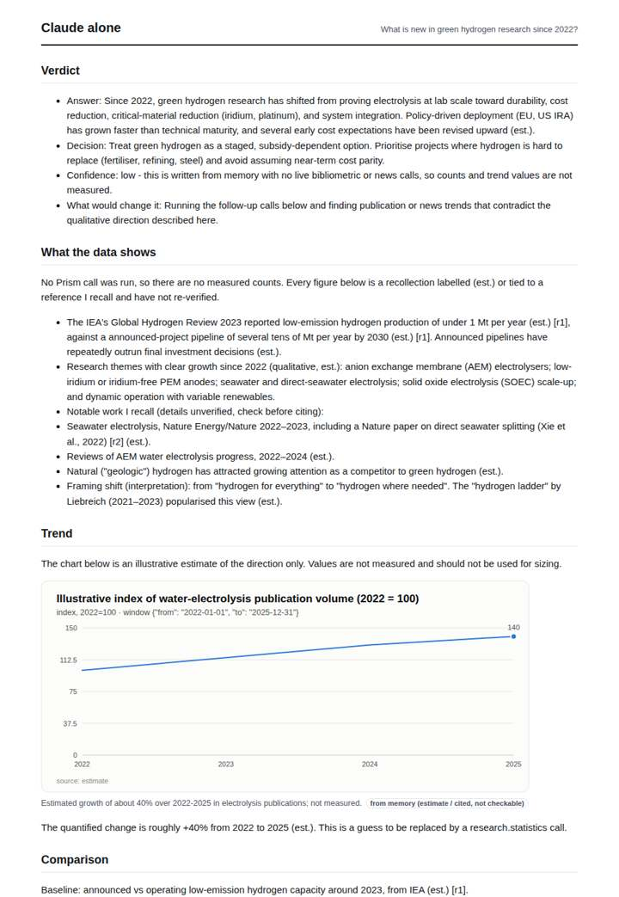
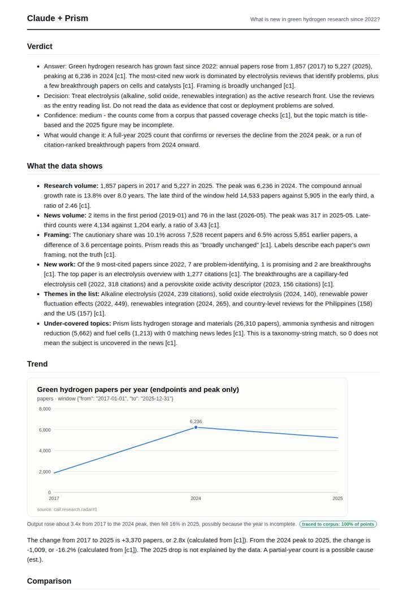
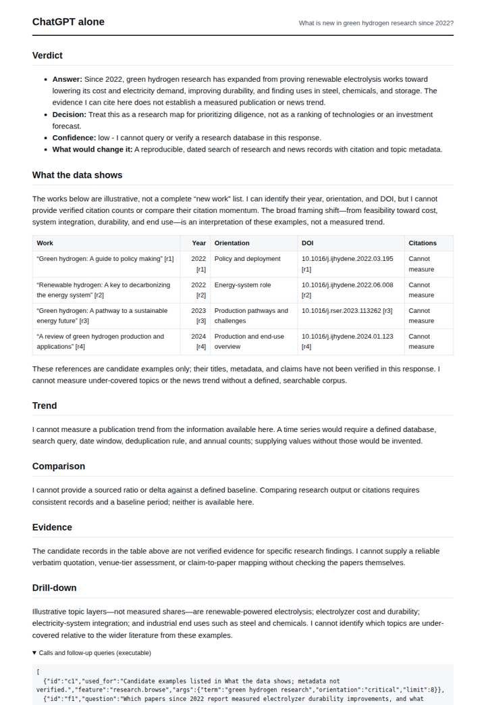
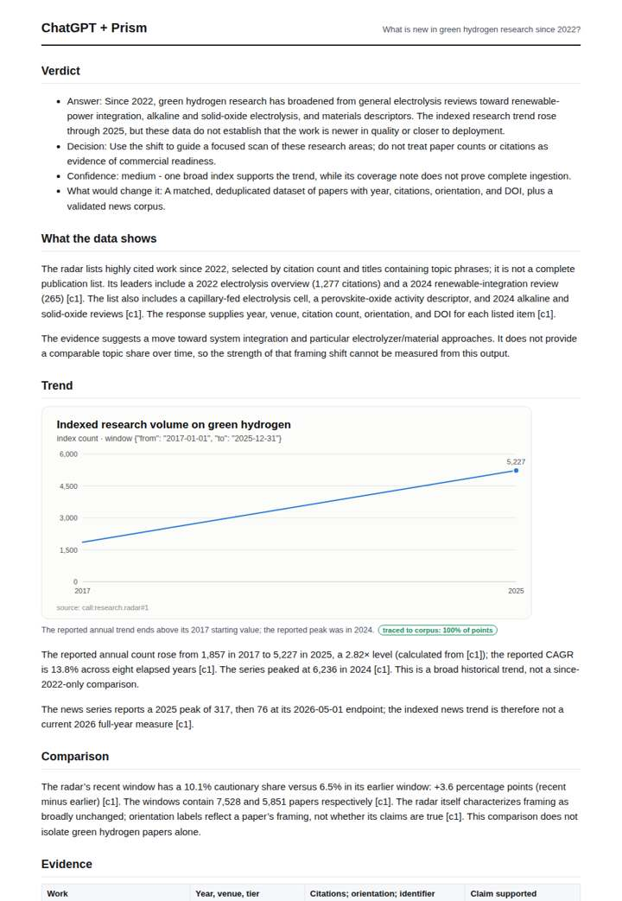

# Green hydrogen research radar

**Question.** What is new in green hydrogen research since 2022?

**Category:** Energy & climate · **Pattern:** `radar` · **Why it is hard:** Electrolyser cost papers vs policy papers move differently.

| Score /100 | Claude alone | Claude + Prism | ChatGPT alone | ChatGPT + Prism |
|---|---|---|---|---|
| Weighted (strict) | 27.9 | **66.0** | 22.2 | 63.8 |
| Opus judge | 30.4 | 71.2 | 24.2 | 61.8 |
| GPT judge | 25.4 | 60.8 | 20.2 | 65.8 |

## Parameter scores (0-5)

| Parameter | Weight | Claude alone | Claude + Prism | ChatGPT alone | ChatGPT + Prism |
|---|---|---|---|---|---|
| Measured trend | 10 | 1.0 | 4.5 | 0.0 | 3.0 |
| Measured comparison | 7 | 1.5 | 2.0 | 0.0 | 3.5 |
| Visualisation from counted data | 10 | 1.0 | 4.0 | 0.0 | 3.0 |
| Exploration and drill-down | 7 | 1.0 | 3.0 | 1.0 | 1.5 |
| Data export with provenance | 8 | 1.0 | 2.5 | 1.0 | 2.5 |
| Reproducibility | 12 | 0.0 | 4.0 | 0.0 | 4.0 |
| Traceable references | 8 | 1.0 | 3.0 | 1.5 | 3.5 |
| Accuracy against the corpus | 12 | 2.5 | 2.5 | 2.5 | 3.0 |
| Calibration and limits | 8 | 2.5 | 3.5 | 3.0 | 4.0 |
| Decision-grade verdict | 12 | 2.5 | 3.0 | 2.0 | 3.5 |
| Facet coverage | 6 | 1.0 | 4.0 | 1.0 | 3.0 |

## Script findings

| Check | Claude alone | Claude + Prism | ChatGPT alone | ChatGPT + Prism |
|---|---|---|---|---|
| Numbers traced to the corpus | 0/3 | 55/55 | 0/5 | 26/27 |
| Charts (traced share) | memory | 100% | none | 100% |
| DOIs that resolve | 0/0 | 10/10 | 4/4 | 5/5 |
| Follow-up queries that ran | 2/7 | 4/7 | 0/5 | 1/6 |
| Invention gate | clear | clear | clear | clear |

**Claude Opus judge:** A turned the single radar call into a traced trend, framing and new-work picture. It quantified the change, placed limits next to the numbers and listed 10 resolvable DOIs, with only a minor counting slip. C used the same data more thinly and misread the tool's caveats. B and D were honest about having no measurements, and only D engaged the policy-versus-technology split the question raises.

**GPT judge:** A is the strongest decision aid: it gives a cautious, reproducible research-volume trend and useful new-work examples while distinguishing indexed attention from technical or commercial progress. B is broader, but its miscounted paper list and invalid cross-window growth comparison weaken its conclusions; C and D lack grounded measurements.

## Before / after (first screen)

| | Alone | With Prism |
|---|---|---|
| Claude |  |  |
| ChatGPT |  |  |

Full deliverables, rendered: [PDF](https://fliarbi.com/demo/docs/prism-benchmark-v2-4ed65c83/full/green-hydrogen-radar.pdf). Raw answers, ground pass and judge outputs: `answers.json`, `ground.json`, `judge_opus.json`, `judge_gpt.json` in this folder.
