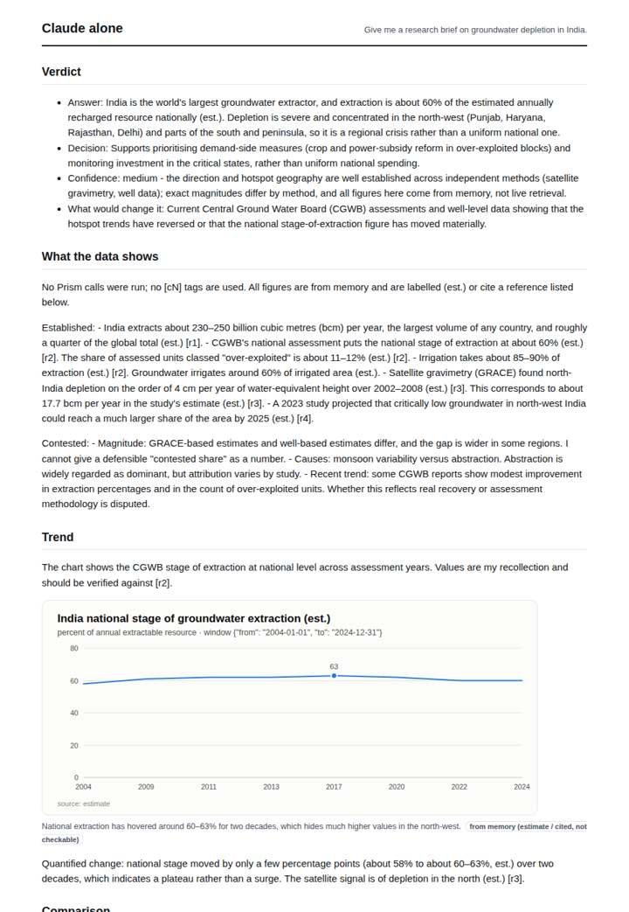
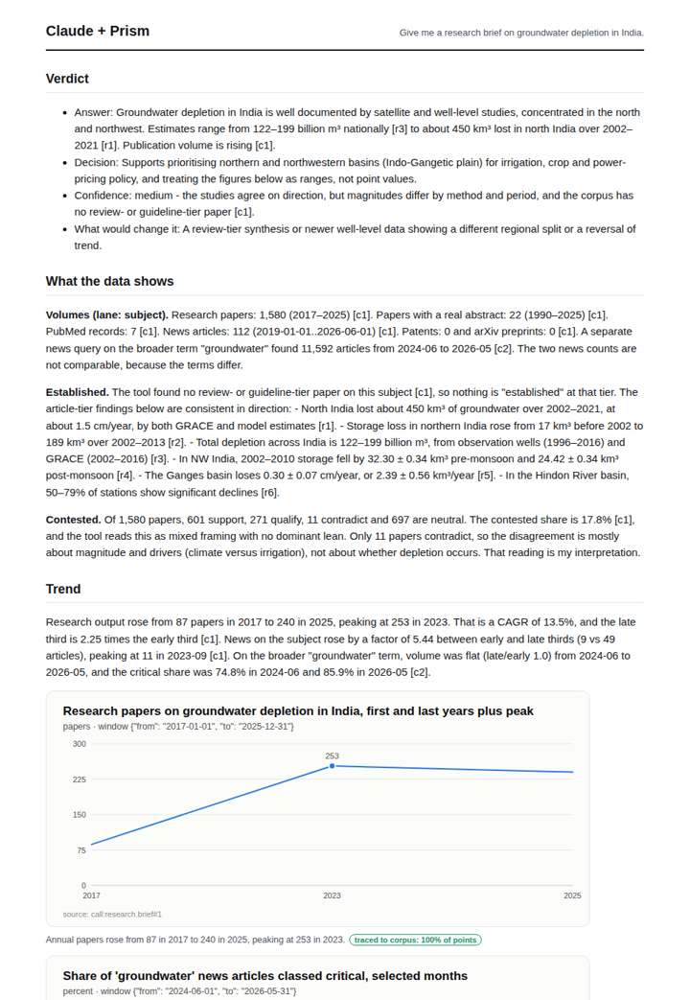
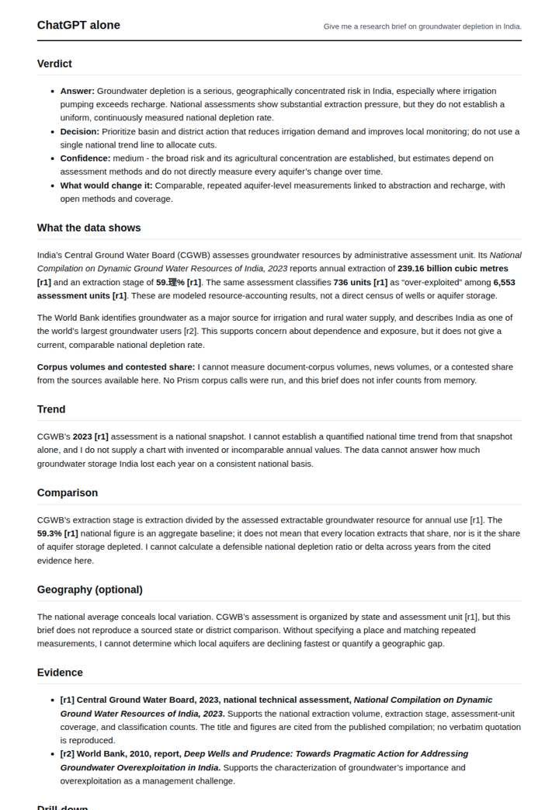
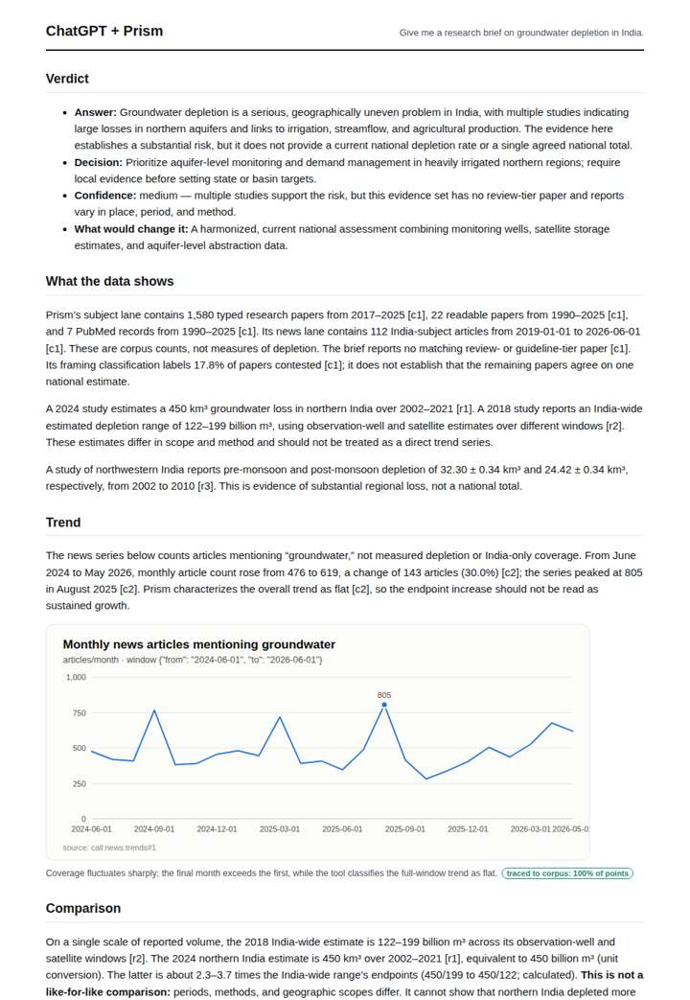

# Groundwater depletion in India

**Question.** Give me a research brief on groundwater depletion in India.

**Category:** Environment & disasters · **Pattern:** `brief` · **Why it is hard:** Punjab and Haryana dominate; the brief should name the geography.

| Score /100 | Claude alone | Claude + Prism | ChatGPT alone | ChatGPT + Prism |
|---|---|---|---|---|
| Weighted (strict) | 30.7 | **71.8** | 25.1 | 70.5 |
| Opus judge | 31.8 | 69.0 | 24.0 | 67.2 |
| GPT judge | 29.6 | 74.6 | 26.2 | 73.8 |

## Parameter scores (0-5)

| Parameter | Weight | Claude alone | Claude + Prism | ChatGPT alone | ChatGPT + Prism |
|---|---|---|---|---|---|
| Measured trend | 10 | 1.0 | 4.0 | 0.0 | 4.0 |
| Measured comparison | 7 | 2.0 | 3.5 | 0.5 | 2.5 |
| Visualisation from counted data | 10 | 1.0 | 3.5 | 0.0 | 3.5 |
| Exploration and drill-down | 7 | 1.5 | 2.5 | 1.0 | 1.0 |
| Data export with provenance | 8 | 1.0 | 1.0 | 0.0 | 3.0 |
| Reproducibility | 12 | 0.0 | 4.5 | 1.0 | 4.5 |
| Traceable references | 8 | 1.0 | 3.5 | 2.0 | 4.0 |
| Accuracy against the corpus | 12 | 2.5 | 4.0 | 2.0 | 3.5 |
| Calibration and limits | 8 | 3.0 | 4.0 | 3.0 | 4.0 |
| Decision-grade verdict | 12 | 2.5 | 4.0 | 2.5 | 4.0 |
| Facet coverage | 6 | 1.5 | 4.0 | 1.5 | 3.5 |

## Script findings

| Check | Claude alone | Claude + Prism | ChatGPT alone | ChatGPT + Prism |
|---|---|---|---|---|
| Numbers traced to the corpus | 0/28 | 63/63 | 0/5 | 40/40 |
| Charts (traced share) | memory | 100%, 100% | none | 100% |
| DOIs that resolve | 1/1 | 8/8 | 0/0 | 4/4 |
| Follow-up queries that ran | 1/6 | 1/6 | 0/5 | 0/5 |
| Invention gate | clear | clear | clear | clear |

**Claude Opus judge:** B and D both grounded their figures in the database, but B covered more ground. It carried the research trend with CAGR, the critical-share decomposition and the contested mix, and it flagged the off-topic California source. D had the cleanest single news series and export but misread the geography focus block. Only memory-based A named Punjab and Haryana explicitly, but its numbers are unverifiable estimates. C sidestepped the geography entirely.

**GPT judge:** A is the strongest decision brief because its figures, charts, and calls are traceable, and it quantifies the research and news trends while stating several relevant limits. Its main weakness is that it misses the requested Punjab and Haryana geography; D is also well sourced, but its trend measures broad news attention and its comparison joins estimates that are not like-for-like.

## Before / after (first screen)

| | Alone | With Prism |
|---|---|---|
| Claude |  |  |
| ChatGPT |  |  |

Full deliverables, rendered: [PDF](https://fliarbi.com/demo/docs/prism-benchmark-v2-4ed65c83/full/groundwater-india-brief.pdf). Raw answers, ground pass and judge outputs: `answers.json`, `ground.json`, `judge_opus.json`, `judge_gpt.json` in this folder.
