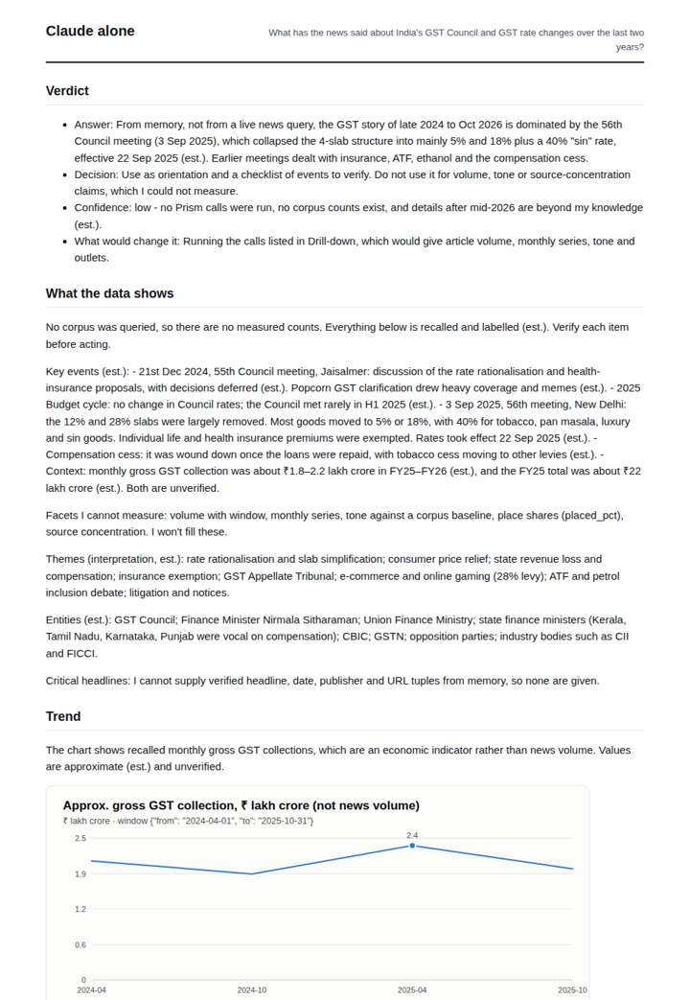
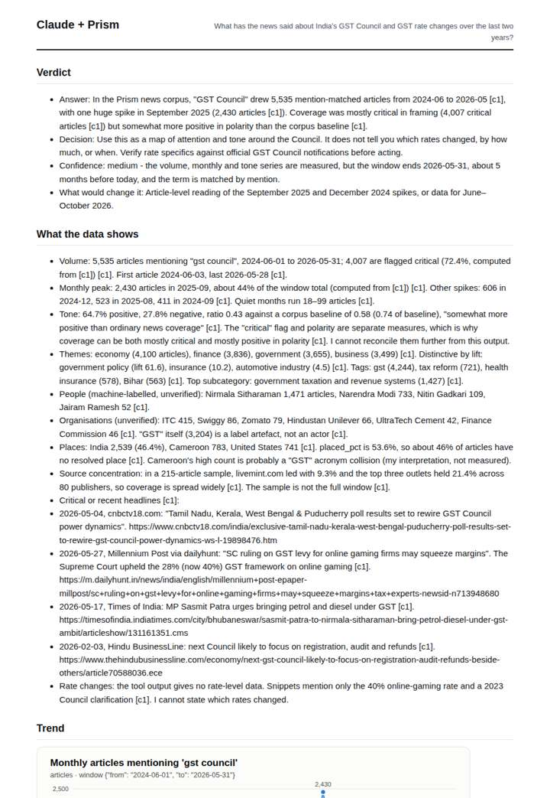
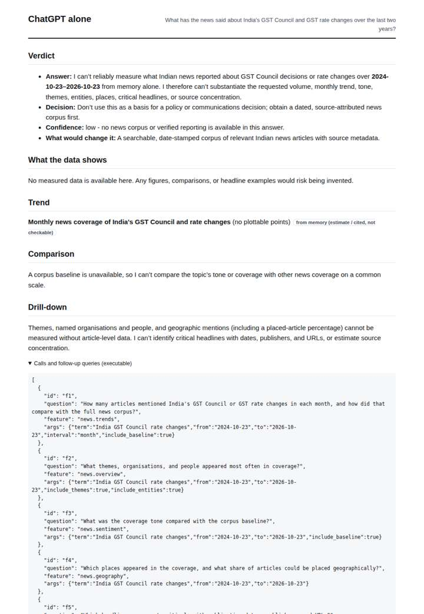
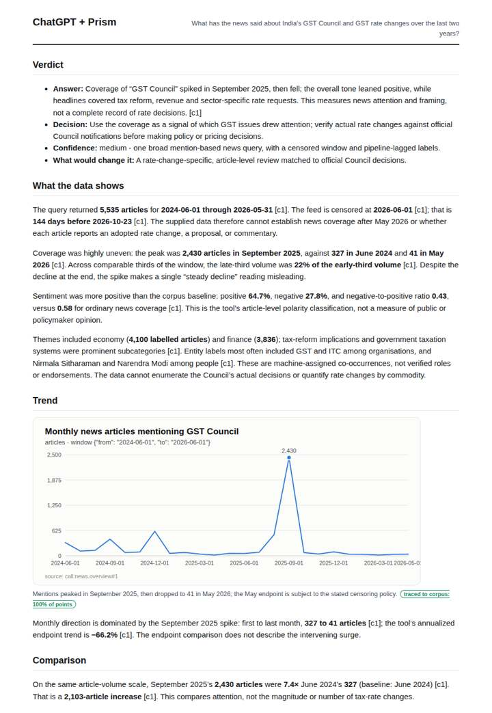

# GST in Indian news

**Question.** What has the news said about India's GST Council and GST rate changes over the last two years?

**Category:** Policy & regulation · **Pattern:** `pulse` · **Why it is hard:** GST 2.0 rate rationalisation in 2025 changed the tone.

| Score /100 | Claude alone | Claude + Prism | ChatGPT alone | ChatGPT + Prism |
|---|---|---|---|---|
| Weighted (strict) | 31.2 | **80.3** | 22.0 | 68.7 |
| Opus judge | 30.2 | 76.4 | 18.2 | 65.2 |
| GPT judge | 32.2 | 84.2 | 25.8 | 72.2 |

## Parameter scores (0-5)

| Parameter | Weight | Claude alone | Claude + Prism | ChatGPT alone | ChatGPT + Prism |
|---|---|---|---|---|---|
| Measured trend | 10 | 1.0 | 4.5 | 0.0 | 4.0 |
| Measured comparison | 7 | 1.5 | 4.5 | 0.0 | 4.5 |
| Visualisation from counted data | 10 | 1.0 | 4.0 | 0.0 | 3.5 |
| Exploration and drill-down | 7 | 1.5 | 4.0 | 1.0 | 2.0 |
| Data export with provenance | 8 | 1.0 | 3.0 | 0.0 | 3.0 |
| Reproducibility | 12 | 0.0 | 5.0 | 1.0 | 4.0 |
| Traceable references | 8 | 0.5 | 1.0 | 0.5 | 1.0 |
| Accuracy against the corpus | 12 | 2.5 | 4.5 | 3.0 | 4.0 |
| Calibration and limits | 8 | 3.5 | 4.5 | 3.0 | 4.0 |
| Decision-grade verdict | 12 | 3.0 | 4.0 | 2.0 | 3.5 |
| Facet coverage | 6 | 1.5 | 4.5 | 0.5 | 3.5 |

## Script findings

| Check | Claude alone | Claude + Prism | ChatGPT alone | ChatGPT + Prism |
|---|---|---|---|---|
| Numbers traced to the corpus | 0/30 | 76/76 | 0/0 | 29/30 |
| Charts (traced share) | memory | 100% | memory | 100% |
| DOIs that resolve | 0/0 | 0/0 | 0/0 | 0/0 |
| Follow-up queries that ran | 4/6 | 4/6 | 0/6 | 2/6 |
| Invention gate | clear | clear | clear | clear |

**Claude Opus judge:** A and C both measured the coverage, but A went further. It traced every number, separated the critical flag from polarity, caught the Cameroon and 'GST' label artefacts, and gave linkable headlines and the late-window tone turn. B offered accurate but unmeasured recall of the GST 2.0 events, and D declined to answer.

**GPT judge:** A is the strongest decision aid: it traces the full monthly news series, quantifies attention and tone against a defined baseline, and gives unusually specific limits and follow-up paths. B is cleaner but leaves out available trend decomposition and tone charting; C offers unverified recollection, while D is candid but supplies almost no measured answer.

## Before / after (first screen)

| | Alone | With Prism |
|---|---|---|
| Claude |  |  |
| ChatGPT |  |  |

Full deliverables, rendered: [PDF](https://fliarbi.com/demo/docs/prism-benchmark-v2-4ed65c83/full/gst-india-pulse.pdf). Raw answers, ground pass and judge outputs: `answers.json`, `ground.json`, `judge_opus.json`, `judge_gpt.json` in this folder.
