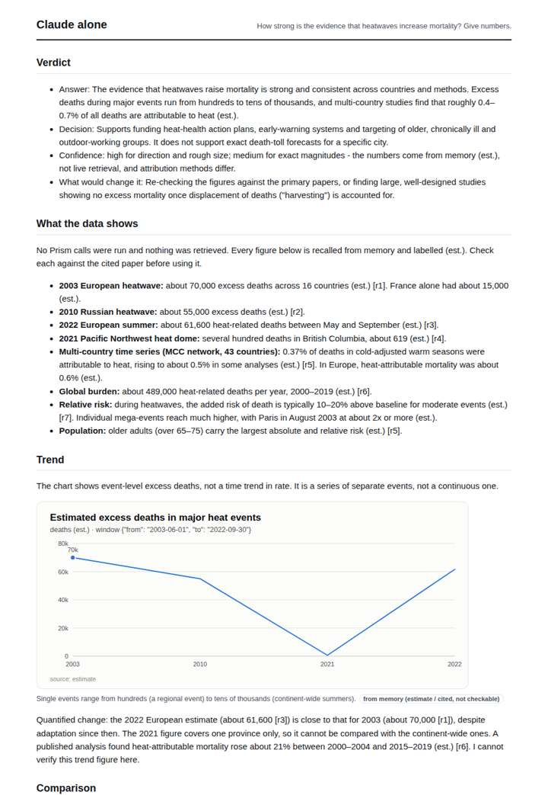
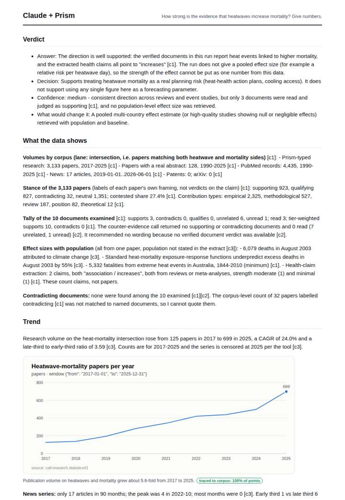
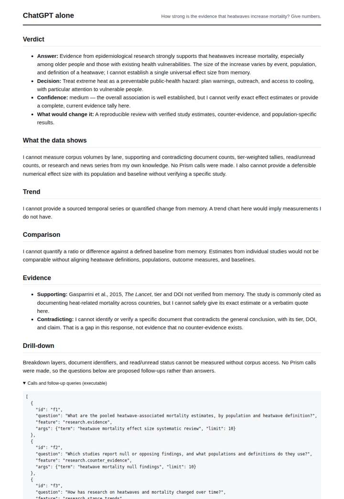
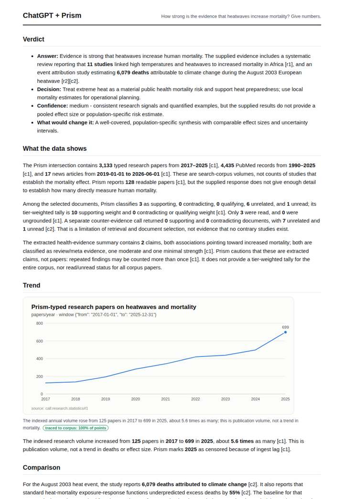

# Heatwaves and mortality

**Question.** How strong is the evidence that heatwaves increase mortality? Give numbers.

**Category:** Energy & climate · **Pattern:** `evidence` · **Why it is hard:** Effect sizes vary hugely by city; population must travel with each number.

| Score /100 | Claude alone | Claude + Prism | ChatGPT alone | ChatGPT + Prism |
|---|---|---|---|---|
| Weighted (strict) | 36.1 | **76.5** | 25.8 | 65.0 |
| Opus judge | 31.8 | 72.4 | 23.4 | 60.6 |
| GPT judge | 40.4 | 80.6 | 28.2 | 69.4 |

## Parameter scores (0-5)

| Parameter | Weight | Claude alone | Claude + Prism | ChatGPT alone | ChatGPT + Prism |
|---|---|---|---|---|---|
| Measured trend | 10 | 1.0 | 4.5 | 0.0 | 4.0 |
| Measured comparison | 7 | 2.0 | 3.5 | 0.5 | 3.0 |
| Visualisation from counted data | 10 | 1.0 | 3.5 | 0.0 | 3.0 |
| Exploration and drill-down | 7 | 1.5 | 3.0 | 0.5 | 1.0 |
| Data export with provenance | 8 | 1.0 | 3.0 | 0.0 | 3.0 |
| Reproducibility | 12 | 1.0 | 4.0 | 1.0 | 4.5 |
| Traceable references | 8 | 1.0 | 4.0 | 1.0 | 1.0 |
| Accuracy against the corpus | 12 | 3.0 | 4.0 | 3.5 | 3.0 |
| Calibration and limits | 8 | 3.0 | 4.5 | 3.0 | 4.5 |
| Decision-grade verdict | 12 | 3.5 | 4.0 | 2.5 | 4.0 |
| Facet coverage | 6 | 1.0 | 3.5 | 1.0 | 3.5 |

## Script findings

| Check | Claude alone | Claude + Prism | ChatGPT alone | ChatGPT + Prism |
|---|---|---|---|---|
| Numbers traced to the corpus | 0/28 | 46/48 | 0/0 | 27/27 |
| Charts (traced share) | memory | 100% | none | 100% |
| DOIs that resolve | 0/0 | 5/5 | 0/0 | 4/5 |
| Follow-up queries that ran | 2/6 | 2/6 | 0/3 | 0/4 |
| Invention gate | clear | clear | clear | clear |

**Claude Opus judge:** B and A both grounded their answers in the retrieved record and said plainly that no pooled, population-specific effect size was available. B pulled ahead with correct call tags, the tool's own trend metrics, all references resolving, and a careful reading of the source-fit failures. D gave the decision-relevant magnitudes a reader wants, but from memory with several misattributions. C answered without any numbers, which fails a question that explicitly asked for them.

**GPT judge:** B is the strongest decision aid because it separates corpus activity from mortality evidence, reports the available numeric findings with their limits, and avoids claiming a pooled risk estimate when no population denominator was retrieved. D offers a useful annual chart, but its misattributed statistics and malformed DOI weaken its evidence trail; neither deliverable supplies the population-linked effect size the question most needs.

## Before / after (first screen)

| | Alone | With Prism |
|---|---|---|
| Claude |  |  |
| ChatGPT |  |  |

Full deliverables, rendered: [PDF](https://fliarbi.com/demo/docs/prism-benchmark-v2-4ed65c83/full/heatwave-mortality.pdf). Raw answers, ground pass and judge outputs: `answers.json`, `ground.json`, `judge_opus.json`, `judge_gpt.json` in this folder.
