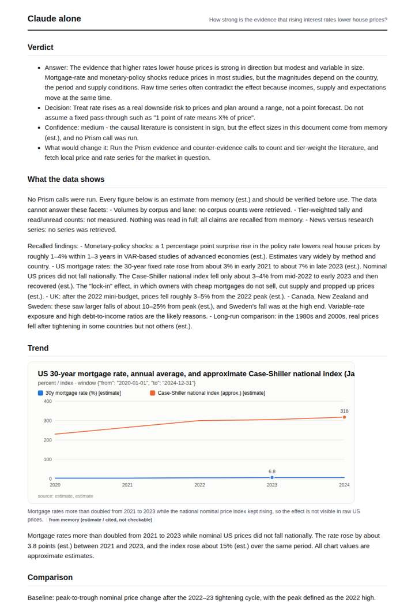
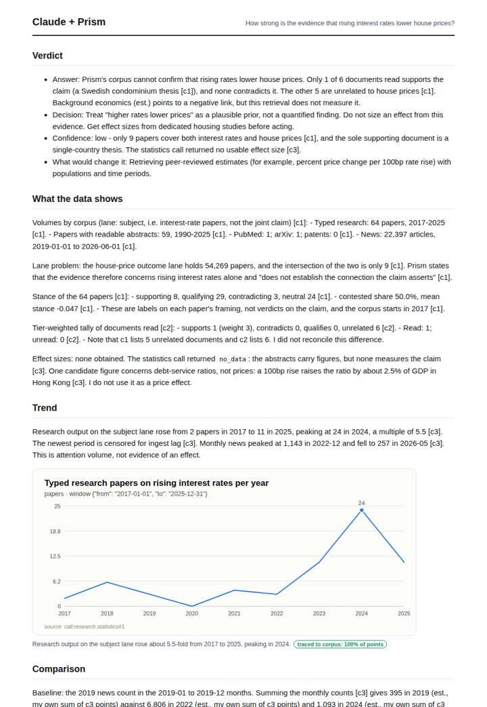
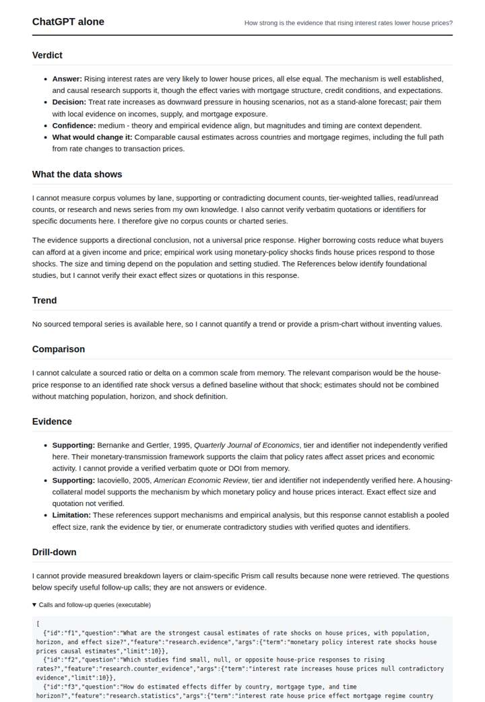
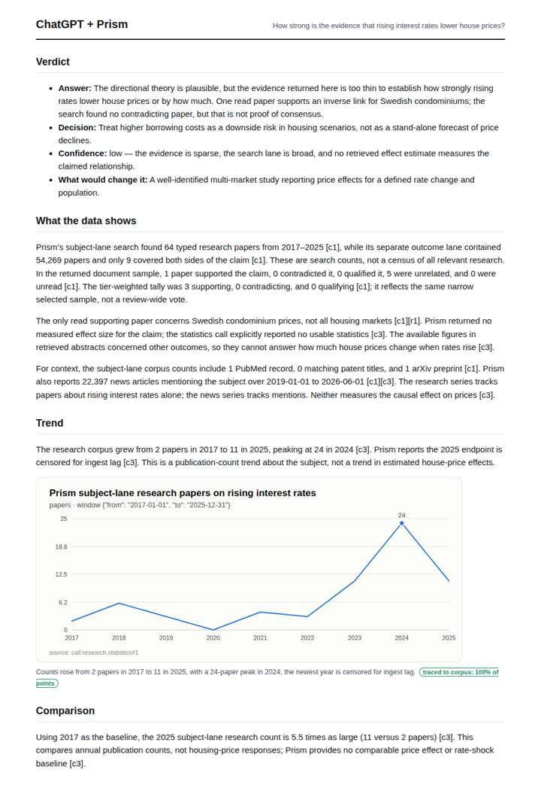

# Do interest rates drive house prices?

**Question.** How strong is the evidence that rising interest rates lower house prices?

**Category:** Finance & markets · **Pattern:** `evidence` · **Why it is hard:** Economics papers, not medical: tiering has to fall back from RCT logic to study type.

| Score /100 | Claude alone | Claude + Prism | ChatGPT alone | ChatGPT + Prism |
|---|---|---|---|---|
| Weighted (strict) | 36.8 | **68.5** | 35.1 | 66.7 |
| Opus judge | 34.2 | 65.0 | 29.0 | 66.8 |
| GPT judge | 39.4 | 72.0 | 41.2 | 66.6 |

## Parameter scores (0-5)

| Parameter | Weight | Claude alone | Claude + Prism | ChatGPT alone | ChatGPT + Prism |
|---|---|---|---|---|---|
| Measured trend | 10 | 1.0 | 4.0 | 0.0 | 3.5 |
| Measured comparison | 7 | 2.0 | 3.0 | 0.5 | 3.5 |
| Visualisation from counted data | 10 | 1.0 | 3.5 | 0.0 | 3.5 |
| Exploration and drill-down | 7 | 1.0 | 2.5 | 1.0 | 1.0 |
| Data export with provenance | 8 | 1.0 | 2.5 | 1.0 | 3.5 |
| Reproducibility | 12 | 1.0 | 3.0 | 1.0 | 3.0 |
| Traceable references | 8 | 1.0 | 4.5 | 3.5 | 2.0 |
| Accuracy against the corpus | 12 | 3.5 | 2.5 | 3.5 | 4.0 |
| Calibration and limits | 8 | 3.5 | 4.0 | 3.0 | 4.0 |
| Decision-grade verdict | 12 | 3.0 | 4.0 | 3.5 | 4.0 |
| Facet coverage | 6 | 1.5 | 4.5 | 1.5 | 4.0 |

## Script findings

| Check | Claude alone | Claude + Prism | ChatGPT alone | ChatGPT + Prism |
|---|---|---|---|---|
| Numbers traced to the corpus | 0/15 | 22/25 | 0/0 | 11/13 |
| Charts (traced share) | memory | 100% | none | 100% |
| DOIs that resolve | 0/0 | 2/2 | 2/2 | 0/0 |
| Follow-up queries that ran | 0/6 | 1/6 | 0/6 | 0/3 |
| Invention gate | clear | clear | clear | clear |

**Claude Opus judge:** B and D both read the database honestly: thin evidence, only 9 papers in the intersection lane, one supporting Swedish paper and no measured effect size. Both give low-confidence verdicts bounded by those limits. D had richer references and caught the c1/c2 anomaly, but its derived news comparison is materially miscalculated. B's cleaner exports and arithmetic edge it ahead. A and C answer from memory: A gives labelled estimates with no identifiers, and C cites real DOIs but has no measured content.

**GPT judge:** C is the most useful for a decision-maker: it surfaces the crucial mismatch between the broad subject corpus and the small joint-claim intersection, gives a traced trend, and makes a suitably cautious recommendation. A is also careful and has stronger export coverage, but its missing follow-up execution and censored-endpoint handling weaken reproducibility; B and D rely on memory or provide no measured evidence.

## Before / after (first screen)

| | Alone | With Prism |
|---|---|---|
| Claude |  |  |
| ChatGPT |  |  |

Full deliverables, rendered: [PDF](https://fliarbi.com/demo/docs/prism-benchmark-v2-4ed65c83/full/housing-prices-evidence.pdf). Raw answers, ground pass and judge outputs: `answers.json`, `ground.json`, `judge_opus.json`, `judge_gpt.json` in this folder.
