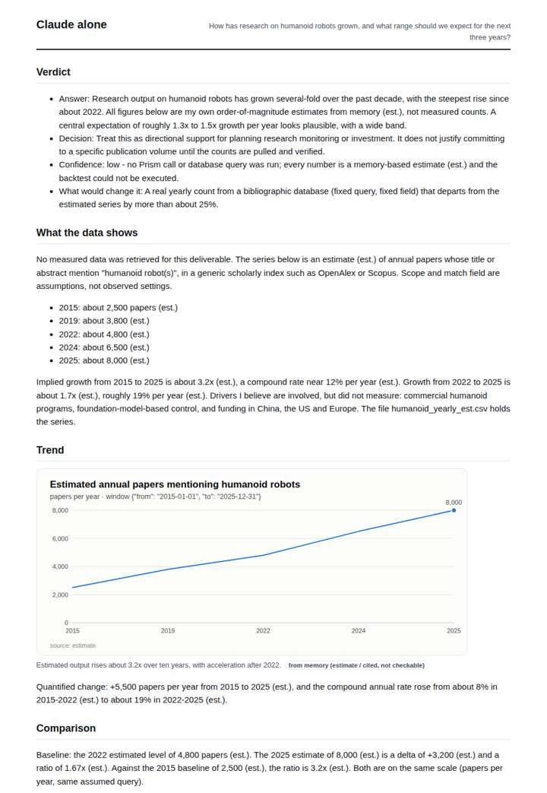
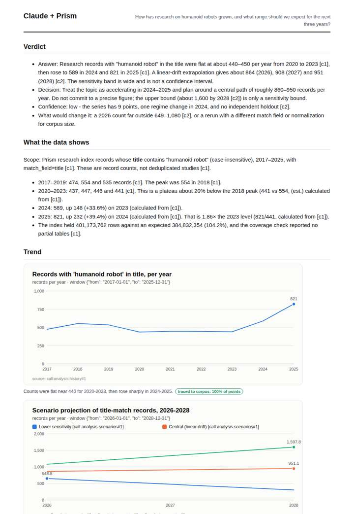
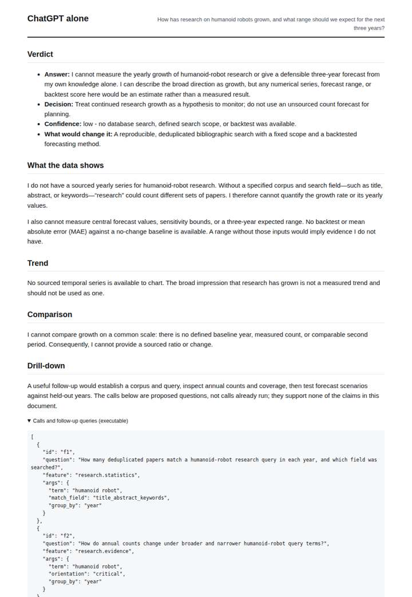
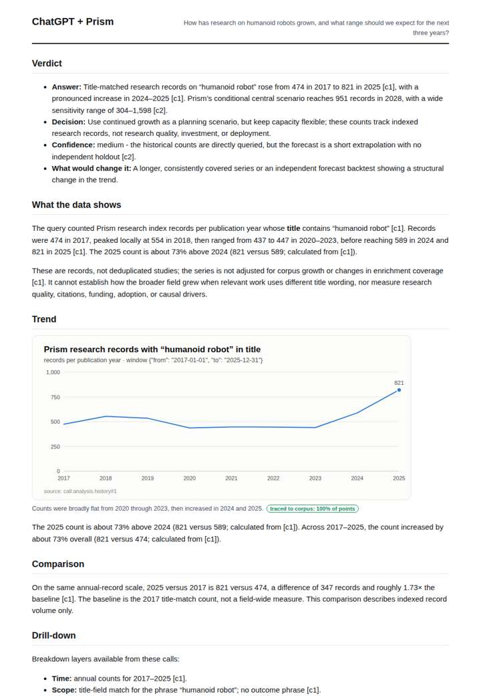

# Humanoid robot research trend

**Question.** How has research on humanoid robots grown, and what range should we expect for the next three years?

**Category:** Technology & AI · **Pattern:** `history` · **Why it is hard:** Media hype vs research output; the series is the reality check.

| Score /100 | Claude alone | Claude + Prism | ChatGPT alone | ChatGPT + Prism |
|---|---|---|---|---|
| Weighted (strict) | 26.8 | 40 | 31.6 | **72.9** |
| Opus judge | 23.5 | 40 | 22.0 | 60.7 |
| GPT judge | 30.2 | 40 | 41.3 | 85.2 |

## Parameter scores (0-5)

| Parameter | Weight | Claude alone | Claude + Prism | ChatGPT alone | ChatGPT + Prism |
|---|---|---|---|---|---|
| Measured trend | 10 | 1.0 | 4.5 | 1.0 | 4.0 |
| Measured comparison | 7 | 1.5 | 4.0 | 0.5 | 4.0 |
| Visualisation from counted data | 10 | 1.0 | 4.0 | 0.0 | 4.0 |
| Exploration and drill-down | 7 | 1.0 | 4.0 | 1.0 | 2.5 |
| Data export with provenance | 8 | 1.0 | 3.0 | 0.0 | 4.5 |
| Reproducibility | 12 | 0.0 | 3.0 | 1.0 | 4.0 |
| Accuracy against the corpus | 12 | 4.0 | 3.0 | 4.0 | 2.5 |
| Calibration and limits | 8 | 3.0 | 4.0 | 4.0 | 4.5 |
| Decision-grade verdict | 12 | 0.0 | 0.0 | 2.5 | 3.0 |
| Facet coverage | 6 | 1.0 | 4.0 | 0.5 | 4.0 |

## Script findings

| Check | Claude alone | Claude + Prism | ChatGPT alone | ChatGPT + Prism |
|---|---|---|---|---|
| Numbers traced to the corpus | 0/38 | 68/76 | 0/0 | 40/41 |
| Charts (traced share) | memory | 100%, 100% | none | 100% |
| DOIs that resolve | 0/0 | 0/0 | 0/0 | 0/0 |
| Follow-up queries that ran | 0/6 | 3/6 | 0/4 | 1/4 |
| Invention gate | tripped | tripped | clear | clear |

**Claude Opus judge:** B and C both used the measured title-match series (474→821, flat 2020-23, sharp 2024-25 rise) and the scenario range (central 864/908/951, bounds 304–1,598 by 2028). B recomputed every ratio, delta and fold error correctly and read the marginal backtest advantage, though its untagged verdict range zeroes its verdict score. C misreported the 2024→2025 jump as 73% instead of 39%. A offered labelled guesses on a different scale, and D declined to answer, so neither gives a decision-maker a usable range.

**GPT judge:** A is the strongest decision aid: it gives a reproducible historical series and a clearly bounded three-year scenario, while acknowledging the forecast’s weak validation. D offers deeper follow-up work, but its untagged verdict figures and unsupported full-coverage label weaken trust; B is careful but cannot quantify the answer, and C relies on estimates.

## Before / after (first screen)

| | Alone | With Prism |
|---|---|---|
| Claude |  |  |
| ChatGPT |  |  |

Full deliverables, rendered: [PDF](https://fliarbi.com/demo/docs/prism-benchmark-v2-4ed65c83/full/humanoid-robots-history.pdf). Raw answers, ground pass and judge outputs: `answers.json`, `ground.json`, `judge_opus.json`, `judge_gpt.json` in this folder.
