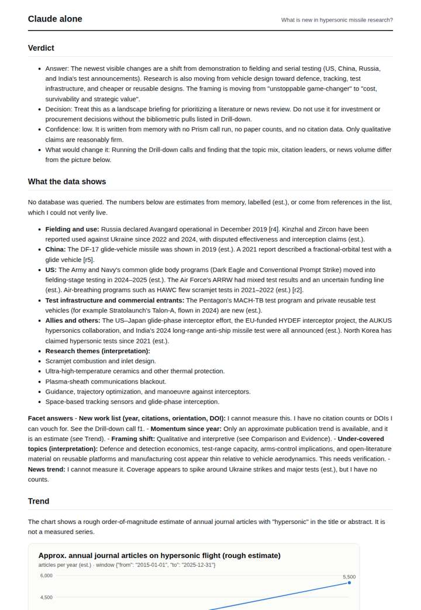
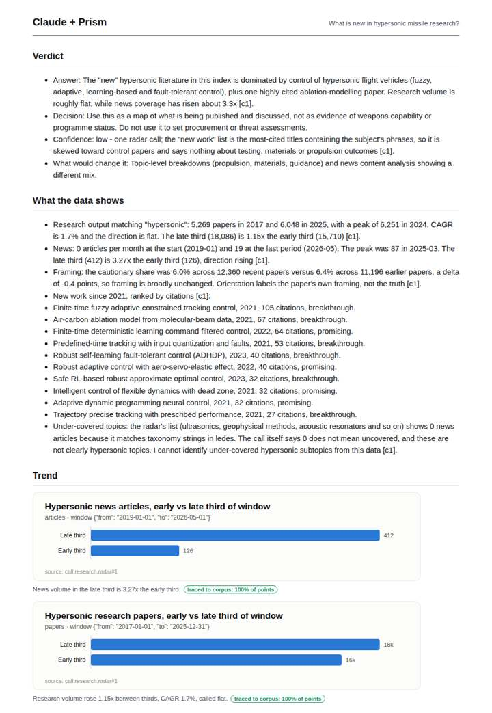
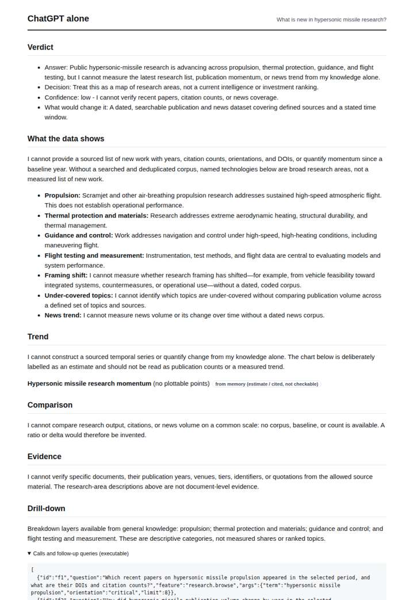
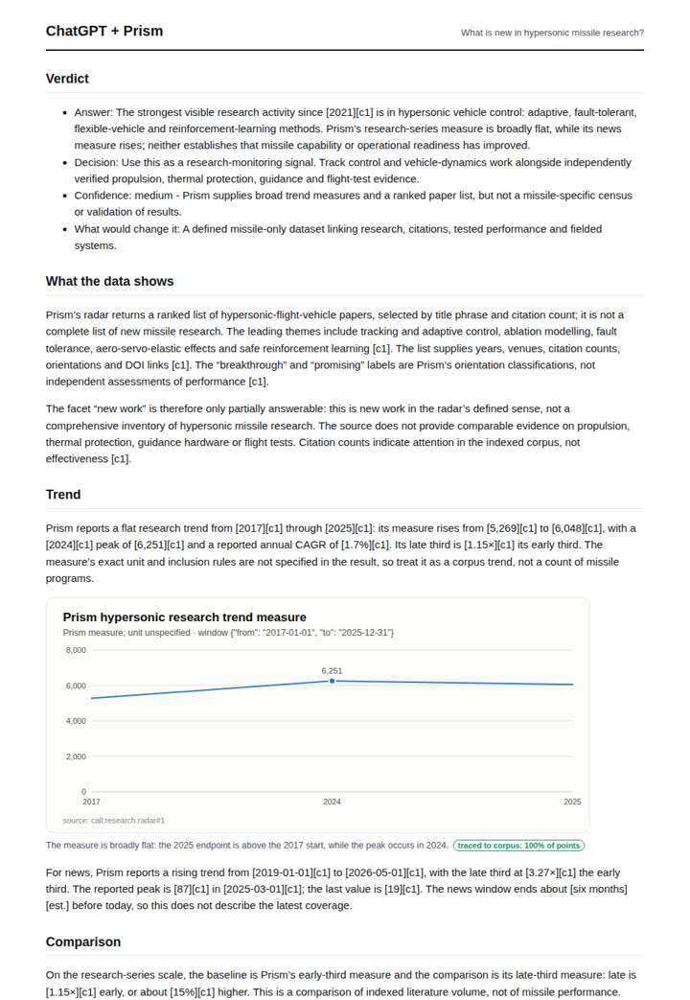

# Hypersonic weapons research

**Question.** What is new in hypersonic missile research?

**Category:** Defence & geopolitics · **Pattern:** `radar` · **Why it is hard:** Much of it is in engineering venues, not defence journals.

| Score /100 | Claude alone | Claude + Prism | ChatGPT alone | ChatGPT + Prism |
|---|---|---|---|---|
| Weighted (strict) | 31.6 | **76.4** | 26.6 | 72.1 |
| Opus judge | 30.4 | 78.4 | 21.8 | 67.4 |
| GPT judge | 32.8 | 74.4 | 31.4 | 76.8 |

## Parameter scores (0-5)

| Parameter | Weight | Claude alone | Claude + Prism | ChatGPT alone | ChatGPT + Prism |
|---|---|---|---|---|---|
| Measured trend | 10 | 1.0 | 1.0 | 0.0 | 4.0 |
| Measured comparison | 7 | 1.0 | 4.0 | 0.0 | 3.5 |
| Visualisation from counted data | 10 | 1.0 | 4.0 | 0.5 | 4.0 |
| Exploration and drill-down | 7 | 1.0 | 4.0 | 1.0 | 2.0 |
| Data export with provenance | 8 | 1.0 | 3.0 | 0.5 | 3.5 |
| Reproducibility | 12 | 1.0 | 5.0 | 1.0 | 4.5 |
| Traceable references | 8 | 1.0 | 3.5 | 0.0 | 1.0 |
| Accuracy against the corpus | 12 | 2.5 | 4.5 | 3.5 | 4.0 |
| Calibration and limits | 8 | 3.0 | 4.0 | 3.0 | 4.0 |
| Decision-grade verdict | 12 | 3.0 | 4.0 | 2.5 | 4.0 |
| Facet coverage | 6 | 1.0 | 5.0 | 1.5 | 4.0 |

## Script findings

| Check | Claude alone | Claude + Prism | ChatGPT alone | ChatGPT + Prism |
|---|---|---|---|---|
| Numbers traced to the corpus | 0/13 | 45/45 | 0/0 | 23/23 |
| Charts (traced share) | memory | 100%, 100% | memory | 100% |
| DOIs that resolve | 0/0 | 10/10 | 0/0 | 10/15 |
| Follow-up queries that ran | 2/7 | 3/6 | 1/5 | 1/5 |
| Invention gate | clear | clear | clear | clear |

**Claude Opus judge:** B and C both grounded their answers in the radar call, but B covered every facet. It contrasted research output (flat, 1.15x) with news attention (3.27x) using correct arithmetic, flagged the off-topic under-covered rows, and gave resolvable references with honest limits. C was accurate but charted only research and broke its DOIs and CSV formatting. A and D answered from memory; D's estimated publication doubling contradicts the measured flat trend.

**GPT judge:** D is strongest for a decision-maker: it connects the research themes to a traced publication trend and contrasts that with rising news attention, while warning that neither establishes capability. C has stronger full-series and export machinery, but its failed DOI checks materially weaken the paper-level evidence.

## Before / after (first screen)

| | Alone | With Prism |
|---|---|---|
| Claude |  |  |
| ChatGPT |  |  |

Full deliverables, rendered: [PDF](https://fliarbi.com/demo/docs/prism-benchmark-v2-4ed65c83/full/hypersonic-radar.pdf). Raw answers, ground pass and judge outputs: `answers.json`, `ground.json`, `judge_opus.json`, `judge_gpt.json` in this folder.
