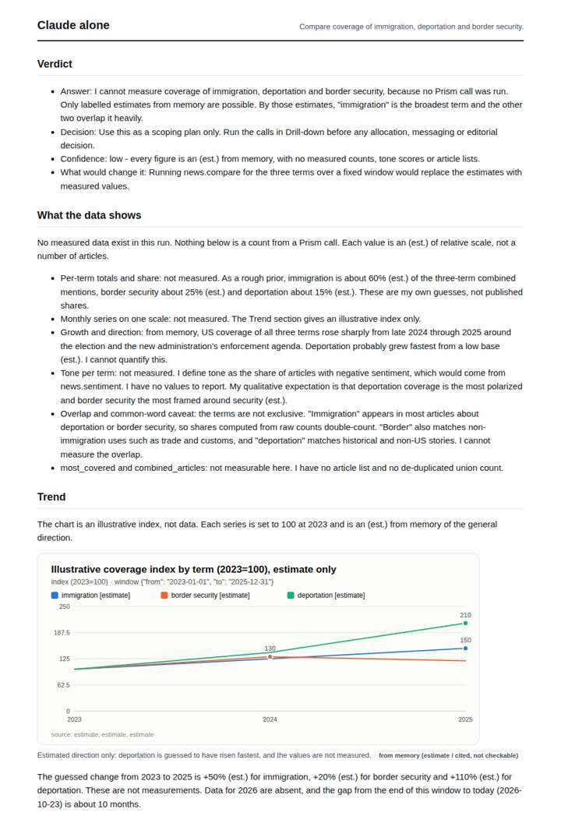
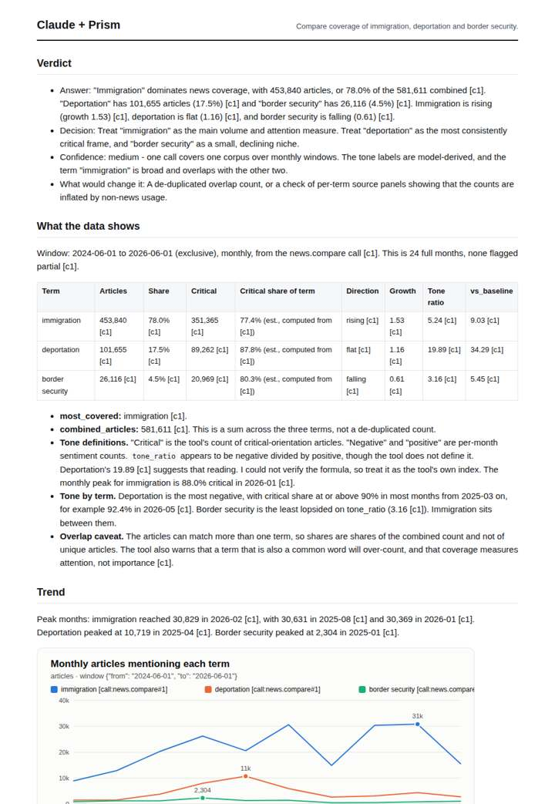
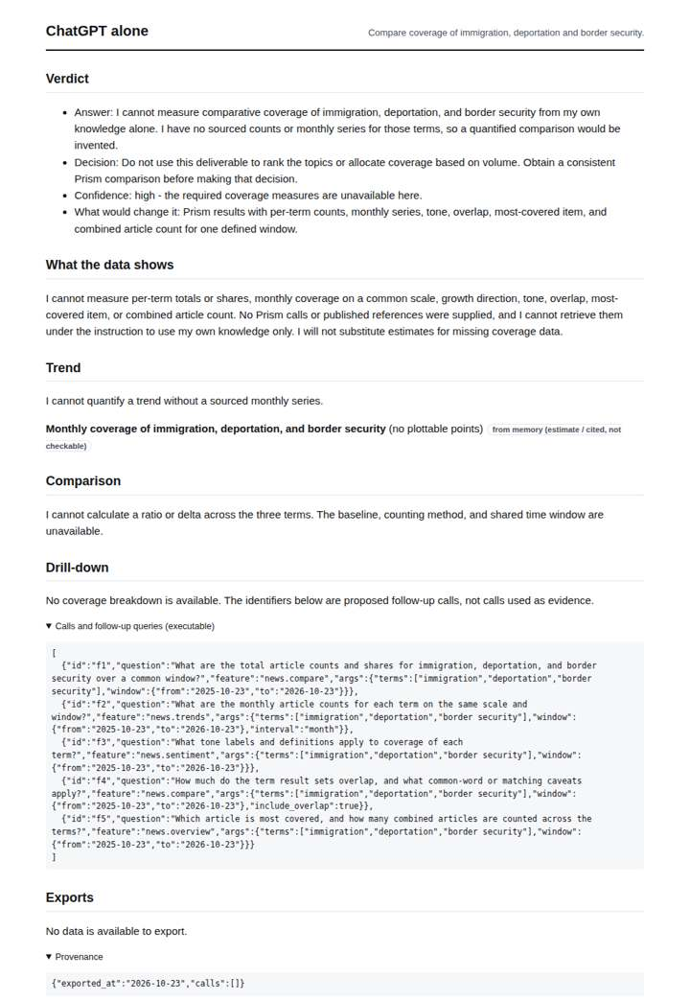
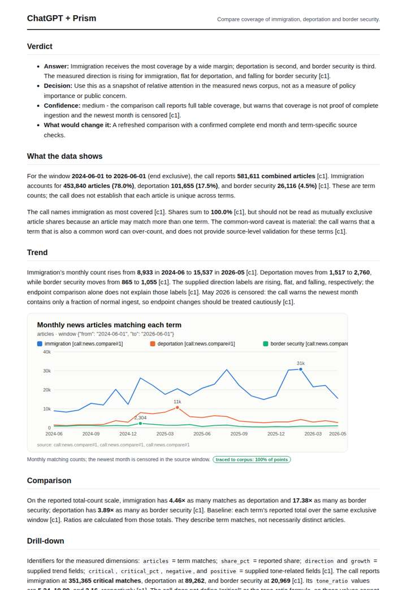

# Immigration policy coverage

**Question.** Compare coverage of immigration, deportation and border security.

**Category:** Policy & regulation · **Pattern:** `compare` · **Why it is hard:** Terms overlap heavily; overlap must be stated.

| Score /100 | Claude alone | Claude + Prism | ChatGPT alone | ChatGPT + Prism |
|---|---|---|---|---|
| Weighted (strict) | 30.8 | **68.7** | 22.8 | 64.1 |
| Opus judge | 28.7 | 71.5 | 20.7 | 58.5 |
| GPT judge | 32.8 | 65.9 | 25.0 | 69.8 |

## Parameter scores (0-5)

| Parameter | Weight | Claude alone | Claude + Prism | ChatGPT alone | ChatGPT + Prism |
|---|---|---|---|---|---|
| Measured trend | 10 | 1.0 | 3.0 | 0.0 | 3.0 |
| Measured comparison | 7 | 1.5 | 4.5 | 0.0 | 4.0 |
| Visualisation from counted data | 10 | 1.0 | 3.0 | 0.0 | 3.5 |
| Exploration and drill-down | 7 | 1.0 | 3.5 | 1.0 | 1.0 |
| Data export with provenance | 8 | 1.0 | 3.5 | 0.0 | 3.0 |
| Reproducibility | 12 | 1.0 | 4.0 | 1.0 | 4.0 |
| Accuracy against the corpus | 12 | 2.0 | 2.5 | 3.0 | 3.0 |
| Calibration and limits | 8 | 3.0 | 3.5 | 2.5 | 3.0 |
| Decision-grade verdict | 12 | 2.5 | 3.5 | 2.5 | 3.5 |
| Facet coverage | 6 | 1.0 | 4.0 | 0.0 | 3.5 |

## Script findings

| Check | Claude alone | Claude + Prism | ChatGPT alone | ChatGPT + Prism |
|---|---|---|---|---|
| Numbers traced to the corpus | 0/19 | 63/67 | 0/0 | 23/24 |
| Charts (traced share) | memory | 100% | memory | 100% |
| DOIs that resolve | 0/0 | 0/0 | 0/0 | 0/0 |
| Follow-up queries that ran | 1/6 | 4/6 | 0/5 | 0/4 |
| Invention gate | clear | clear | clear | clear |

**Claude Opus judge:** A and D both grounded the term totals, shares and exact ratios in the call. A went further: it read critical share per term, named peaks with dates, quantified changes, read the censoring correctly and shipped two exports with executable follow-ups. D misread the censoring, treating May as a partial month, and offered no runnable drill-down. B and C honestly declined or estimated, but C's guessed shares contradict the measured ordering, so neither supports a decision.

**GPT judge:** C is the strongest decision aid: it gives a reproducible same-window ranking, complete chart series, and careful separation of critical orientation from sentiment. B adds useful drill-down and comparison detail, but its endpoint treatment conflicts with the source’s censoring caveat; C also has a censor-date mistake, while A and D lack grounded measurements.

## Before / after (first screen)

| | Alone | With Prism |
|---|---|---|
| Claude |  |  |
| ChatGPT |  |  |

Full deliverables, rendered: [PDF](https://fliarbi.com/demo/docs/prism-benchmark-v2-4ed65c83/full/immigration-us-trend.pdf). Raw answers, ground pass and judge outputs: `answers.json`, `ground.json`, `judge_opus.json`, `judge_gpt.json` in this folder.
