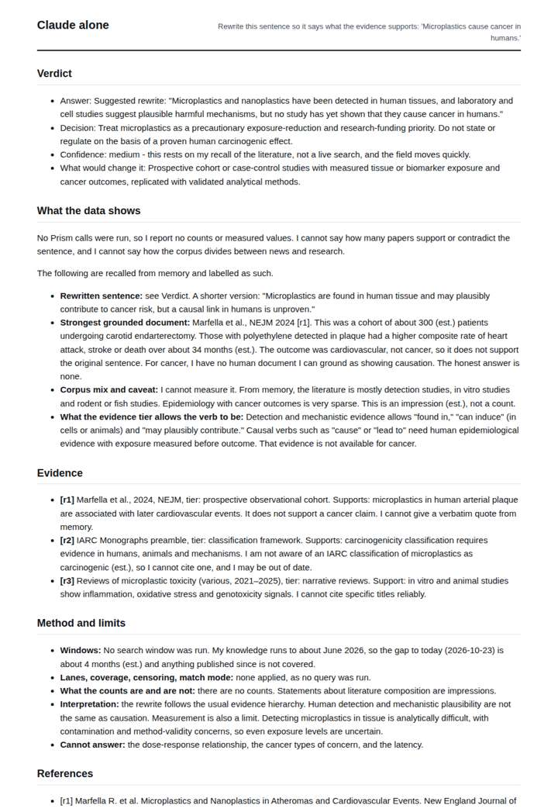
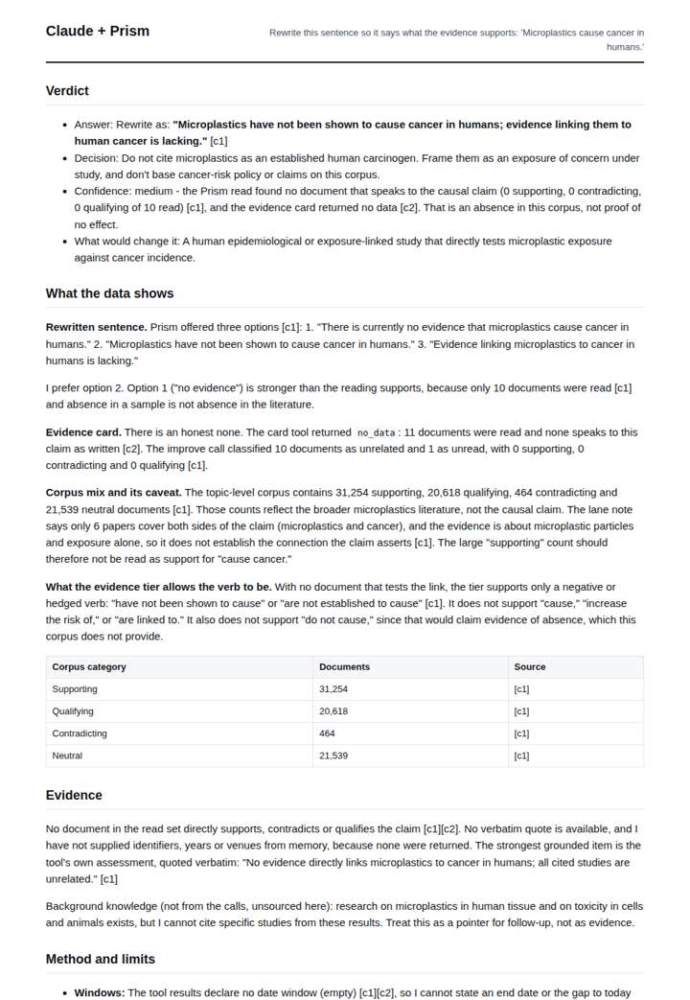
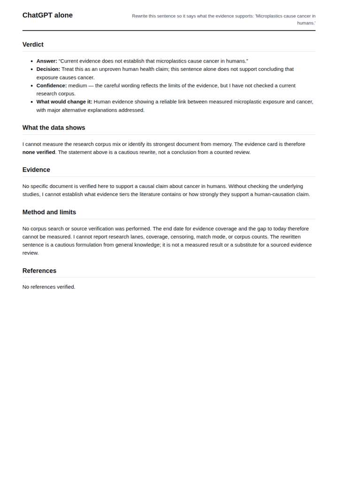
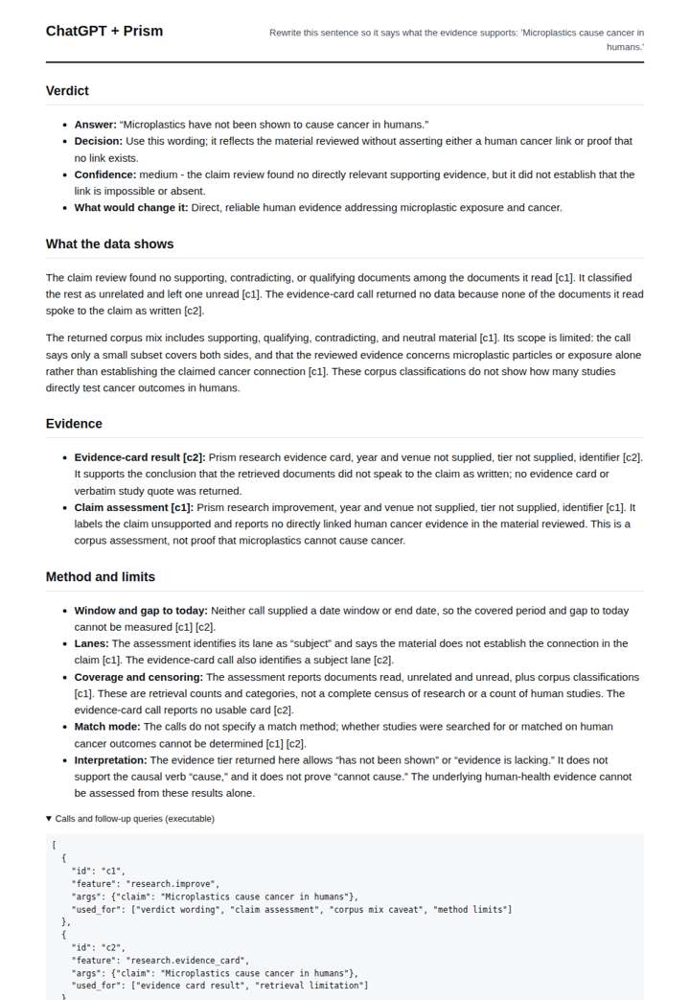

# Fix an overstated claim

**Question.** Rewrite this sentence so it says what the evidence supports: 'Microplastics cause cancer in humans.'

**Category:** Journalism & fact-checking · **Pattern:** `improve` · **Why it is hard:** The evidence is mostly animal and cell studies; the rewrite must say so.

| Score /100 | Claude alone | Claude + Prism | ChatGPT alone | ChatGPT + Prism |
|---|---|---|---|---|
| Weighted (strict) | 49.7 | **59.3** | 44.5 | 53.4 |
| Opus judge | 55.2 | 51.0 | 36.6 | 42.1 |
| GPT judge | 44.1 | 67.6 | 52.4 | 64.8 |

## Parameter scores (0-5)

| Parameter | Weight | Claude alone | Claude + Prism | ChatGPT alone | ChatGPT + Prism |
|---|---|---|---|---|---|
| Reproducibility | 12 | 1.0 | 3.0 | 1.0 | 2.0 |
| Traceable references | 8 | 1.5 | 1.0 | 0.5 | 1.0 |
| Accuracy against the corpus | 12 | 3.5 | 2.5 | 4.0 | 3.0 |
| Calibration and limits | 8 | 3.0 | 4.0 | 2.5 | 3.0 |
| Decision-grade verdict | 12 | 3.5 | 3.5 | 3.0 | 3.5 |
| Facet coverage | 6 | 2.0 | 4.0 | 1.5 | 3.5 |

## Script findings

| Check | Claude alone | Claude + Prism | ChatGPT alone | ChatGPT + Prism |
|---|---|---|---|---|
| Numbers traced to the corpus | 0/2 | 12/14 | 0/0 | 0/0 |
| Charts (traced share) | none | none | none | none |
| DOIs that resolve | 1/1 | 0/0 | 0/0 | 0/0 |
| Follow-up queries that ran | 0/5 | 2/5 | 0/0 | 2/3 |
| Invention gate | clear | clear | clear | clear |

**Claude Opus judge:** Only A's rewrite says what the evidence actually is: plastic particles found in human tissue, plausible mechanisms in cell and animal studies, and no human causal evidence. That is the crux of the question. A also introduced no fabrications. D was the best grounded and read the subject-lane corpus mix correctly, but it invented contents for the failed evidence-card call and gave a rewrite that omits the animal and cell basis. C had the same fabrication problem. B was honest but thin.

**GPT judge:** D best equips a decision-maker with a cautious rewrite, a clear policy boundary, and the relevant distinction between broad topic counts and evidence directly testing human cancer causation. Its c2 document-count error and unsupported background account keep it below a clean result; A is the more internally consistent alternative but is less complete about the evidence facets.

## Before / after (first screen)

| | Alone | With Prism |
|---|---|---|
| Claude |  |  |
| ChatGPT |  |  |

Full deliverables, rendered: [PDF](https://fliarbi.com/demo/docs/prism-benchmark-v2-4ed65c83/full/improve-microplastics.pdf). Raw answers, ground pass and judge outputs: `answers.json`, `ground.json`, `judge_opus.json`, `judge_gpt.json` in this folder.
