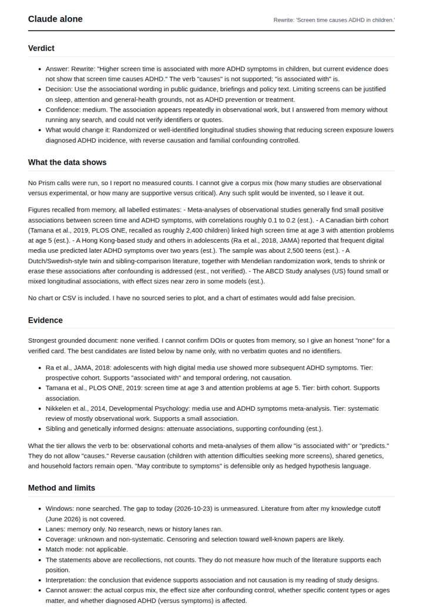
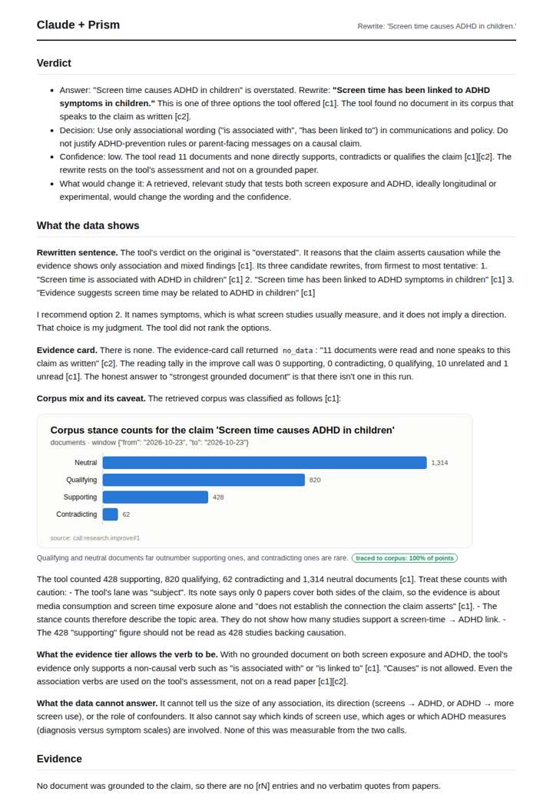
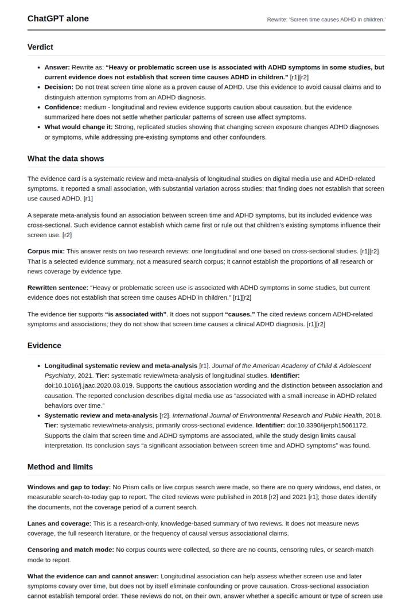
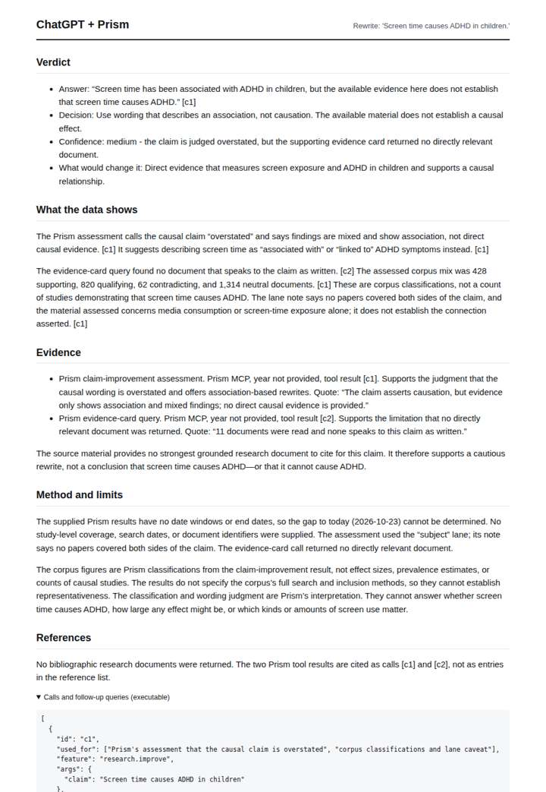

# Fix a screen-time claim

**Question.** Rewrite: 'Screen time causes ADHD in children.'

**Category:** Journalism & fact-checking · **Pattern:** `improve` · **Why it is hard:** Association is not causation; the rewrite must downgrade the verb.

| Score /100 | Claude alone | Claude + Prism | ChatGPT alone | ChatGPT + Prism |
|---|---|---|---|---|
| Weighted (strict) | 51.0 | **62.8** | 30.3 | 59.3 |
| Opus judge | 42.1 | 55.2 | 26.9 | 46.2 |
| GPT judge | 60.0 | 70.3 | 33.8 | 72.4 |

## Parameter scores (0-5)

| Parameter | Weight | Claude alone | Claude + Prism | ChatGPT alone | ChatGPT + Prism |
|---|---|---|---|---|---|
| Reproducibility | 12 | 1.0 | 2.5 | 0.0 | 2.5 |
| Traceable references | 8 | 1.0 | 1.0 | 1.0 | 1.0 |
| Accuracy against the corpus | 12 | 3.5 | 3.0 | 1.5 | 3.5 |
| Calibration and limits | 8 | 4.0 | 4.5 | 2.5 | 4.0 |
| Decision-grade verdict | 12 | 4.0 | 4.0 | 3.0 | 3.5 |
| Facet coverage | 6 | 1.0 | 4.0 | 1.0 | 3.0 |

## Script findings

| Check | Claude alone | Claude + Prism | ChatGPT alone | ChatGPT + Prism |
|---|---|---|---|---|
| Numbers traced to the corpus | 0/4 | 9/14 | 0/2 | 4/5 |
| Charts (traced share) | none | 100% | none | none |
| DOIs that resolve | 0/0 | 0/0 | 1/2 | 0/0 |
| Follow-up queries that ran | 1/6 | 4/6 | 0/3 | 2/3 |
| Invention gate | clear | clear | clear | clear |

**Claude Opus judge:** All four correctly downgrade 'causes' to an associational verb. B best tied its rewrite, the corpus mix and the subject-lane caveat to the recorded call, and gave a calibrated low confidence. B and C both lose points for quoting text from a c2 call that actually returned null. D's polished citations rest on an unresolvable DOI, and A is an honest memory answer with one factual slip.

**GPT judge:** B is the most decision-ready: it gives a clear noncausal rewrite and accurately reports the assessment, lane caveat, corpus classifications, and missing evidence card. C covers more implied facets, but misattributes the 11-document tally to the empty evidence-card call; A is candid but largely memory-based, while D relies on an unresolved DOI.

## Before / after (first screen)

| | Alone | With Prism |
|---|---|---|
| Claude |  |  |
| ChatGPT |  |  |

Full deliverables, rendered: [PDF](https://fliarbi.com/demo/docs/prism-benchmark-v2-4ed65c83/full/improve-screen-time.pdf). Raw answers, ground pass and judge outputs: `answers.json`, `ground.json`, `judge_opus.json`, `judge_gpt.json` in this folder.
