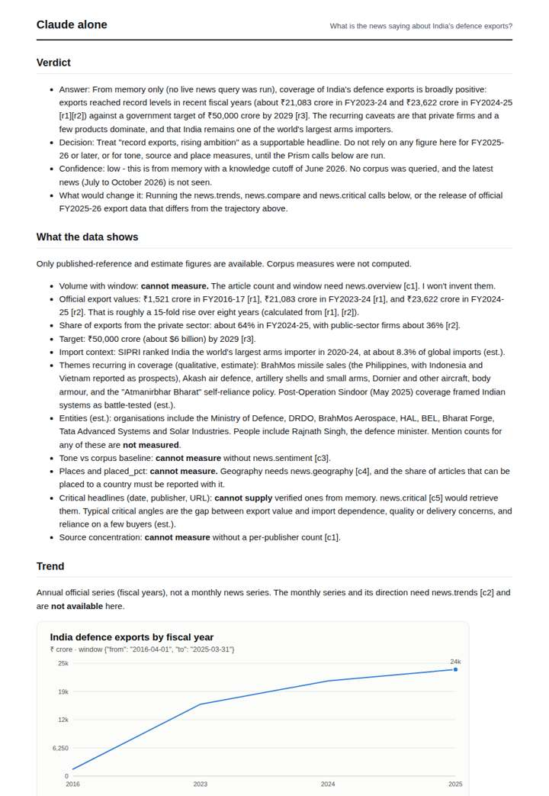
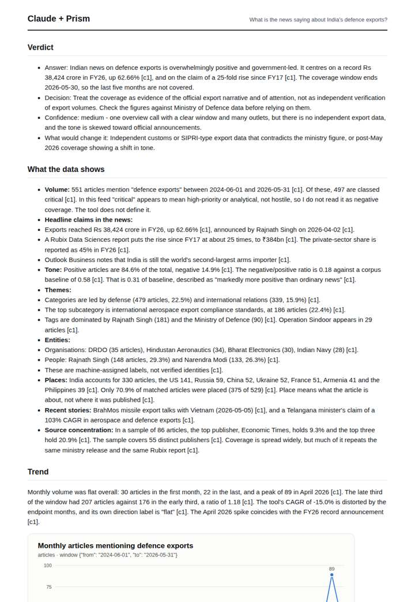
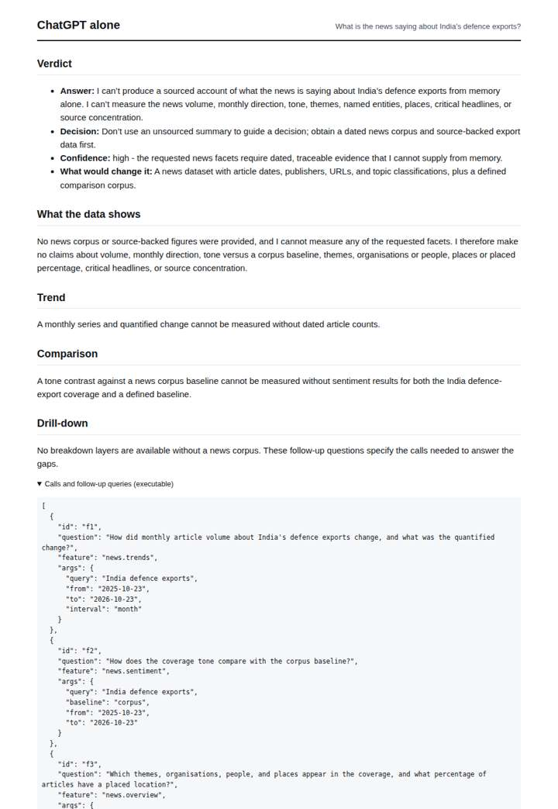
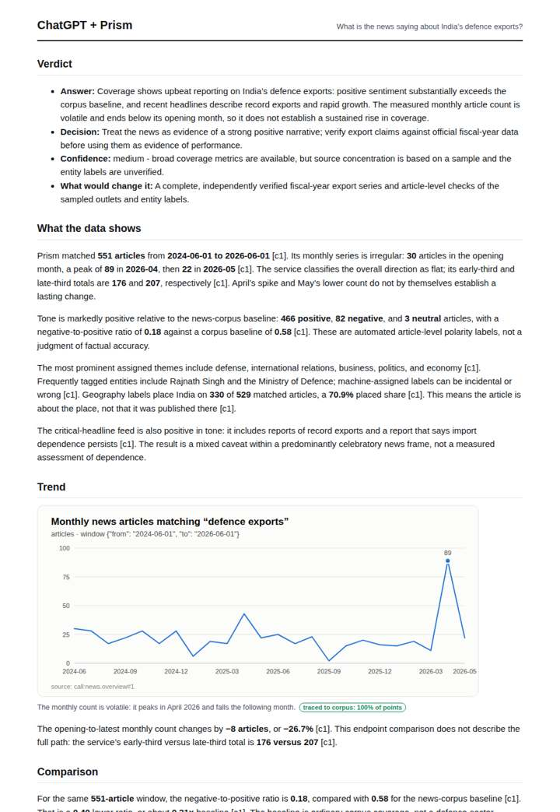

# India defence exports

**Question.** What is the news saying about India's defence exports?

**Category:** Defence & geopolitics · **Pattern:** `pulse` · **Why it is hard:** BrahMos deals and record export figures drive positive tone.

| Score /100 | Claude alone | Claude + Prism | ChatGPT alone | ChatGPT + Prism |
|---|---|---|---|---|
| Weighted (strict) | 22.0 | **74.8** | 21.3 | 74.2 |
| Opus judge | 23.2 | 85.2 | 18.2 | 73.6 |
| GPT judge | 20.8 | 64.4 | 24.4 | 74.8 |

## Parameter scores (0-5)

| Parameter | Weight | Claude alone | Claude + Prism | ChatGPT alone | ChatGPT + Prism |
|---|---|---|---|---|---|
| Measured trend | 10 | 1.0 | 3.5 | 0.0 | 4.0 |
| Measured comparison | 7 | 1.0 | 4.0 | 0.0 | 4.0 |
| Visualisation from counted data | 10 | 1.0 | 4.0 | 0.0 | 3.5 |
| Exploration and drill-down | 7 | 1.0 | 4.0 | 0.5 | 2.0 |
| Data export with provenance | 8 | 1.0 | 3.0 | 0.0 | 4.0 |
| Reproducibility | 12 | 0.0 | 5.0 | 1.0 | 4.5 |
| Traceable references | 8 | 1.0 | 2.0 | 0.5 | 1.5 |
| Accuracy against the corpus | 12 | 2.5 | 3.5 | 3.0 | 4.0 |
| Calibration and limits | 8 | 3.0 | 4.0 | 3.0 | 4.5 |
| Decision-grade verdict | 12 | 0.0 | 3.5 | 2.0 | 4.0 |
| Facet coverage | 6 | 1.0 | 4.5 | 0.5 | 4.0 |

## Script findings

| Check | Claude alone | Claude + Prism | ChatGPT alone | ChatGPT + Prism |
|---|---|---|---|---|
| Numbers traced to the corpus | 0/44 | 81/81 | 0/0 | 32/33 |
| Charts (traced share) | memory | 100%, 100% | none | 100% |
| DOIs that resolve | 0/0 | 0/0 | 0/0 | 0/0 |
| Follow-up queries that ran | 1/5 | 6/6 | 0/5 | 2/5 |
| Invention gate | tripped | clear | clear | clear |

**Claude Opus judge:** A and D both grounded their answers in the same overview call, but A went further. It added the tone comparison chart, the substantive export claims (Rs 38,424 crore, 25-fold), a correct reading of 'critical', and executable follow-ups. B gave plausible official figures from memory and did not measure the news at all, and C declined to answer.

**GPT judge:** A is the strongest decision aid: it grounds the positive tone against a defined corpus baseline, shows that article volume is volatile and flat overall, and separates news claims from verified export performance. B has more breakdowns and charts, but unsupported export and story specifics, plus a misreported window, weaken its reliability; C and D do not provide measured news evidence.

## Before / after (first screen)

| | Alone | With Prism |
|---|---|---|
| Claude |  |  |
| ChatGPT |  |  |

Full deliverables, rendered: [PDF](https://fliarbi.com/demo/docs/prism-benchmark-v2-4ed65c83/full/india-defence-exports.pdf). Raw answers, ground pass and judge outputs: `answers.json`, `ground.json`, `judge_opus.json`, `judge_gpt.json` in this folder.
