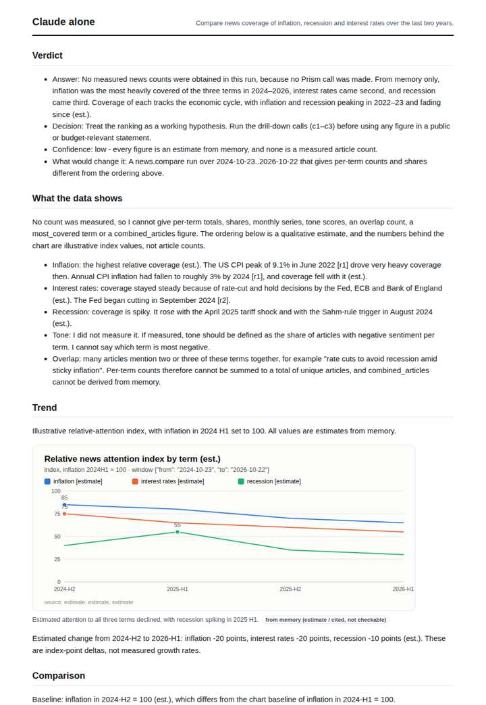
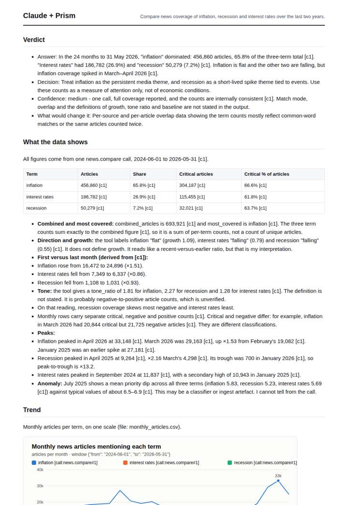
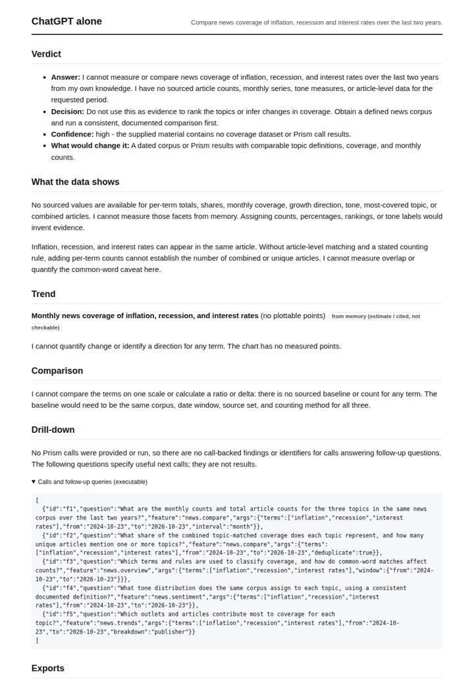
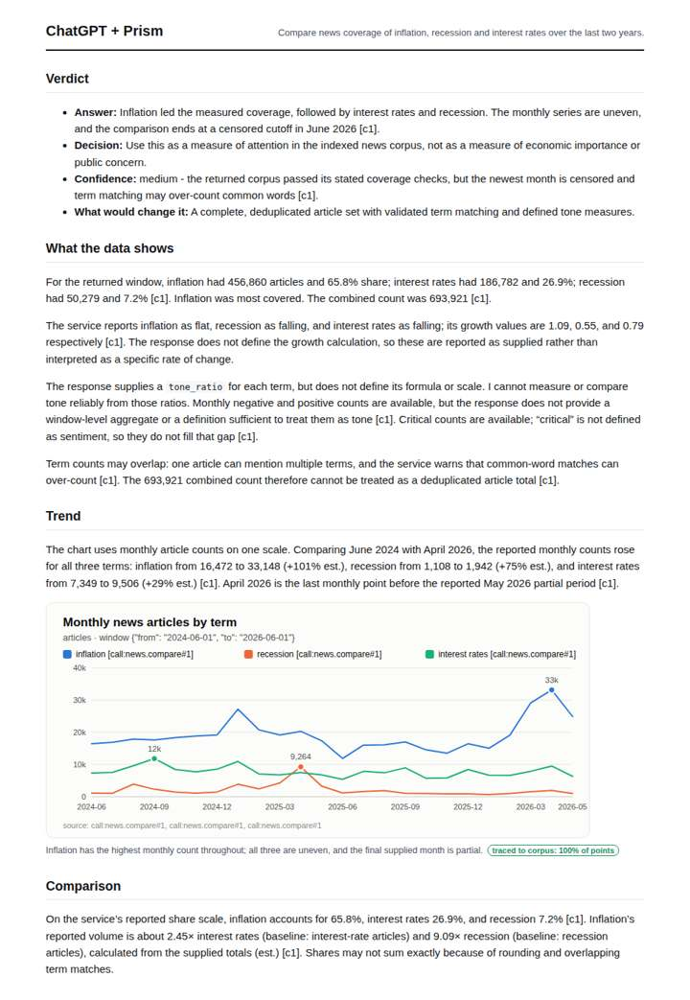

# Inflation vs recession in the news

**Question.** Compare news coverage of inflation, recession and interest rates over the last two years.

**Category:** Finance & markets · **Pattern:** `compare` · **Why it is hard:** Overlapping terms; the comparison must be on one scale and one window.

| Score /100 | Claude alone | Claude + Prism | ChatGPT alone | ChatGPT + Prism |
|---|---|---|---|---|
| Weighted (strict) | 31.1 | **82.4** | 34.2 | 58.0 |
| Opus judge | 26.1 | 87.2 | 22.4 | 59.1 |
| GPT judge | 36.1 | 77.6 | 46.1 | 57.0 |

## Parameter scores (0-5)

| Parameter | Weight | Claude alone | Claude + Prism | ChatGPT alone | ChatGPT + Prism |
|---|---|---|---|---|---|
| Measured trend | 10 | 1.0 | 4.0 | 0.5 | 2.5 |
| Measured comparison | 7 | 1.5 | 5.0 | 0.5 | 4.0 |
| Visualisation from counted data | 10 | 1.0 | 4.0 | 0.5 | 2.5 |
| Exploration and drill-down | 7 | 1.5 | 2.0 | 1.0 | 2.0 |
| Data export with provenance | 8 | 1.0 | 5.0 | 0.5 | 4.0 |
| Reproducibility | 12 | 0.0 | 5.0 | 1.0 | 4.0 |
| Accuracy against the corpus | 12 | 2.5 | 4.0 | 4.0 | 1.5 |
| Calibration and limits | 8 | 3.5 | 4.5 | 3.5 | 2.5 |
| Decision-grade verdict | 12 | 2.0 | 3.5 | 3.0 | 3.0 |
| Facet coverage | 6 | 2.0 | 4.0 | 1.5 | 3.5 |

## Script findings

| Check | Claude alone | Claude + Prism | ChatGPT alone | ChatGPT + Prism |
|---|---|---|---|---|
| Numbers traced to the corpus | 0/14 | 88/88 | 0/0 | 25/26 |
| Charts (traced share) | memory | 100% | memory | 100% |
| DOIs that resolve | 0/0 | 0/0 | 0/0 | 0/0 |
| Follow-up queries that ran | 2/5 | 2/6 | 0/5 | 2/4 |
| Invention gate | clear | clear | clear | clear |

**Claude Opus judge:** C was the only deliverable that read the measured record correctly end to end. Its ratios and peaks recompute exactly, it understood that combined counts are not unique articles, it applied censoring to the right month and it flagged data anomalies. A used the same data but misread the censored month and claimed rising trends against the tool's own direction labels. B offered memory-based estimates that contradicted the data, and D declined to answer.

**GPT judge:** B is the strongest decision aid: it provides a traced, same-window comparison, monthly series, quantified contrasts, and usable exports. Its unsupported coverage check and overconfident recession interpretation lower confidence; C is less reliable because it misreads the censored month, while A and D do not deliver measured comparisons.

## Before / after (first screen)

| | Alone | With Prism |
|---|---|---|
| Claude |  |  |
| ChatGPT |  |  |

Full deliverables, rendered: [PDF](https://fliarbi.com/demo/docs/prism-benchmark-v2-4ed65c83/full/inflation-vs-recession.pdf). Raw answers, ground pass and judge outputs: `answers.json`, `ground.json`, `judge_opus.json`, `judge_gpt.json` in this folder.
