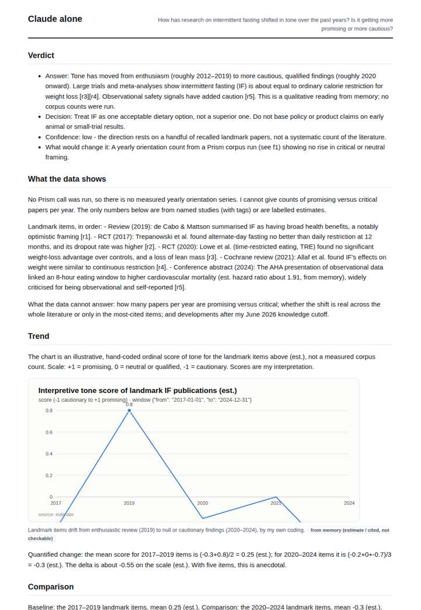
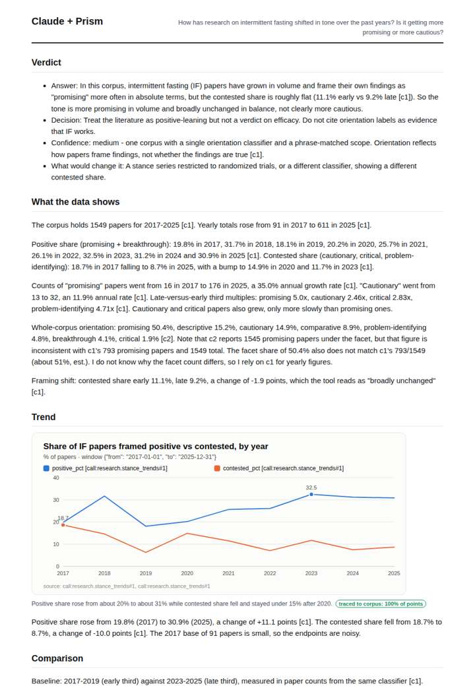
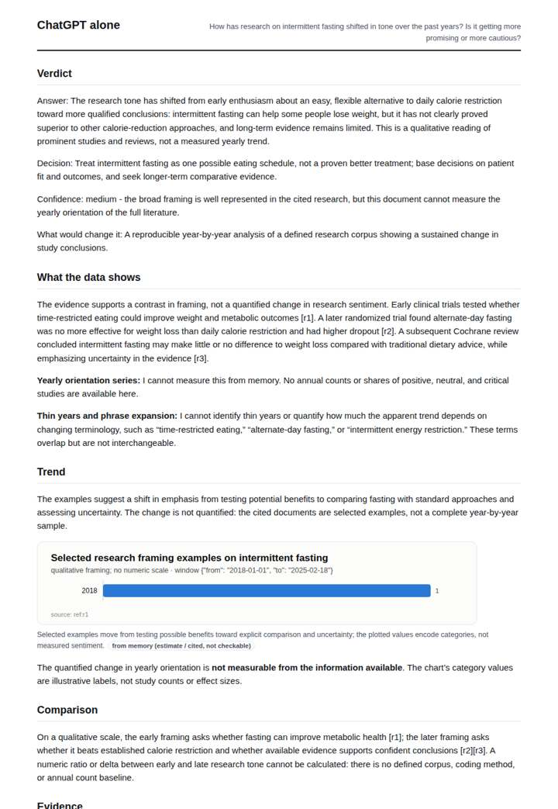
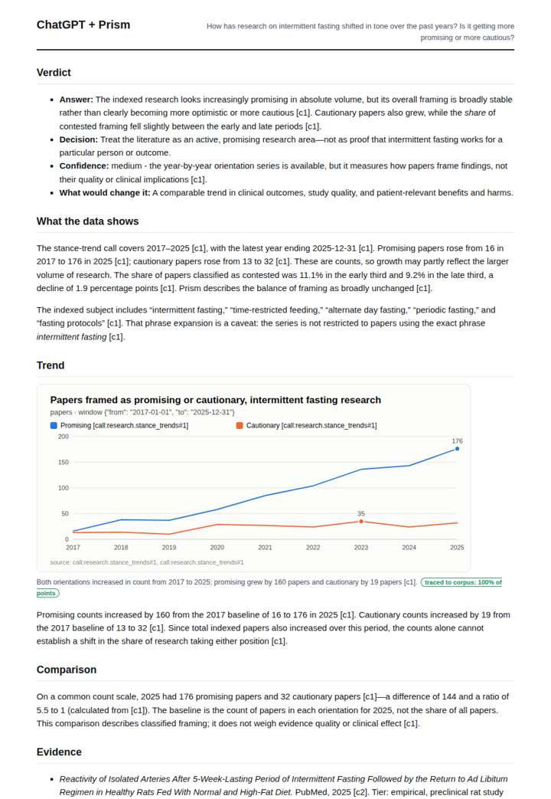

# How intermittent-fasting research is framed

**Question.** How has research on intermittent fasting shifted in tone over the past years? Is it getting more promising or more cautious?

**Category:** Medical & clinical evidence · **Pattern:** `stance` · **Why it is hard:** Framing is a property of thousands of abstracts, not something a model can recall.

| Score /100 | Claude alone | Claude + Prism | ChatGPT alone | ChatGPT + Prism |
|---|---|---|---|---|
| Weighted (strict) | 32.7 | **85.8** | 25.1 | 74.5 |
| Opus judge | 32.6 | 85.0 | 22.0 | 73.8 |
| GPT judge | 32.8 | 86.6 | 28.2 | 75.2 |

## Parameter scores (0-5)

| Parameter | Weight | Claude alone | Claude + Prism | ChatGPT alone | ChatGPT + Prism |
|---|---|---|---|---|---|
| Measured trend | 10 | 1.0 | 5.0 | 1.0 | 4.0 |
| Measured comparison | 7 | 1.5 | 5.0 | 1.0 | 4.0 |
| Visualisation from counted data | 10 | 1.0 | 4.0 | 0.5 | 3.0 |
| Exploration and drill-down | 7 | 2.0 | 4.0 | 1.5 | 3.5 |
| Data export with provenance | 8 | 1.0 | 3.0 | 1.0 | 4.0 |
| Reproducibility | 12 | 1.0 | 5.0 | 1.0 | 4.0 |
| Traceable references | 8 | 3.0 | 3.0 | 1.0 | 3.0 |
| Accuracy against the corpus | 12 | 1.5 | 4.5 | 1.0 | 4.0 |
| Calibration and limits | 8 | 3.0 | 4.5 | 2.5 | 4.0 |
| Decision-grade verdict | 12 | 2.0 | 4.5 | 2.0 | 4.0 |
| Facet coverage | 6 | 1.5 | 4.0 | 1.5 | 3.0 |

## Script findings

| Check | Claude alone | Claude + Prism | ChatGPT alone | ChatGPT + Prism |
|---|---|---|---|---|
| Numbers traced to the corpus | 0/16 | 71/71 | 0/0 | 18/19 |
| Charts (traced share) | memory | 100% | memory | 100% |
| DOIs that resolve | 4/4 | 1/1 | 2/2 | 2/2 |
| Follow-up queries that ran | 3/6 | 4/6 | 2/6 | 3/4 |
| Invention gate | clear | clear | clear | clear |

**Claude Opus judge:** C answered the tone question with the right measure: yearly positive vs contested shares, exact deltas, and early/late ratios. It also flagged the tool's own facet inconsistency, giving a decision-maker a traced 'more promising in volume, broadly stable in balance' answer. B reached the same verdict with traced data but charted counts rather than shares. A and D answered from memory with a 'more cautious' narrative that the measured corpus does not support, and D additionally fabricated and misdated references.

**GPT judge:** A best supports a decision: it traces the full annual series, separates rising counts from the largely stable contested share, and states what the framing labels can and cannot establish. C is also well sourced, but its count-only chart and single-year ratio do less to answer whether the balance of tone shifted.

## Before / after (first screen)

| | Alone | With Prism |
|---|---|---|
| Claude |  |  |
| ChatGPT |  |  |

Full deliverables, rendered: [PDF](https://fliarbi.com/demo/docs/prism-benchmark-v2-4ed65c83/full/intermittent-fasting-stance.pdf). Raw answers, ground pass and judge outputs: `answers.json`, `ground.json`, `judge_opus.json`, `judge_gpt.json` in this folder.
