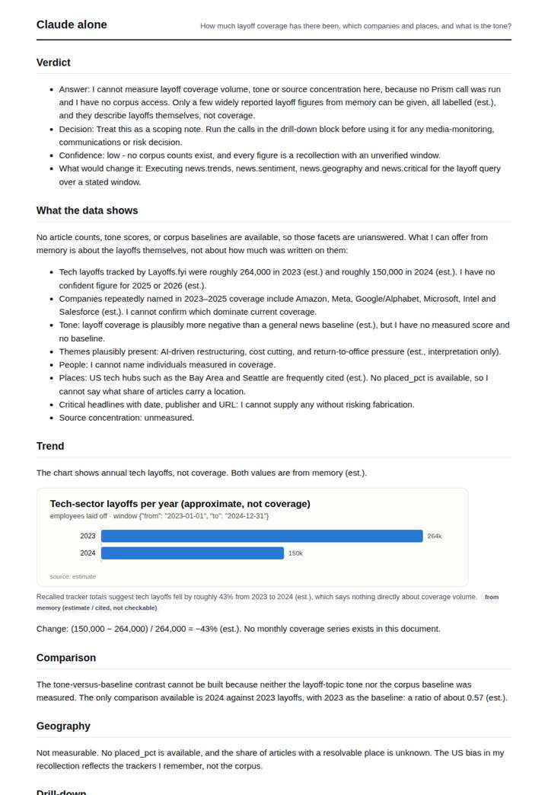
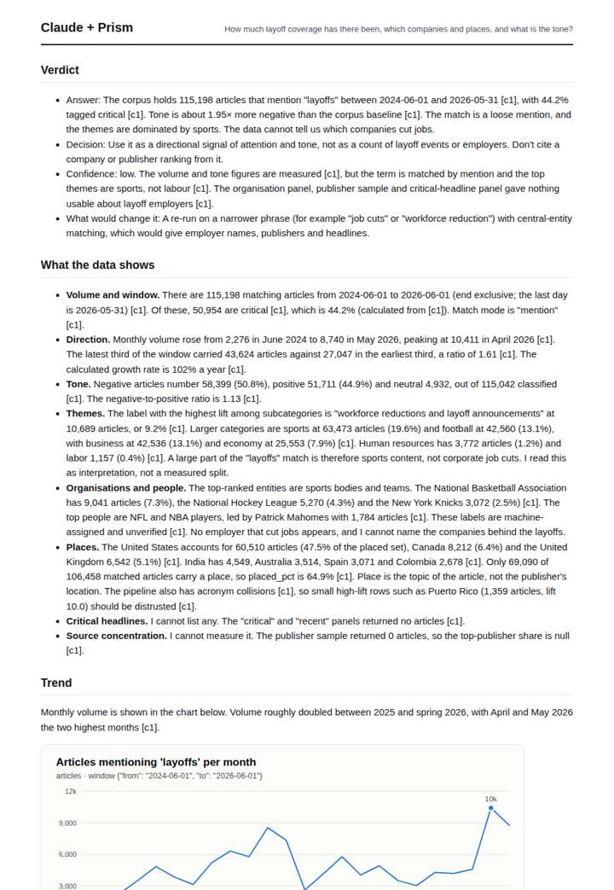
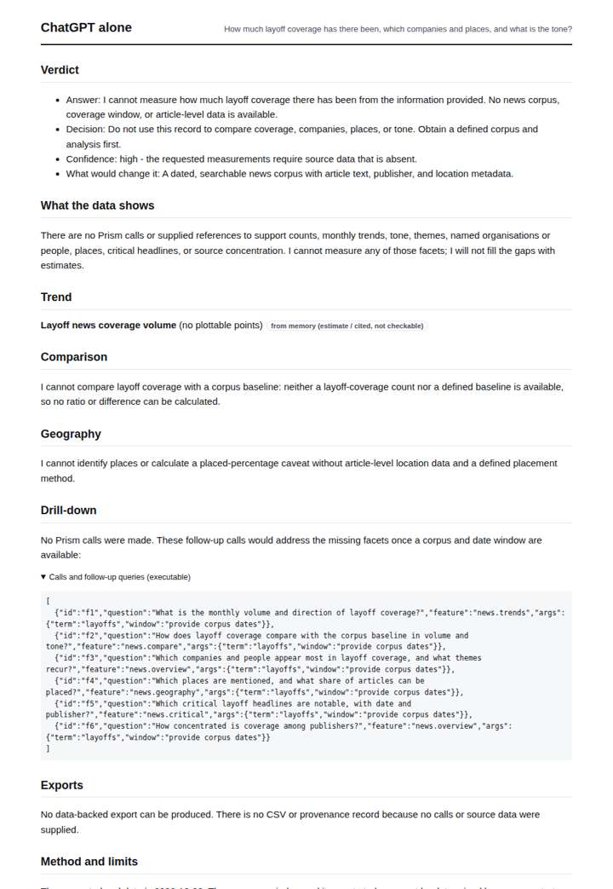
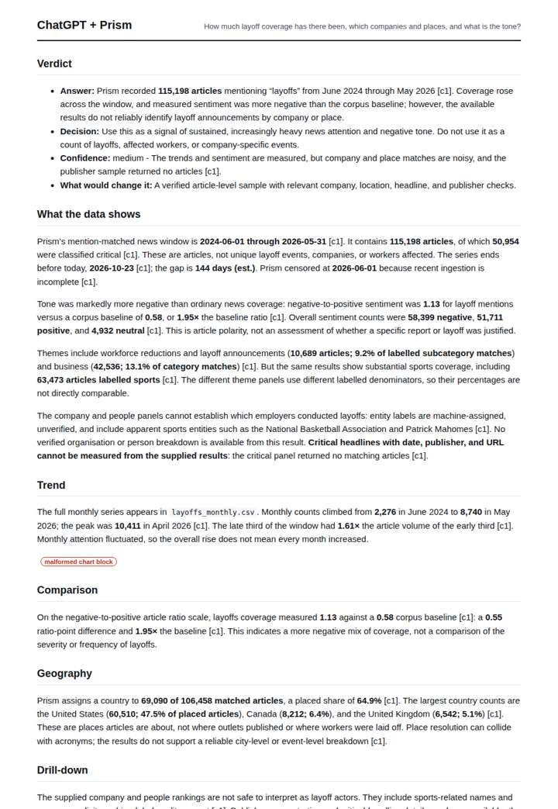

# Layoffs in the news

**Question.** How much layoff coverage has there been, which companies and places, and what is the tone?

**Category:** Education & labour · **Pattern:** `pulse` · **Why it is hard:** Tech layoffs dominate headlines out of proportion to labour data.

| Score /100 | Claude alone | Claude + Prism | ChatGPT alone | ChatGPT + Prism |
|---|---|---|---|---|
| Weighted (strict) | 32.7 | **80.7** | 25.4 | 63.0 |
| Opus judge | 32.8 | 77.8 | 16.6 | 58.4 |
| GPT judge | 32.6 | 83.6 | 34.2 | 67.6 |

## Parameter scores (0-5)

| Parameter | Weight | Claude alone | Claude + Prism | ChatGPT alone | ChatGPT + Prism |
|---|---|---|---|---|---|
| Measured trend | 10 | 1.0 | 4.5 | 0.0 | 1.0 |
| Measured comparison | 7 | 1.0 | 4.5 | 0.0 | 4.5 |
| Visualisation from counted data | 10 | 1.0 | 4.5 | 0.0 | 0.0 |
| Exploration and drill-down | 7 | 1.5 | 4.0 | 1.0 | 2.5 |
| Data export with provenance | 8 | 1.0 | 4.5 | 0.0 | 4.5 |
| Reproducibility | 12 | 1.0 | 5.0 | 0.5 | 4.5 |
| Traceable references | 8 | 1.0 | 1.0 | 0.0 | 1.0 |
| Accuracy against the corpus | 12 | 3.0 | 4.5 | 4.0 | 4.5 |
| Calibration and limits | 8 | 2.5 | 4.5 | 3.0 | 4.0 |
| Decision-grade verdict | 12 | 3.0 | 3.0 | 3.0 | 4.0 |
| Facet coverage | 6 | 1.0 | 4.0 | 1.0 | 4.0 |

## Script findings

| Check | Claude alone | Claude + Prism | ChatGPT alone | ChatGPT + Prism |
|---|---|---|---|---|
| Numbers traced to the corpus | 0/8 | 76/76 | 0/0 | 34/34 |
| Charts (traced share) | memory | 100%, 100% | memory | memory |
| DOIs that resolve | 0/0 | 0/0 | 0/0 | 0/0 |
| Follow-up queries that ran | 1/6 | 4/6 | 0/6 | 1/5 |
| Invention gate | clear | clear | clear | clear |

**Claude Opus judge:** D and B both measured the same corpus correctly. D went further: it decomposed volume into critical share and caught the sports contamination of the 'layoffs' match. It also caught the acronym collision and the May 2026 enrichment collapse, and it shipped valid charts and a full regenerate recipe. B was accurate and well caveated, but its chart is malformed and it is thinner on drill-down. A and C had no data. A offered off-question layoff totals from memory, honestly labelled; C declined entirely.

**GPT judge:** C best equips a decision-maker: it quantifies the volume and tone trends, shows the critical-share pattern, and surfaces the sports-heavy noise and place-coverage limits. B is careful and reproducible, but its chart and trend ceilings sharply limit the evidence presentation; C’s main weaknesses are its overlong verdict and a one-day gap calculation error.

## Before / after (first screen)

| | Alone | With Prism |
|---|---|---|
| Claude |  |  |
| ChatGPT |  |  |

Full deliverables, rendered: [PDF](https://fliarbi.com/demo/docs/prism-benchmark-v2-4ed65c83/full/layoffs-pulse.pdf). Raw answers, ground pass and judge outputs: `answers.json`, `ground.json`, `judge_opus.json`, `judge_gpt.json` in this folder.
