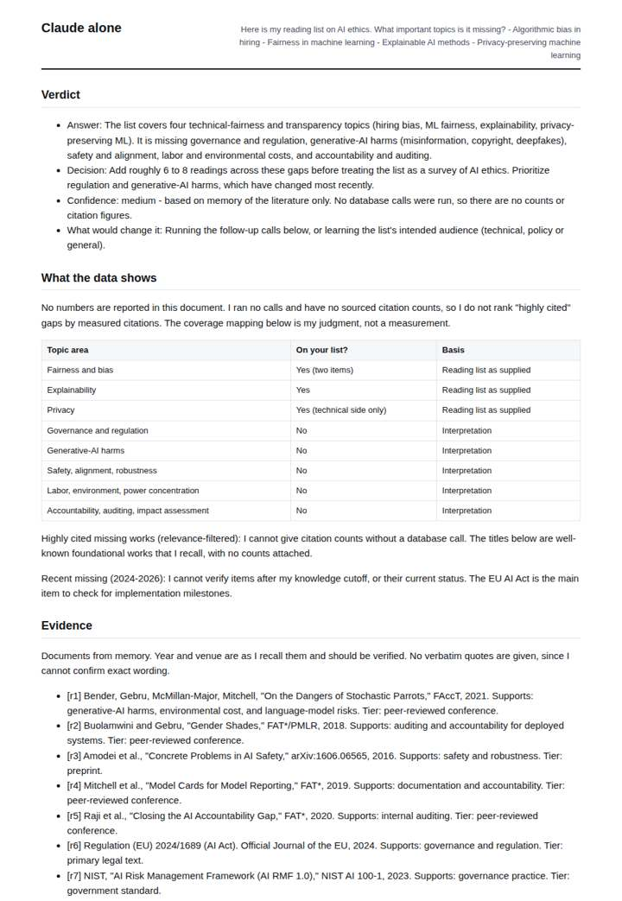
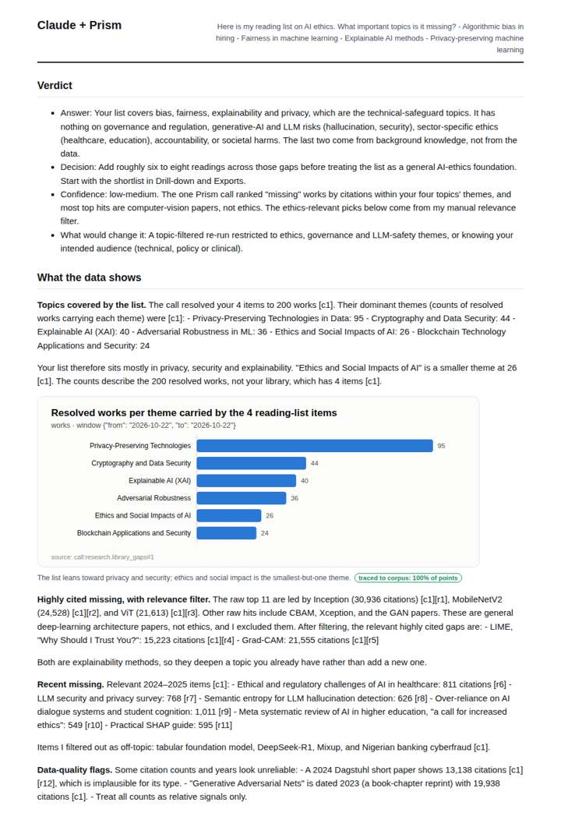
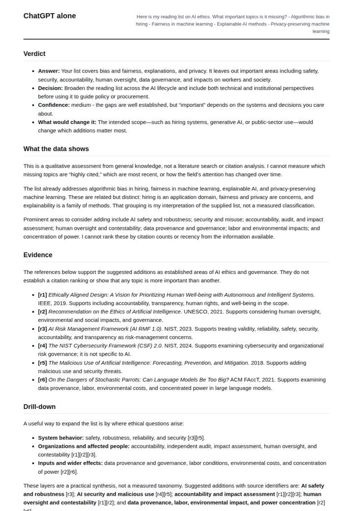
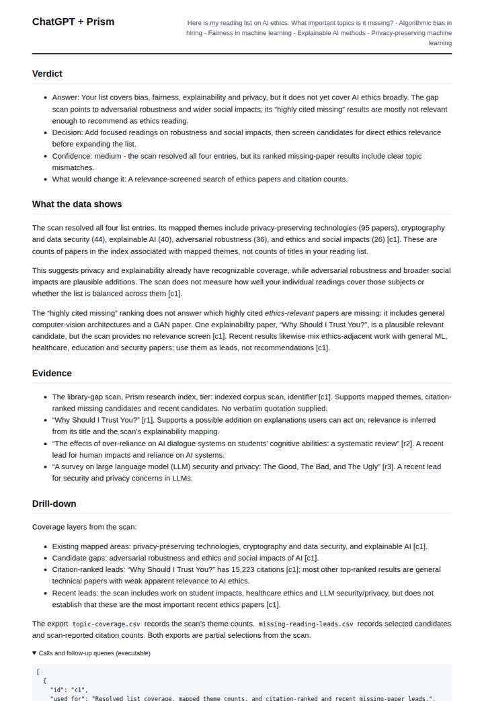

# What is my AI-ethics reading list missing?

**Question.** Here is my reading list on AI ethics. What important topics is it missing?

**Category:** Academic research & literature review · **Pattern:** `library` · **Why it is hard:** Coverage gaps are measured against the corpus, not suggested from memory.

| Score /100 | Claude alone | Claude + Prism | ChatGPT alone | ChatGPT + Prism |
|---|---|---|---|---|
| Weighted (strict) | 45.1 | **69.2** | 40.7 | 61.7 |
| Opus judge | 41.4 | 74.0 | 34.9 | 54.7 |
| GPT judge | 48.7 | 64.3 | 46.5 | 68.7 |

## Parameter scores (0-5)

| Parameter | Weight | Claude alone | Claude + Prism | ChatGPT alone | ChatGPT + Prism |
|---|---|---|---|---|---|
| Visualisation from counted data | 10 | 0.0 | 3.5 | 0.0 | 0.0 |
| Exploration and drill-down | 7 | 2.0 | 3.0 | 1.0 | 3.0 |
| Data export with provenance | 8 | 1.0 | 4.0 | 0.0 | 3.5 |
| Reproducibility | 12 | 1.0 | 4.0 | 0.0 | 4.0 |
| Traceable references | 8 | 3.0 | 3.0 | 3.5 | 3.0 |
| Accuracy against the corpus | 12 | 4.0 | 3.0 | 4.0 | 3.0 |
| Calibration and limits | 8 | 3.0 | 3.5 | 4.0 | 4.5 |
| Decision-grade verdict | 12 | 4.0 | 3.5 | 4.0 | 3.5 |
| Facet coverage | 6 | 1.5 | 3.5 | 1.0 | 3.5 |

## Script findings

| Check | Claude alone | Claude + Prism | ChatGPT alone | ChatGPT + Prism |
|---|---|---|---|---|
| Numbers traced to the corpus | 0/0 | 26/26 | 0/2 | 6/6 |
| Charts (traced share) | none | 100% | none | none |
| DOIs that resolve | 4/4 | 12/12 | 3/3 | 3/3 |
| Follow-up queries that ran | 3/6 | 3/6 | 2/5 | 2/3 |
| Invention gate | clear | clear | clear | clear |

**Claude Opus judge:** A was the only deliverable that used the gap scan correctly. It read the theme counts by their definition, filtered the off-topic computer-vision 'highly cited missing' rows, and flagged the citation anomalies. It then turned the ethics-relevant recent items into concrete additions with DOIs and separated them from memory-based gaps. C used the same data but misread covered themes as gaps. B and D gave sensible but unmeasured, memory-only topic lists.

**GPT judge:** C best supports a decision-maker by separating corpus-grounded themes and leads from the question of whether they are truly ethics-relevant, while preserving traceable exports and explicit limits. D is more elaborate, but its misreading of the theme counts and unsupported date make its comparisons less dependable; A and B are honest memory-based suggestions without corpus-grounded coverage.

## Before / after (first screen)

| | Alone | With Prism |
|---|---|---|
| Claude |  |  |
| ChatGPT |  |  |

Full deliverables, rendered: [PDF](https://fliarbi.com/demo/docs/prism-benchmark-v2-4ed65c83/full/library-gaps-ai-ethics.pdf). Raw answers, ground pass and judge outputs: `answers.json`, `ground.json`, `judge_opus.json`, `judge_gpt.json` in this folder.
