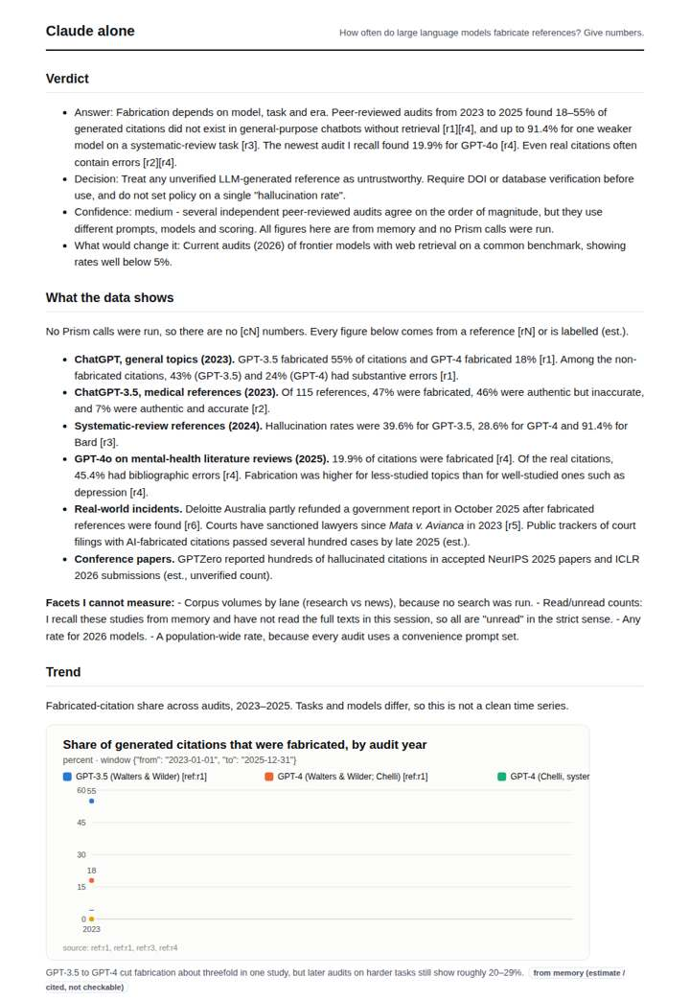
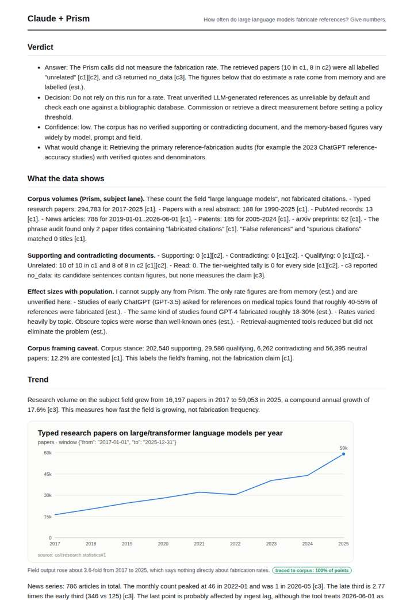
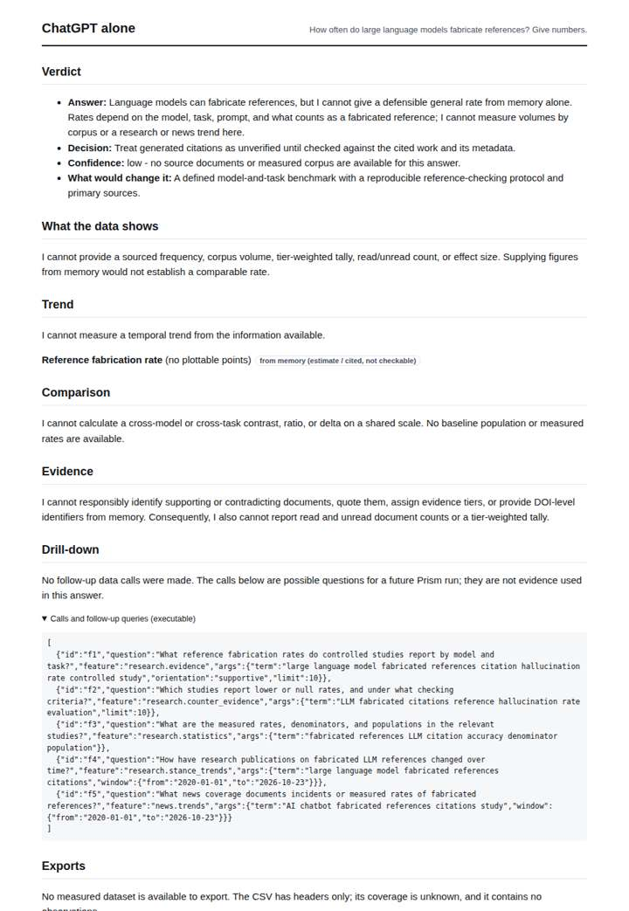
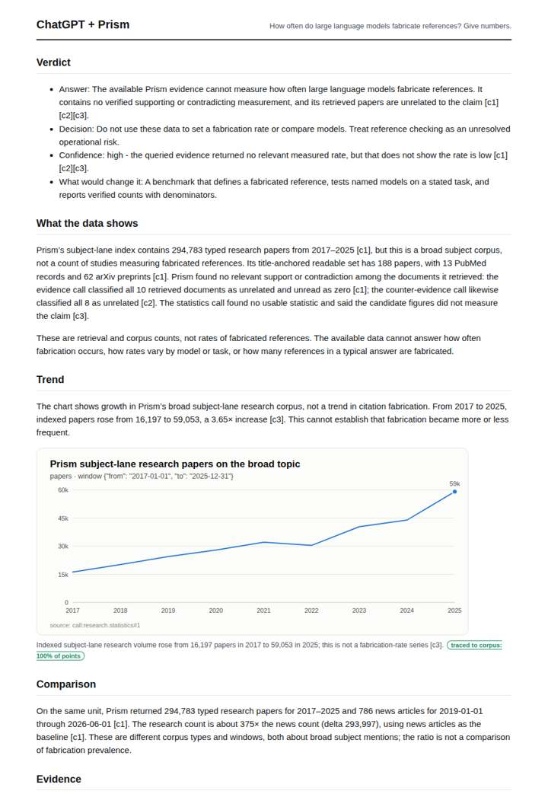

# Do LLMs hallucinate citations?

**Question.** How often do large language models fabricate references? Give numbers.

**Category:** Technology & AI · **Pattern:** `evidence` · **Why it is hard:** The meta-question: a model answering about its own failure mode.

| Score /100 | Claude alone | Claude + Prism | ChatGPT alone | ChatGPT + Prism |
|---|---|---|---|---|
| Weighted (strict) | 22.0 | 65.6 | 26.8 | **68.9** |
| Opus judge | 26.2 | 64.6 | 19.0 | 56.4 |
| GPT judge | 17.8 | 66.6 | 34.6 | 81.4 |

## Parameter scores (0-5)

| Parameter | Weight | Claude alone | Claude + Prism | ChatGPT alone | ChatGPT + Prism |
|---|---|---|---|---|---|
| Measured trend | 10 | 0.5 | 3.0 | 0.0 | 4.0 |
| Measured comparison | 7 | 2.0 | 1.5 | 0.0 | 0.5 |
| Visualisation from counted data | 10 | 1.0 | 3.5 | 0.0 | 3.5 |
| Exploration and drill-down | 7 | 1.0 | 1.5 | 1.0 | 1.0 |
| Data export with provenance | 8 | 1.0 | 2.5 | 0.5 | 3.5 |
| Reproducibility | 12 | 0.0 | 4.0 | 1.0 | 4.5 |
| Traceable references | 8 | 1.5 | 3.5 | 0.5 | 4.5 |
| Accuracy against the corpus | 12 | 2.0 | 3.5 | 4.0 | 4.0 |
| Calibration and limits | 8 | 3.0 | 4.0 | 2.5 | 3.0 |
| Decision-grade verdict | 12 | 0.0 | 4.0 | 2.5 | 4.0 |
| Facet coverage | 6 | 1.0 | 4.0 | 1.5 | 3.5 |

## Script findings

| Check | Claude alone | Claude + Prism | ChatGPT alone | ChatGPT + Prism |
|---|---|---|---|---|
| Numbers traced to the corpus | 0/47 | 38/39 | 0/0 | 21/23 |
| Charts (traced share) | memory | 100% | memory | 100% |
| DOIs that resolve | 3/3 | 3/3 | 0/0 | 3/3 |
| Follow-up queries that ran | 0/6 | 1/6 | 0/5 | 0/5 |
| Invention gate | tripped | clear | clear | clear |

**Claude Opus judge:** C separated measured from remembered: it traced every tool number and reported that the corpus held no fabrication-rate evidence. It still gave clearly labelled estimate ranges and a usable decision. A had the most useful real-world figures, and they appear correct, but none trace and its verdict rests on untagged numbers. D was rigorous but answered 'give numbers' with none, and B gave nothing.

**GPT judge:** A is the strongest decision-grade response because it refuses to turn broad subject-corpus counts into a fabrication rate, and it clearly states what evidence would be needed to answer the question. B adds memory-based rate estimates that are labelled honestly, but they remain unverified and its news-trend reading is inconsistent; C is cautious but offers little usable measurement. D appears most numerically decisive, yet its unsupported specifics make it the least reliable basis for a decision.

## Before / after (first screen)

| | Alone | With Prism |
|---|---|---|
| Claude |  |  |
| ChatGPT |  |  |

Full deliverables, rendered: [PDF](https://fliarbi.com/demo/docs/prism-benchmark-v2-4ed65c83/full/llm-hallucination-evidence.pdf). Raw answers, ground pass and judge outputs: `answers.json`, `ground.json`, `judge_opus.json`, `judge_gpt.json` in this folder.
