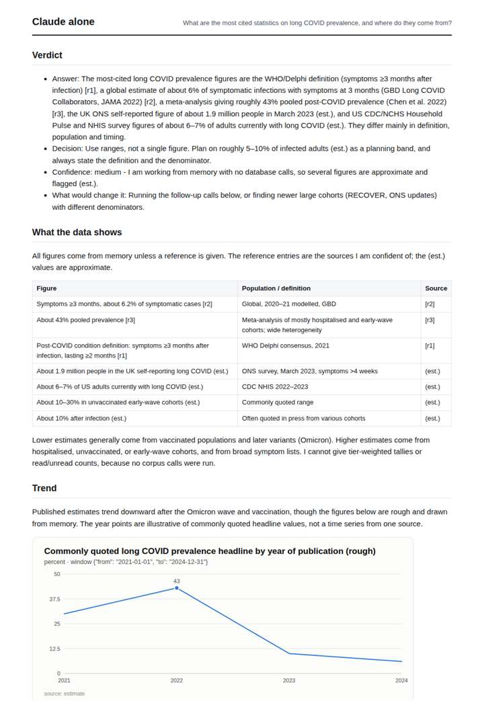
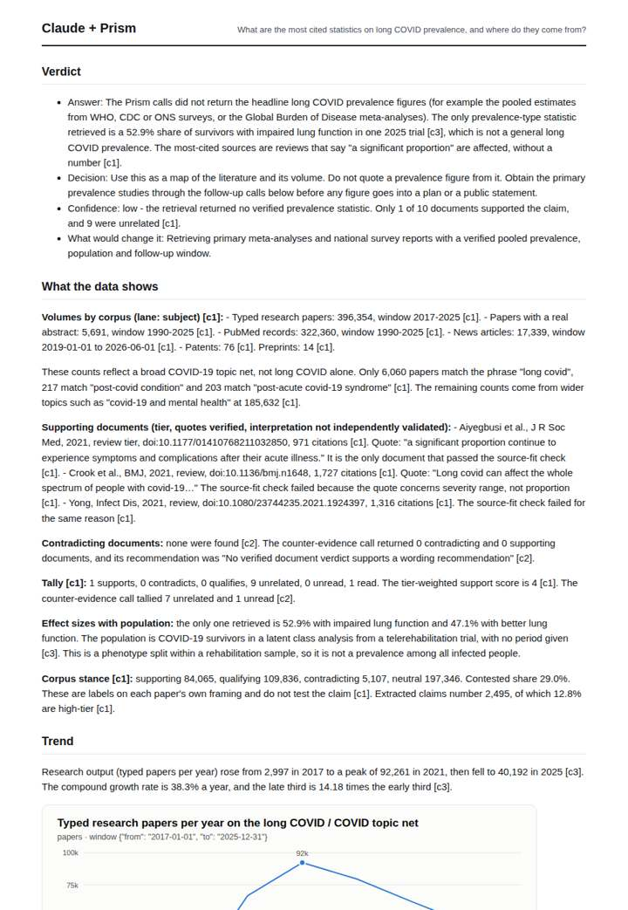
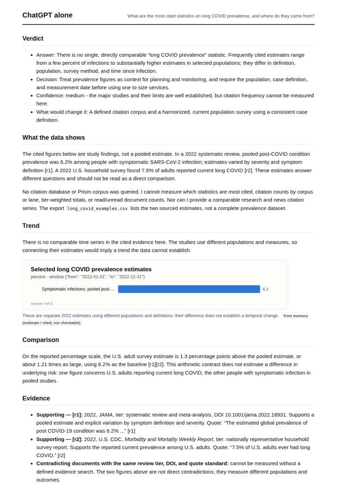
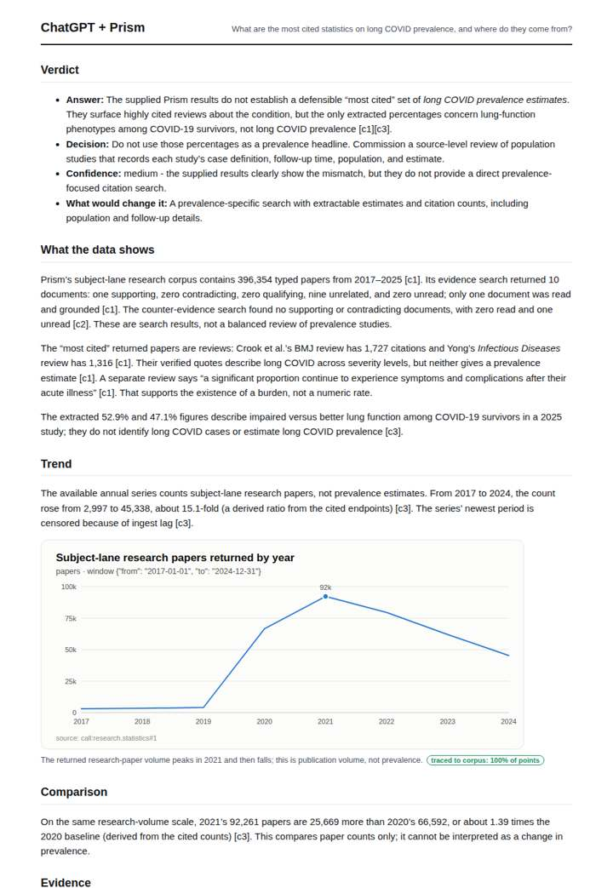

# Long COVID statistics

**Question.** What are the most cited statistics on long COVID prevalence, and where do they come from?

**Category:** Medical & clinical evidence · **Pattern:** `evidence` · **Why it is hard:** Prevalence figures range from 5% to 50% depending on definition; a figure without its population is useless.

| Score /100 | Claude alone | Claude + Prism | ChatGPT alone | ChatGPT + Prism |
|---|---|---|---|---|
| Weighted (strict) | 38.7 | 61.4 | 23.5 | **68.9** |
| Opus judge | 35.8 | 56.2 | 18.4 | 67.6 |
| GPT judge | 41.6 | 66.6 | 28.6 | 70.2 |

## Parameter scores (0-5)

| Parameter | Weight | Claude alone | Claude + Prism | ChatGPT alone | ChatGPT + Prism |
|---|---|---|---|---|---|
| Measured trend | 10 | 1.0 | 2.5 | 0.0 | 3.0 |
| Measured comparison | 7 | 2.0 | 3.0 | 1.5 | 3.5 |
| Visualisation from counted data | 10 | 1.0 | 2.5 | 0.5 | 3.0 |
| Exploration and drill-down | 7 | 1.5 | 2.0 | 1.0 | 3.0 |
| Data export with provenance | 8 | 1.0 | 2.5 | 0.5 | 3.0 |
| Reproducibility | 12 | 1.0 | 4.0 | 1.0 | 4.0 |
| Traceable references | 8 | 2.5 | 4.0 | 1.0 | 4.0 |
| Accuracy against the corpus | 12 | 3.0 | 3.0 | 1.0 | 4.0 |
| Calibration and limits | 8 | 3.5 | 4.0 | 2.5 | 3.0 |
| Decision-grade verdict | 12 | 3.0 | 3.0 | 2.5 | 4.0 |
| Facet coverage | 6 | 1.5 | 3.0 | 1.5 | 2.5 |

## Script findings

| Check | Claude alone | Claude + Prism | ChatGPT alone | ChatGPT + Prism |
|---|---|---|---|---|
| Numbers traced to the corpus | 0/19 | 63/64 | 0/12 | 29/29 |
| Charts (traced share) | memory | 100% | memory | 100% |
| DOIs that resolve | 3/3 | 5/5 | 1/1 | 3/3 |
| Follow-up queries that ran | 2/5 | 2/6 | 0/5 | 3/6 |
| Invention gate | clear | clear | clear | clear |

**Claude Opus judge:** A was the only deliverable that stayed fully traced and handled the censored period correctly. It told the decision-maker plainly that the retrieved statistics are not prevalence estimates and set out what to commission next. B had richer context, including the useful phrase audit, but plotted a censored year as a decline and included an untraced news figure. C and D answered from memory: D's figures were broadly right and honestly flagged, while C misattributed its headline sources.

**GPT judge:** D is the strongest decision aid because it clearly separates highly cited reviews and survivor lung-function percentages from actual long COVID prevalence, then recommends against using them as prevalence headlines. C reaches a similar caution, but spends more of the deliverable on broad corpus trends and stance counts that do not answer the prevalence question.

## Before / after (first screen)

| | Alone | With Prism |
|---|---|---|
| Claude |  |  |
| ChatGPT |  |  |

Full deliverables, rendered: [PDF](https://fliarbi.com/demo/docs/prism-benchmark-v2-4ed65c83/full/long-covid-statistics.pdf). Raw answers, ground pass and judge outputs: `answers.json`, `ground.json`, `judge_opus.json`, `judge_gpt.json` in this folder.
