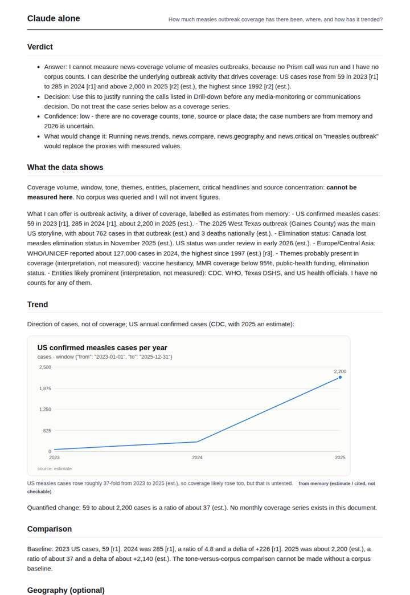
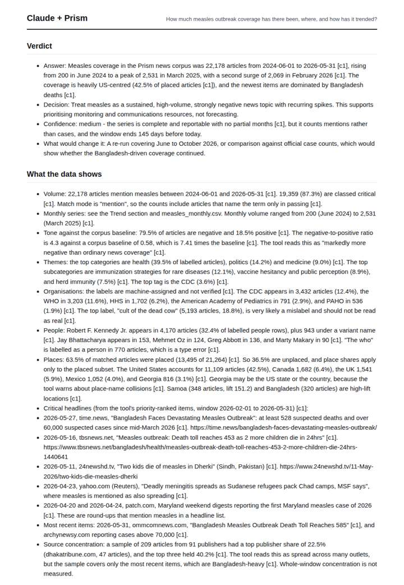
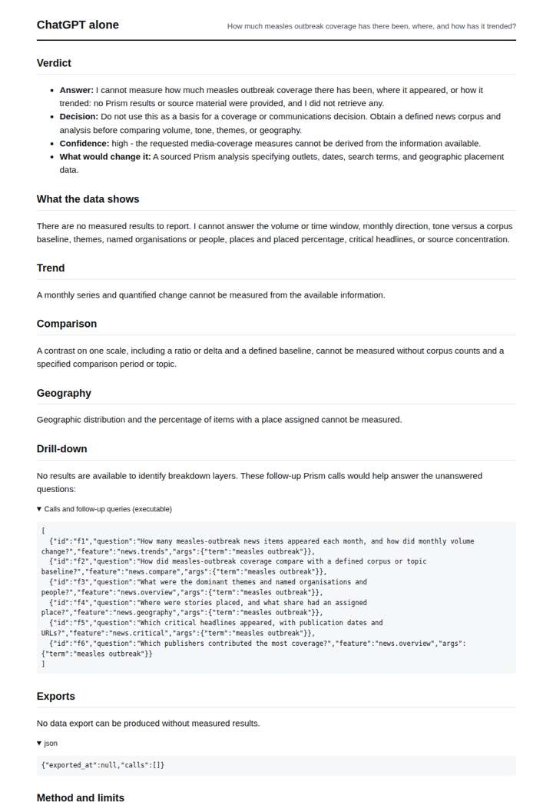
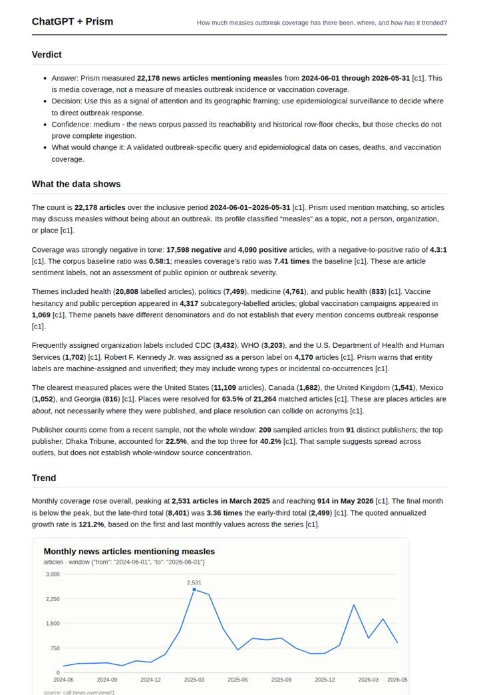

# Measles resurgence coverage

**Question.** How much measles outbreak coverage has there been, where, and how has it trended?

**Category:** Public health & epidemiology · **Pattern:** `pulse` · **Why it is hard:** The 2025 US and Canadian outbreaks dominate; a global picture needs the geography split.

| Score /100 | Claude alone | Claude + Prism | ChatGPT alone | ChatGPT + Prism |
|---|---|---|---|---|
| Weighted (strict) | 35.5 | 73.0 | 23.2 | **77.1** |
| Opus judge | 30.4 | 82.0 | 18.0 | 68.6 |
| GPT judge | 40.6 | 64.0 | 28.4 | 85.6 |

## Parameter scores (0-5)

| Parameter | Weight | Claude alone | Claude + Prism | ChatGPT alone | ChatGPT + Prism |
|---|---|---|---|---|---|
| Measured trend | 10 | 1.0 | 4.0 | 0.0 | 4.5 |
| Measured comparison | 7 | 1.5 | 4.5 | 0.0 | 4.5 |
| Visualisation from counted data | 10 | 1.0 | 3.5 | 0.0 | 3.5 |
| Exploration and drill-down | 7 | 1.0 | 3.5 | 2.0 | 3.0 |
| Data export with provenance | 8 | 1.0 | 4.0 | 0.0 | 3.0 |
| Reproducibility | 12 | 1.0 | 5.0 | 1.0 | 5.0 |
| Traceable references | 8 | 1.5 | 1.0 | 0.5 | 0.5 |
| Accuracy against the corpus | 12 | 3.5 | 3.0 | 3.0 | 4.5 |
| Calibration and limits | 8 | 3.0 | 2.5 | 2.5 | 4.5 |
| Decision-grade verdict | 12 | 3.0 | 4.0 | 2.5 | 4.0 |
| Facet coverage | 6 | 1.0 | 5.0 | 0.0 | 4.5 |

## Script findings

| Check | Claude alone | Claude + Prism | ChatGPT alone | ChatGPT + Prism |
|---|---|---|---|---|
| Numbers traced to the corpus | 0/20 | 109/109 | 0/0 | 45/45 |
| Charts (traced share) | memory | 100% | none | 100% |
| DOIs that resolve | 0/0 | 0/0 | 0/0 | 0/0 |
| Follow-up queries that ran | 2/7 | 3/6 | 5/6 | 3/5 |
| Invention gate | clear | clear | clear | clear |

**Claude Opus judge:** D and B both reproduce the measured series exactly, but D also splits the geography, flags the entity and place anomalies, and shows the enrichment lag that under-counts the 2026 Bangladesh surge. D also reaches item-level headlines with URLs, which B never does. A and C measure nothing about coverage; C substitutes memory case counts, which a decision-maker could misread as a coverage series.

**GPT judge:** C is the strongest decision-grade answer: its traced trend, comparisons, and limits stay aligned with the record, though it lacks a geography export and external references. D covers more facets, but its false claim that the latest month is complete undermines its trend reading and confidence.

## Before / after (first screen)

| | Alone | With Prism |
|---|---|---|
| Claude |  |  |
| ChatGPT |  |  |

Full deliverables, rendered: [PDF](https://fliarbi.com/demo/docs/prism-benchmark-v2-4ed65c83/full/measles-outbreak-pulse.pdf). Raw answers, ground pass and judge outputs: `answers.json`, `ground.json`, `judge_opus.json`, `judge_gpt.json` in this folder.
