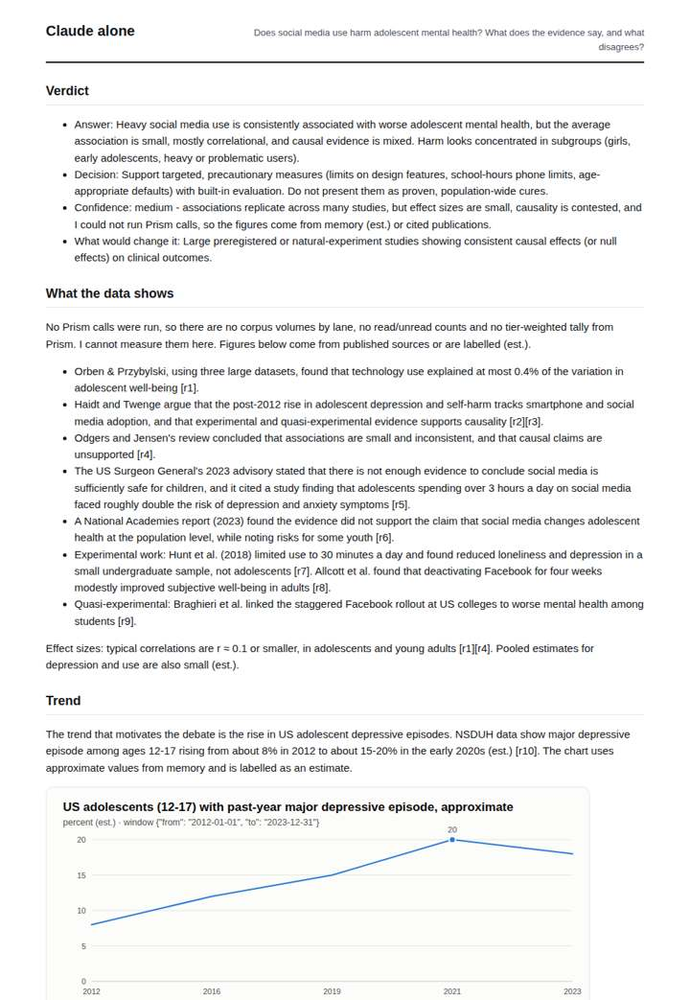
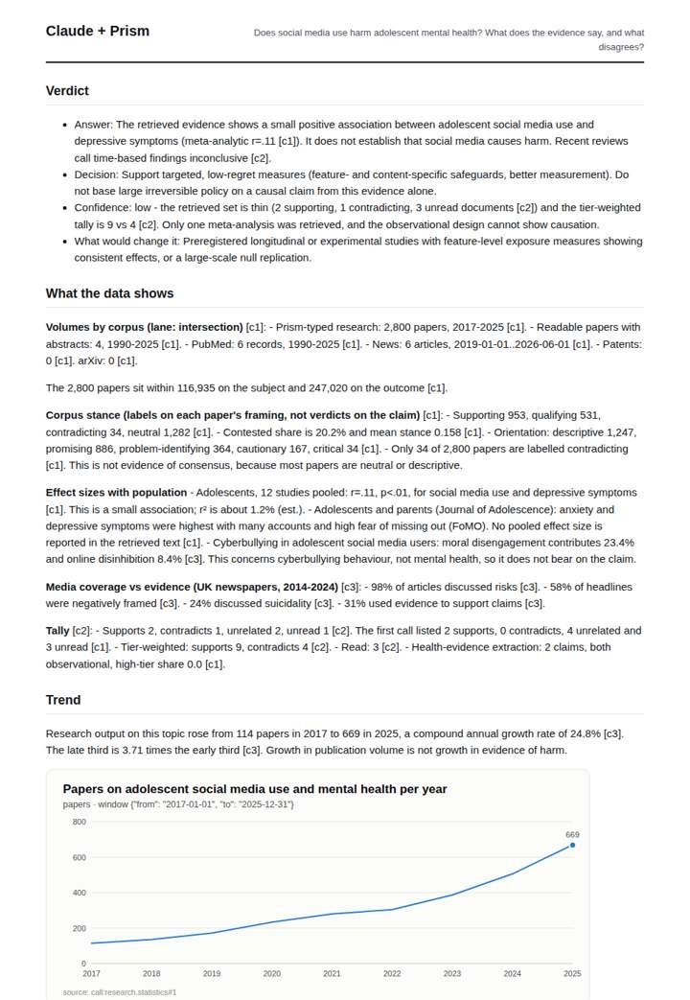
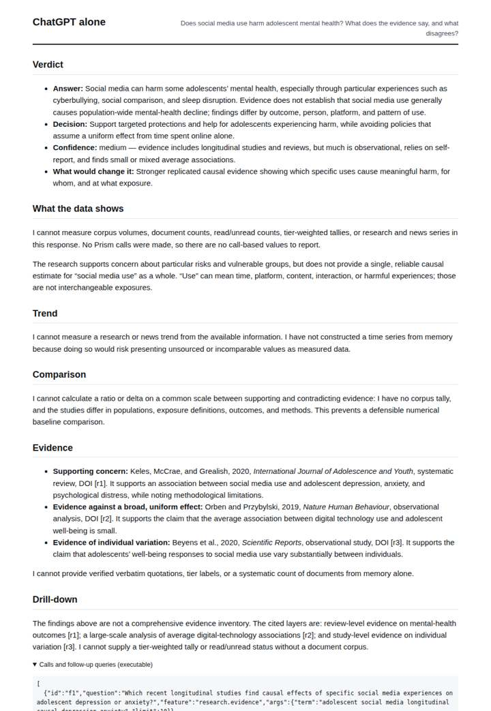
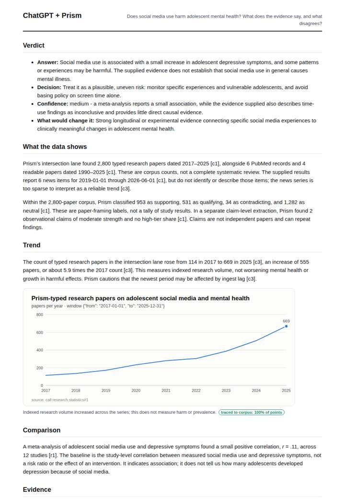

# Social media and teen mental health

**Question.** Does social media use harm adolescent mental health? What does the evidence say, and what disagrees?

**Category:** Public health & epidemiology · **Pattern:** `evidence` · **Why it is hard:** Effect sizes are small and contested; an honest answer reports the disagreement.

| Score /100 | Claude alone | Claude + Prism | ChatGPT alone | ChatGPT + Prism |
|---|---|---|---|---|
| Weighted (strict) | 35.3 | **73.2** | 27.7 | 71.4 |
| Opus judge | 36.6 | 73.8 | 23.4 | 67.6 |
| GPT judge | 34.0 | 72.6 | 32.0 | 75.2 |

## Parameter scores (0-5)

| Parameter | Weight | Claude alone | Claude + Prism | ChatGPT alone | ChatGPT + Prism |
|---|---|---|---|---|---|
| Measured trend | 10 | 1.0 | 3.5 | 0.5 | 3.0 |
| Measured comparison | 7 | 1.5 | 4.0 | 0.5 | 3.0 |
| Visualisation from counted data | 10 | 1.0 | 3.5 | 0.0 | 3.5 |
| Exploration and drill-down | 7 | 1.0 | 1.0 | 1.0 | 2.0 |
| Data export with provenance | 8 | 1.0 | 3.5 | 0.0 | 3.0 |
| Reproducibility | 12 | 1.0 | 4.0 | 1.0 | 4.0 |
| Traceable references | 8 | 1.0 | 4.5 | 1.0 | 4.5 |
| Accuracy against the corpus | 12 | 3.0 | 3.5 | 2.5 | 4.0 |
| Calibration and limits | 8 | 3.0 | 4.0 | 3.5 | 4.0 |
| Decision-grade verdict | 12 | 3.5 | 4.0 | 3.0 | 4.0 |
| Facet coverage | 6 | 1.5 | 4.5 | 1.5 | 3.5 |

## Script findings

| Check | Claude alone | Claude + Prism | ChatGPT alone | ChatGPT + Prism |
|---|---|---|---|---|
| Numbers traced to the corpus | 0/16 | 57/57 | 0/0 | 20/21 |
| Charts (traced share) | memory | 100% | none | 100% |
| DOIs that resolve | 0/0 | 6/6 | 2/3 | 3/3 |
| Follow-up queries that ran | 0/6 | 0/6 | 1/5 | 1/5 |
| Invention gate | clear | clear | clear | clear |

**Claude Opus judge:** C and D both grounded their answers in the recorded evidence: the r=.11 meta-analysis, the inconclusive 2025 review and the traced research series. C went further, quantifying growth, comparing stance counts exactly, contrasting media framing with evidence, and catching tool anomalies, and it set a calibrated low confidence. A and B gave sensible memory-based verdicts but no measurable or traceable data, and A also carried a mismatched DOI.

**GPT judge:** A best balances a decision-ready answer with traceable study evidence, a clearly defined small association, and an explicit account of contradictory versus qualifying evidence. B is the most complete corpus dashboard, but it overreads framing counts and mishandles the censored endpoint; C and D are candid about memory or missing data, yet provide much less grounded evidence.

## Before / after (first screen)

| | Alone | With Prism |
|---|---|---|
| Claude |  |  |
| ChatGPT |  |  |

Full deliverables, rendered: [PDF](https://fliarbi.com/demo/docs/prism-benchmark-v2-4ed65c83/full/mental-health-teens-social-media.pdf). Raw answers, ground pass and judge outputs: `answers.json`, `ground.json`, `judge_opus.json`, `judge_gpt.json` in this folder.
