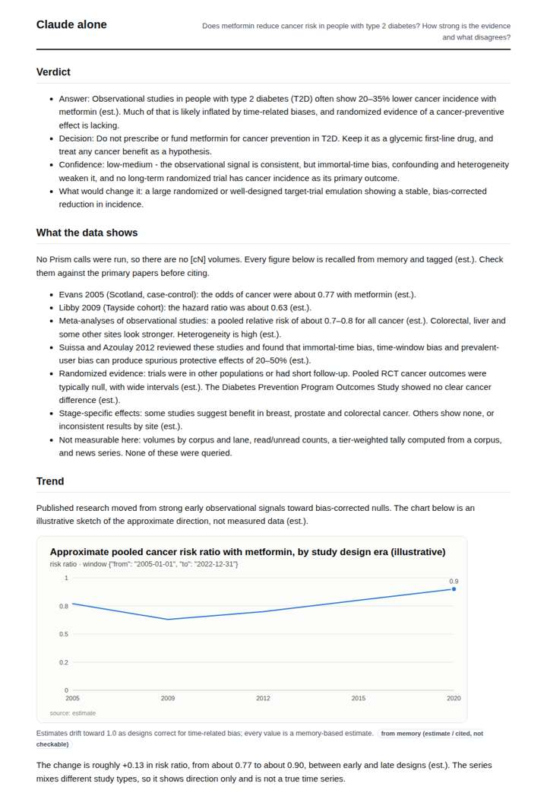
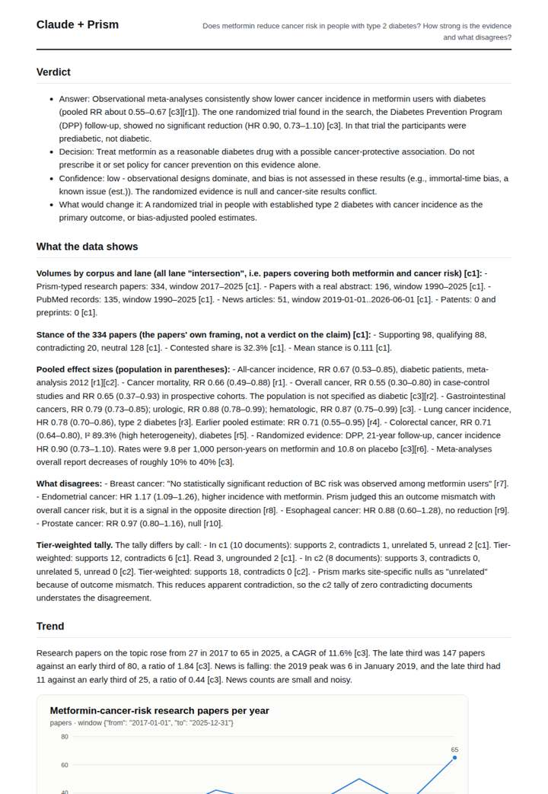
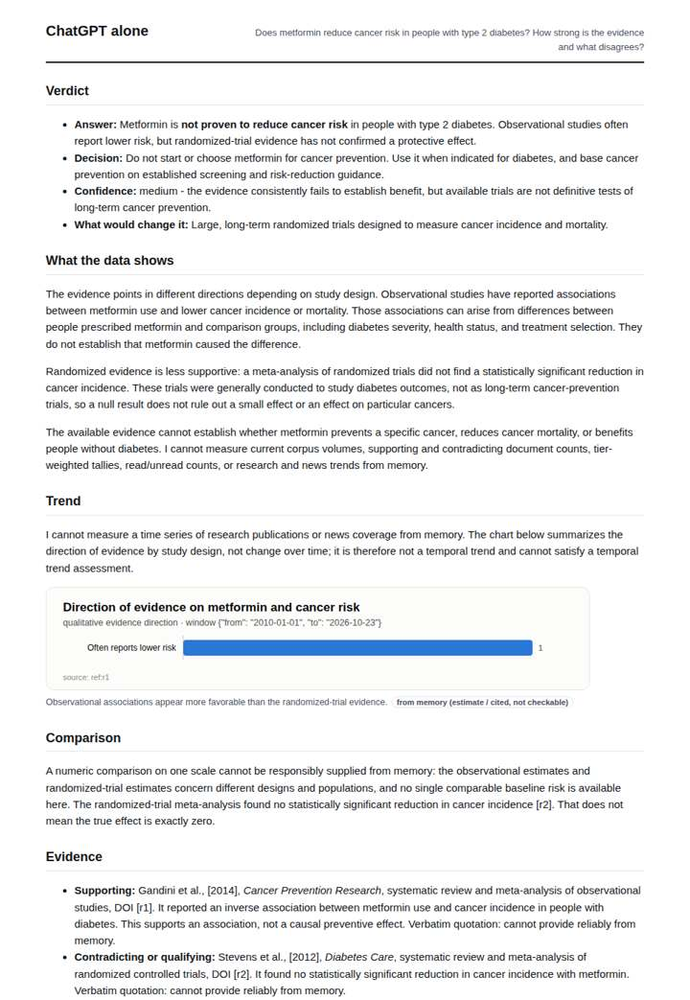
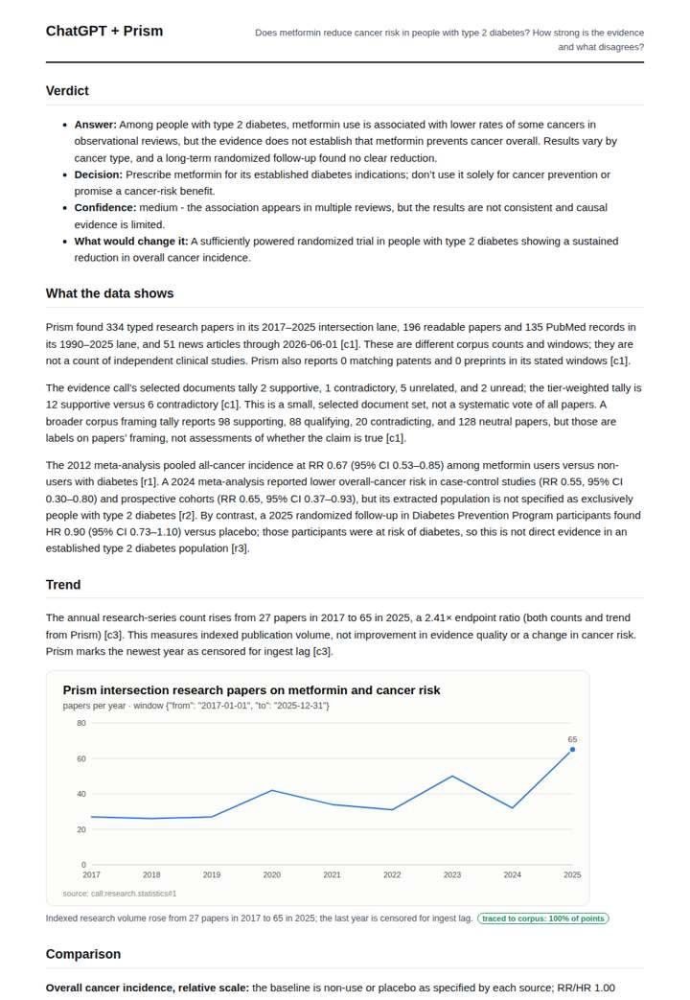

# Does metformin lower cancer risk?

**Question.** Does metformin reduce cancer risk in people with type 2 diabetes? How strong is the evidence and what disagrees?

**Category:** Medical & clinical evidence · **Pattern:** `evidence` · **Why it is hard:** Observational meta-analyses say yes; randomised trials are weaker. A good answer has to separate the two tiers.

| Score /100 | Claude alone | Claude + Prism | ChatGPT alone | ChatGPT + Prism |
|---|---|---|---|---|
| Weighted (strict) | 39.3 | 71.8 | 29.1 | **73.7** |
| Opus judge | 36.6 | 76.4 | 27.4 | 73.8 |
| GPT judge | 42.0 | 67.2 | 30.8 | 73.6 |

## Parameter scores (0-5)

| Parameter | Weight | Claude alone | Claude + Prism | ChatGPT alone | ChatGPT + Prism |
|---|---|---|---|---|---|
| Measured trend | 10 | 1.0 | 3.5 | 0.0 | 3.5 |
| Measured comparison | 7 | 2.0 | 4.5 | 1.0 | 4.0 |
| Visualisation from counted data | 10 | 1.0 | 3.5 | 0.5 | 3.5 |
| Exploration and drill-down | 7 | 1.5 | 2.5 | 0.5 | 2.5 |
| Data export with provenance | 8 | 1.0 | 3.0 | 1.0 | 3.0 |
| Reproducibility | 12 | 1.0 | 4.0 | 1.0 | 4.0 |
| Traceable references | 8 | 1.0 | 4.0 | 1.0 | 4.0 |
| Accuracy against the corpus | 12 | 3.5 | 3.5 | 2.5 | 4.0 |
| Calibration and limits | 8 | 3.5 | 3.5 | 3.0 | 4.0 |
| Decision-grade verdict | 12 | 4.0 | 3.5 | 3.5 | 4.0 |
| Facet coverage | 6 | 1.0 | 4.0 | 1.0 | 3.5 |

## Script findings

| Check | Claude alone | Claude + Prism | ChatGPT alone | ChatGPT + Prism |
|---|---|---|---|---|
| Numbers traced to the corpus | 0/23 | 95/95 | 0/0 | 59/59 |
| Charts (traced share) | memory | 100% | memory | 100% |
| DOIs that resolve | 0/0 | 11/11 | 1/2 | 4/4 |
| Follow-up queries that ran | 1/6 | 1/6 | 0/5 | 1/6 |
| Invention gate | clear | clear | clear | clear |

**Claude Opus judge:** B and C both separated the observational tier (RR about 0.55–0.67) from the randomized DPP null (HR 0.90, 0.73–1.10) with traced numbers and resolving DOIs. B went further: it surfaced the site-level contradictions (breast, endometrial, esophageal, prostate) and noted that the tool's tally hides them as 'unrelated'. A and D gave expert-sounding memory answers. D also carried an unresolvable DOI and a pseudo-numeric chart.

**GPT judge:** B best separates the observational association from the weaker randomized evidence, flags the DPP population mismatch, and gives a usable decision with traceable estimates. D is broader and supplies more site-specific counterexamples, but its claim that no established-T2D randomized trial was found exceeds what the record establishes, and its censoring account is inconsistent.

## Before / after (first screen)

| | Alone | With Prism |
|---|---|---|
| Claude |  |  |
| ChatGPT |  |  |

Full deliverables, rendered: [PDF](https://fliarbi.com/demo/docs/prism-benchmark-v2-4ed65c83/full/metformin-cancer-risk.pdf). Raw answers, ground pass and judge outputs: `answers.json`, `ground.json`, `judge_opus.json`, `judge_gpt.json` in this folder.
