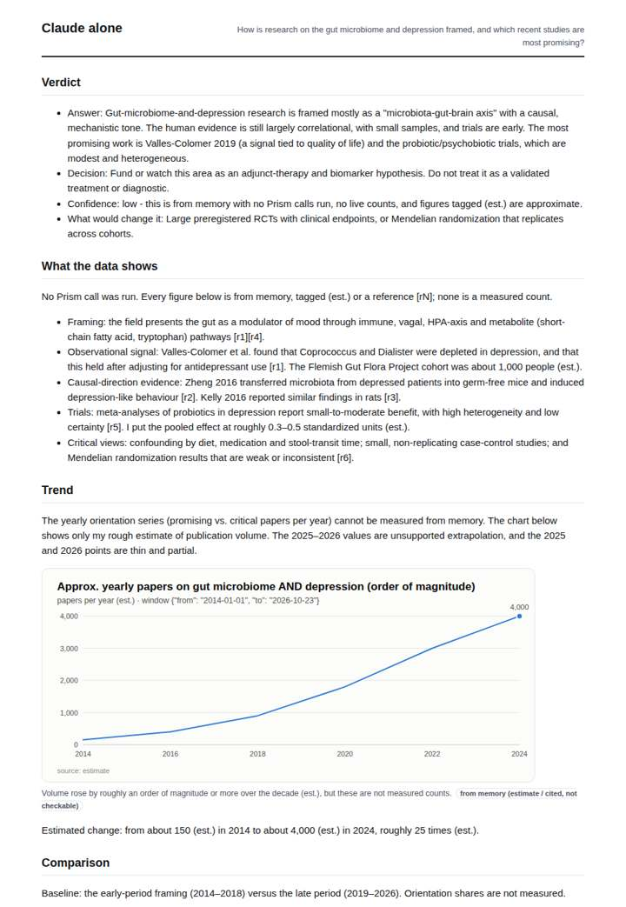
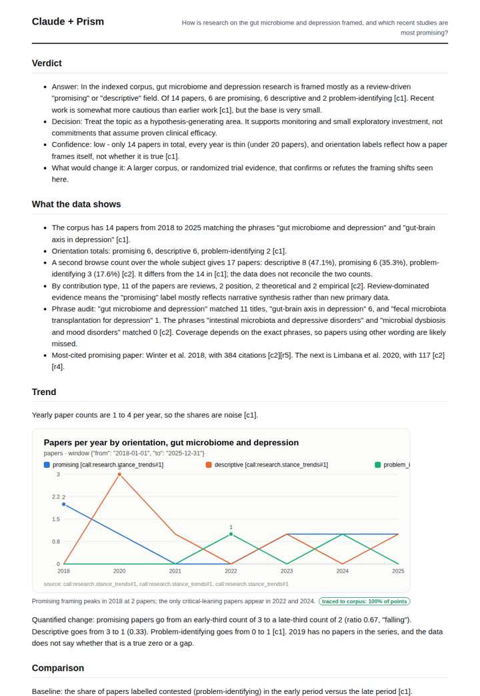
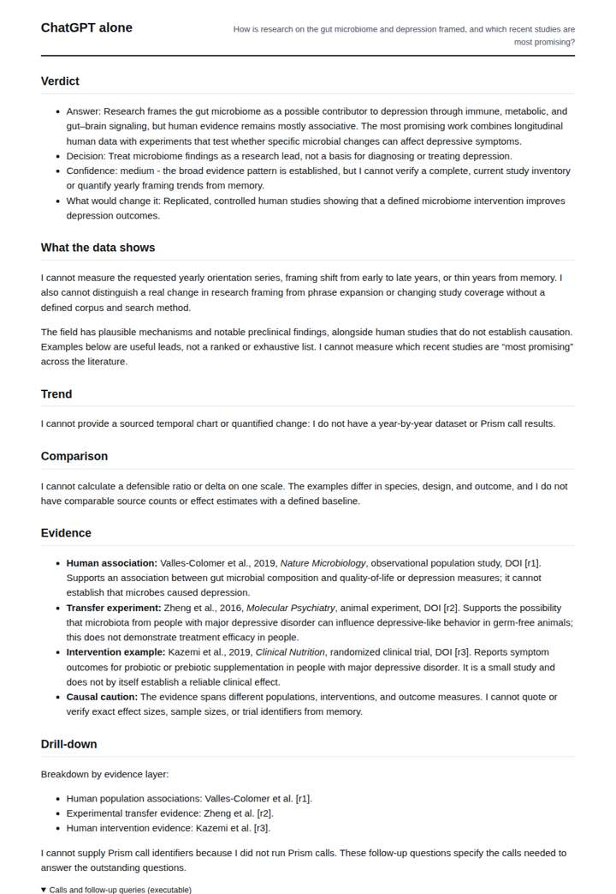
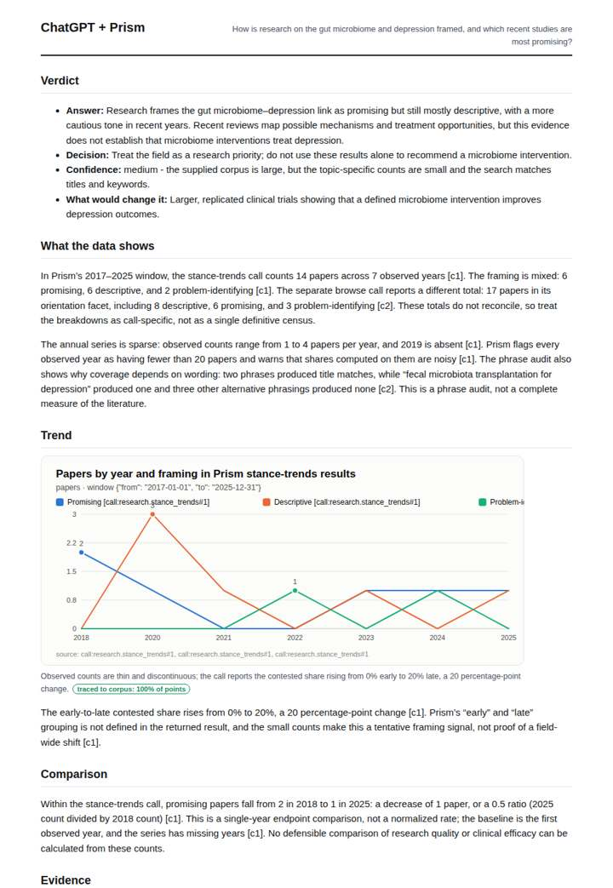

# Gut microbiome and depression literature

**Question.** How is research on the gut microbiome and depression framed, and which recent studies are most promising?

**Category:** Academic research & literature review · **Pattern:** `stance` · **Why it is hard:** Mouse studies and human cohorts share a vocabulary; stance labels separate the framings.

| Score /100 | Claude alone | Claude + Prism | ChatGPT alone | ChatGPT + Prism |
|---|---|---|---|---|
| Weighted (strict) | 36.7 | **81.5** | 35.5 | 72.9 |
| Opus judge | 32.8 | 85.4 | 29.0 | 72.2 |
| GPT judge | 40.6 | 77.6 | 42.0 | 73.6 |

## Parameter scores (0-5)

| Parameter | Weight | Claude alone | Claude + Prism | ChatGPT alone | ChatGPT + Prism |
|---|---|---|---|---|---|
| Measured trend | 10 | 1.0 | 5.0 | 0.0 | 4.5 |
| Measured comparison | 7 | 1.0 | 4.0 | 0.5 | 4.0 |
| Visualisation from counted data | 10 | 1.0 | 4.0 | 0.0 | 4.0 |
| Exploration and drill-down | 7 | 1.5 | 2.5 | 1.0 | 2.5 |
| Data export with provenance | 8 | 1.0 | 3.0 | 0.0 | 3.0 |
| Reproducibility | 12 | 1.0 | 5.0 | 1.0 | 3.0 |
| Traceable references | 8 | 3.0 | 4.0 | 4.0 | 3.5 |
| Accuracy against the corpus | 12 | 3.0 | 4.0 | 4.0 | 4.0 |
| Calibration and limits | 8 | 3.0 | 4.5 | 3.0 | 4.0 |
| Decision-grade verdict | 12 | 3.0 | 4.0 | 3.5 | 3.5 |
| Facet coverage | 6 | 1.0 | 4.0 | 1.5 | 4.0 |

## Script findings

| Check | Claude alone | Claude + Prism | ChatGPT alone | ChatGPT + Prism |
|---|---|---|---|---|
| Numbers traced to the corpus | 0/6 | 27/27 | 0/0 | 15/18 |
| Charts (traced share) | memory | 100% | none | 100% |
| DOIs that resolve | 1/1 | 5/5 | 3/3 | 4/4 |
| Follow-up queries that ran | 0/6 | 0/6 | 0/5 | 2/4 |
| Invention gate | clear | clear | clear | clear |

**Claude Opus judge:** A and D both grounded their framing analysis in the recorded calls. A was more careful: it caught the anomaly where counts did not sum to totals, placed its limits next to the numbers, kept nulls as nulls, and calibrated confidence as low. D overstated confidence on a 14-paper base. B and C, answering from memory, correctly separated mouse transfer studies from human cohorts but could not measure framing or trends; C was the most honest about this, and B offered labelled estimates.

**GPT judge:** B gives the clearest decision-grade account: it traces the framing series, quantifies the cautious shift, and links the small, review-heavy corpus to practical limits. D is close, but its chart turns absent years into zeros and its export/reproduction details are weaker; A and C rely mainly on memory or estimates.

## Before / after (first screen)

| | Alone | With Prism |
|---|---|---|
| Claude |  |  |
| ChatGPT |  |  |

Full deliverables, rendered: [PDF](https://fliarbi.com/demo/docs/prism-benchmark-v2-4ed65c83/full/microbiome-depression-stance.pdf). Raw answers, ground pass and judge outputs: `answers.json`, `ground.json`, `judge_opus.json`, `judge_gpt.json` in this folder.
