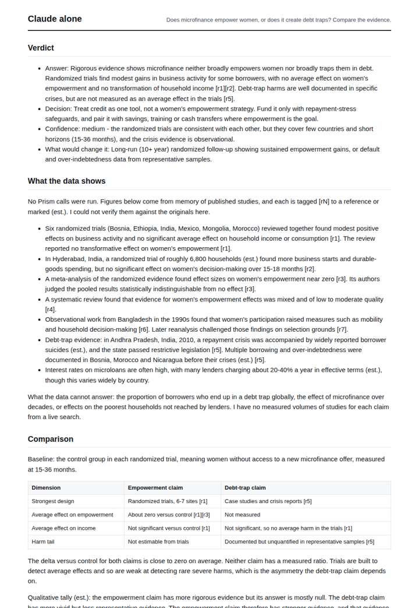
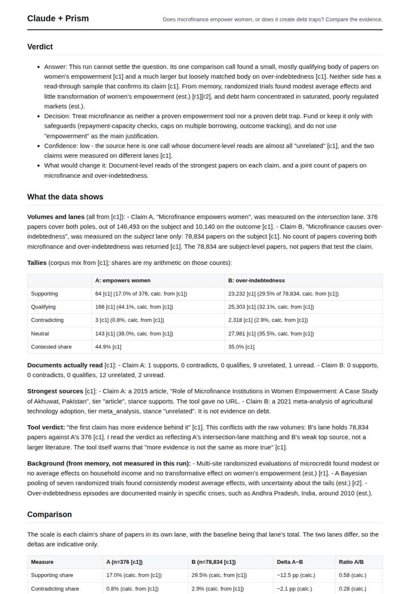
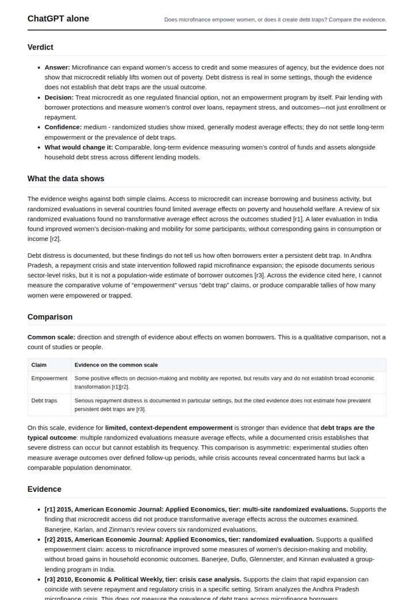
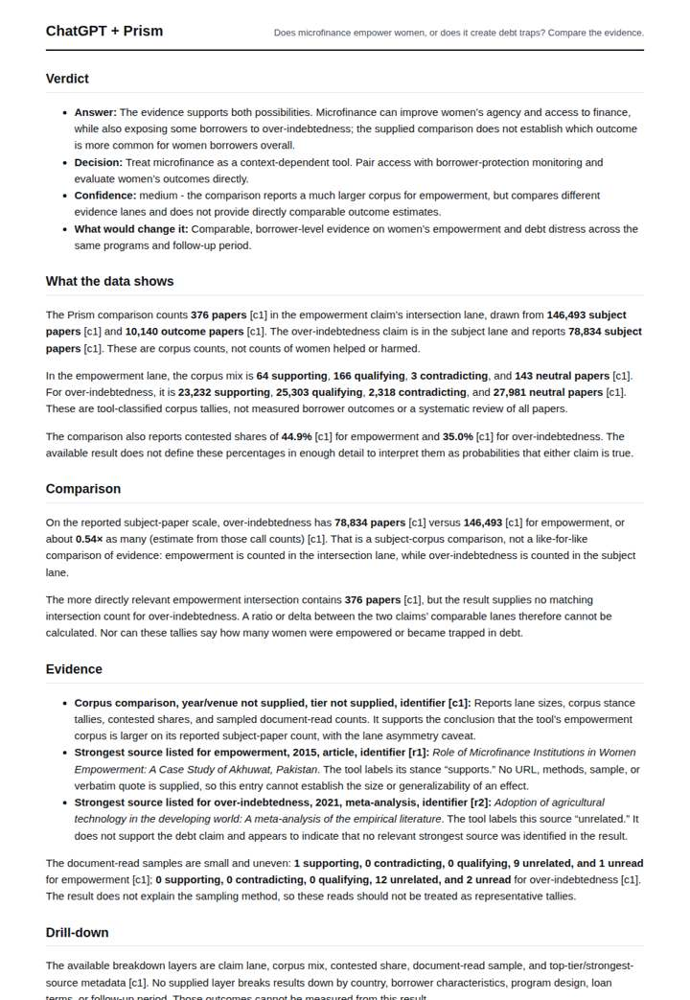

# Microfinance: empowerment or debt trap?

**Question.** Does microfinance empower women, or does it create debt traps? Compare the evidence.

**Category:** Academic research & literature review · **Pattern:** `claims` · **Why it is hard:** The 2015 RCT wave turned the consensus; both sides persist.

| Score /100 | Claude alone | Claude + Prism | ChatGPT alone | ChatGPT + Prism |
|---|---|---|---|---|
| Weighted (strict) | 21.1 | 54.9 | 37.1 | **64.8** |
| Opus judge | 23.1 | 52.7 | 26.7 | 60.7 |
| GPT judge | 19.1 | 57.1 | 47.6 | 68.9 |

## Parameter scores (0-5)

| Parameter | Weight | Claude alone | Claude + Prism | ChatGPT alone | ChatGPT + Prism |
|---|---|---|---|---|---|
| Measured comparison | 7 | 1.5 | 4.0 | 1.0 | 4.5 |
| Visualisation from counted data | 10 | 0.0 | 0.0 | 0.0 | 0.0 |
| Exploration and drill-down | 7 | 1.5 | 2.0 | 1.0 | 1.0 |
| Data export with provenance | 8 | 1.0 | 4.5 | 0.0 | 4.5 |
| Reproducibility | 12 | 0.0 | 3.0 | 1.0 | 4.5 |
| Traceable references | 8 | 1.5 | 2.5 | 3.5 | 2.5 |
| Accuracy against the corpus | 12 | 2.0 | 2.0 | 2.5 | 4.0 |
| Calibration and limits | 8 | 3.0 | 4.0 | 4.0 | 4.0 |
| Decision-grade verdict | 12 | 0.0 | 3.0 | 3.5 | 3.5 |
| Facet coverage | 6 | 1.0 | 3.5 | 1.5 | 3.5 |

## Script findings

| Check | Claude alone | Claude + Prism | ChatGPT alone | ChatGPT + Prism |
|---|---|---|---|---|
| Numbers traced to the corpus | 0/11 | 39/49 | 0/1 | 18/18 |
| Charts (traced share) | none | 25% | none | none |
| DOIs that resolve | 4/4 | 3/3 | 2/2 | 1/1 |
| Follow-up queries that ran | 1/5 | 0/6 | 0/4 | 0/3 |
| Invention gate | tripped | clear | clear | clear |

**Claude Opus judge:** C was the only deliverable that kept every number traced and on the correct lane. It flagged the off-topic strongest source and the undefined contested share, and it gave a clean, provenance-backed export. D did more comparative arithmetic but mixed the intersection and subject lanes in its headline reading. The memory-only answers (A, B) could not measure anything, and B misreported a key RCT.

**GPT judge:** B is the strongest decision aid: it preserves the recorded corpus counts and provenance, calculates the limited same-scale comparison, and clearly explains why those counts cannot decide borrower outcomes. D offers richer calculations and a chart, but mixes incompatible lanes and adds unverified memory claims; A is careful but largely unmeasured, while C overstates unverified specifics.

## Before / after (first screen)

| | Alone | With Prism |
|---|---|---|
| Claude |  |  |
| ChatGPT |  |  |

Full deliverables, rendered: [PDF](https://fliarbi.com/demo/docs/prism-benchmark-v2-4ed65c83/full/microfinance-claims.pdf). Raw answers, ground pass and judge outputs: `answers.json`, `ground.json`, `judge_opus.json`, `judge_gpt.json` in this folder.
