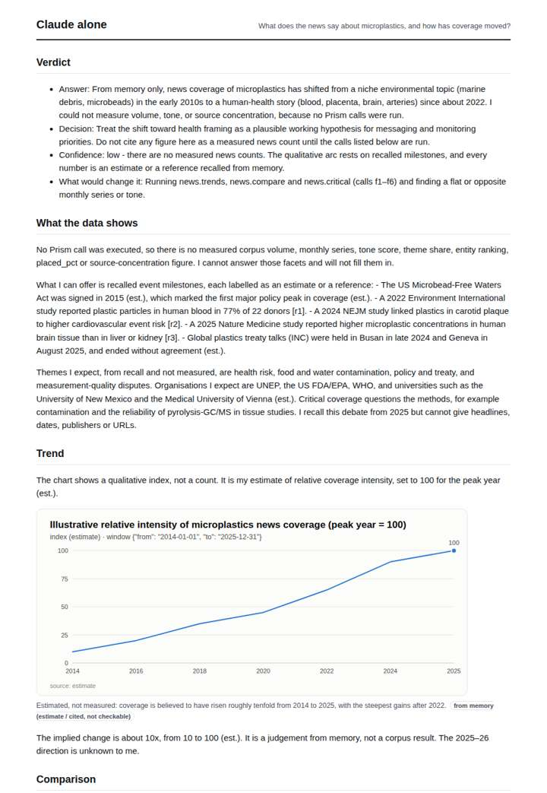
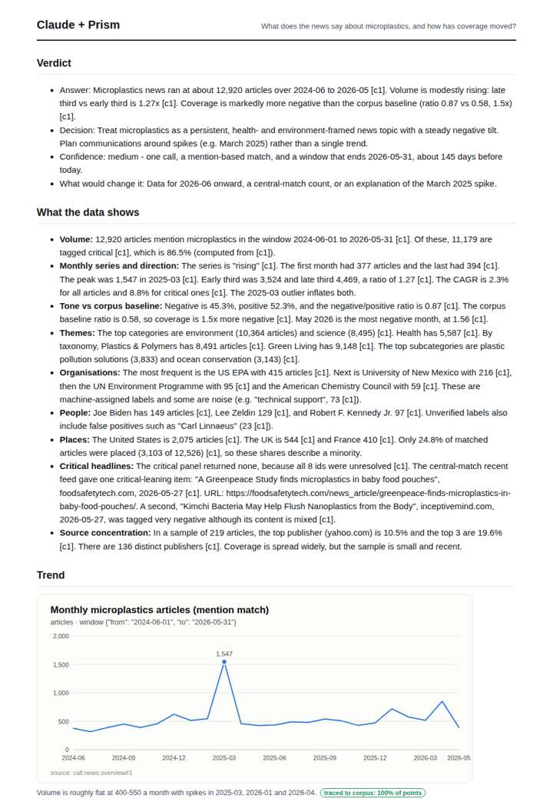
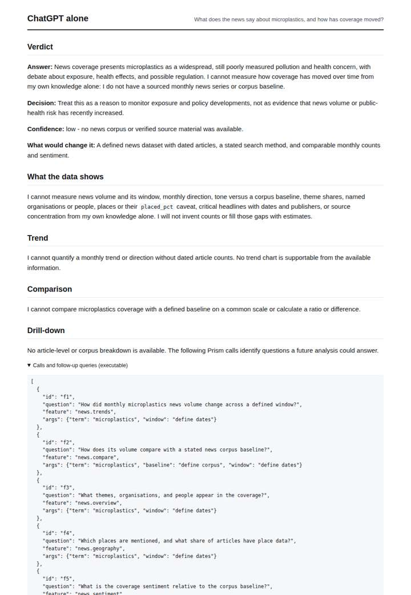
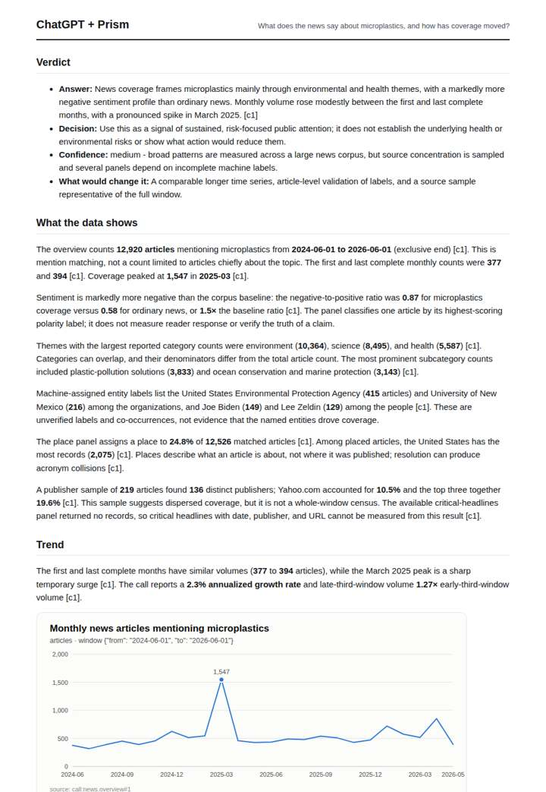

# Microplastics in the news

**Question.** What does the news say about microplastics, and how has coverage moved?

**Category:** Environment & disasters · **Pattern:** `pulse` · **Why it is hard:** Human-tissue studies (brain, placenta) drove 2024-2025 spikes.

| Score /100 | Claude alone | Claude + Prism | ChatGPT alone | ChatGPT + Prism |
|---|---|---|---|---|
| Weighted (strict) | 38.7 | **73.4** | 24.4 | 70.6 |
| Opus judge | 38.4 | 70.4 | 19.0 | 65.6 |
| GPT judge | 39.0 | 76.4 | 29.8 | 75.6 |

## Parameter scores (0-5)

| Parameter | Weight | Claude alone | Claude + Prism | ChatGPT alone | ChatGPT + Prism |
|---|---|---|---|---|---|
| Measured trend | 10 | 1.0 | 4.5 | 0.0 | 4.5 |
| Measured comparison | 7 | 1.0 | 4.5 | 0.0 | 4.5 |
| Visualisation from counted data | 10 | 1.0 | 4.0 | 0.0 | 3.0 |
| Exploration and drill-down | 7 | 1.5 | 2.5 | 1.0 | 2.5 |
| Data export with provenance | 8 | 1.0 | 3.0 | 0.0 | 3.0 |
| Reproducibility | 12 | 1.0 | 4.5 | 1.0 | 4.5 |
| Traceable references | 8 | 3.0 | 2.0 | 0.5 | 0.5 |
| Accuracy against the corpus | 12 | 3.5 | 3.5 | 3.5 | 4.0 |
| Calibration and limits | 8 | 3.5 | 3.5 | 3.0 | 3.0 |
| Decision-grade verdict | 12 | 3.0 | 3.5 | 2.5 | 4.0 |
| Facet coverage | 6 | 1.0 | 4.5 | 0.5 | 4.5 |

## Script findings

| Check | Claude alone | Claude + Prism | ChatGPT alone | ChatGPT + Prism |
|---|---|---|---|---|
| Numbers traced to the corpus | 0/6 | 67/67 | 0/0 | 33/33 |
| Charts (traced share) | memory | 100% | none | 100% |
| DOIs that resolve | 3/3 | 0/0 | 0/0 | 0/0 |
| Follow-up queries that ran | 2/6 | 1/6 | 0/6 | 2/4 |
| Invention gate | clear | clear | clear | clear |

**Claude Opus judge:** B and C both traced the full monthly series, the 2025-03 peak and the 1.5x negativity versus baseline. C went further with the critical-versus-total decomposition, news items with URLs, and caught anomalies such as noisy entity labels and the undefined 'critical' flag, though it mis-stated what the March outlier inflates. A was an honest memory answer with real DOIs but measured nothing, and D was an honest blank.

**GPT judge:** C and D provide the only fully traced movement series and baseline tone comparison, so they support a decision about how coverage moved rather than offering a memory-based narrative. D is the stronger decision brief because it defines the tone baseline, explains the data limits, and treats the empty critical-headline result as contrary evidence; its main weakness is calling the final month complete.

## Before / after (first screen)

| | Alone | With Prism |
|---|---|---|
| Claude |  |  |
| ChatGPT |  |  |

Full deliverables, rendered: [PDF](https://fliarbi.com/demo/docs/prism-benchmark-v2-4ed65c83/full/microplastics-pulse.pdf). Raw answers, ground pass and judge outputs: `answers.json`, `ground.json`, `judge_opus.json`, `judge_gpt.json` in this folder.
