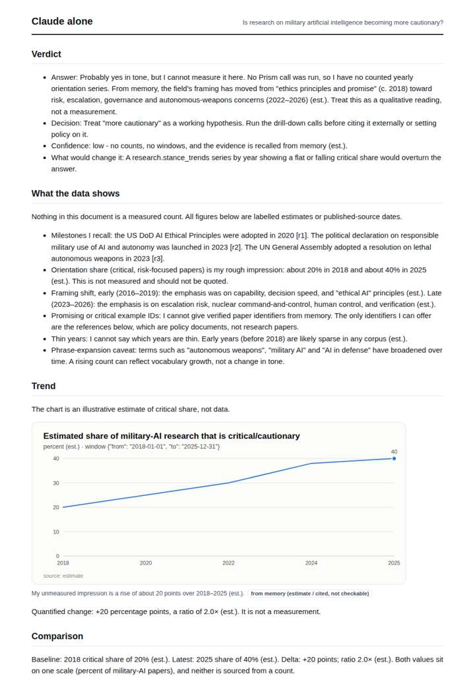
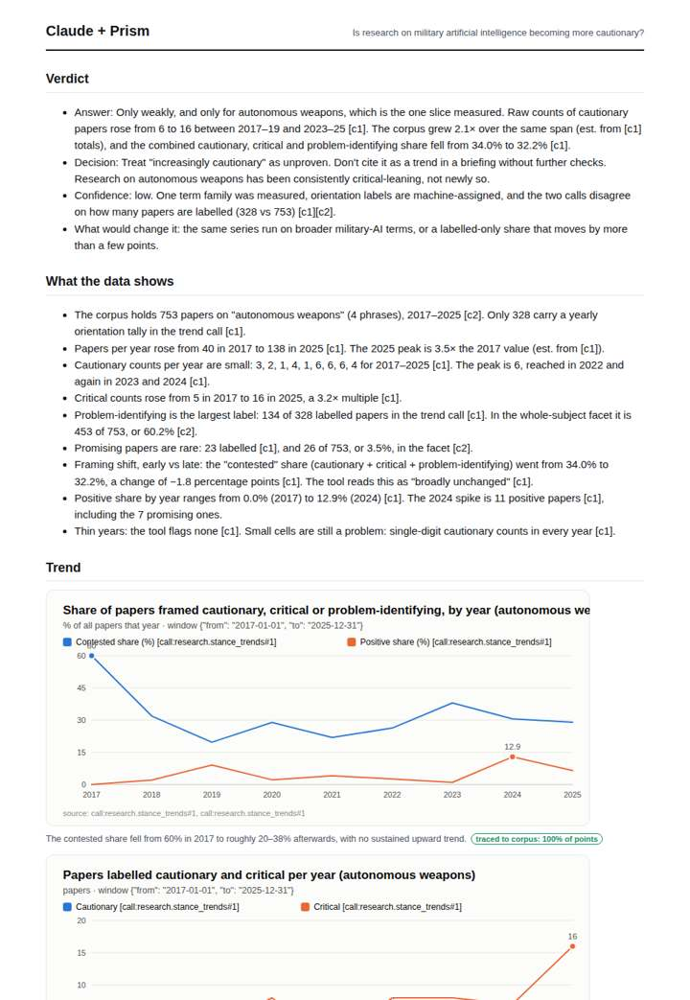
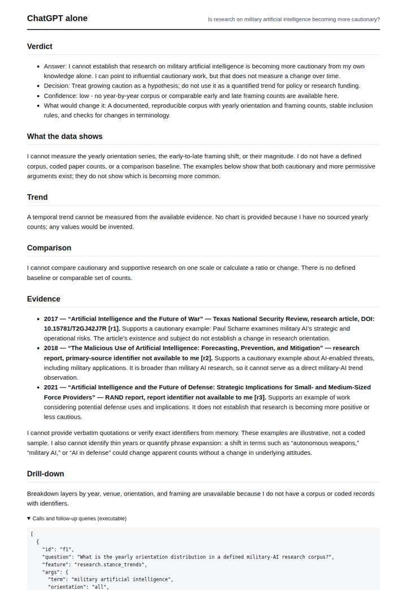
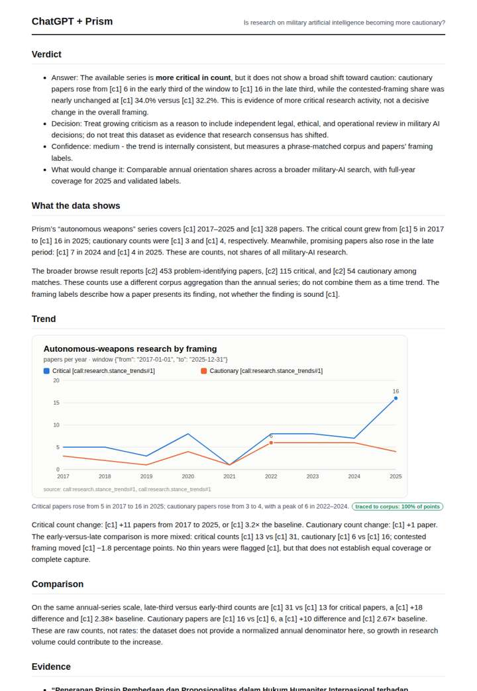

# Military AI research framing

**Question.** Is research on military artificial intelligence becoming more cautionary?

**Category:** Defence & geopolitics · **Pattern:** `stance` · **Why it is hard:** Autonomy debates produce a large critical literature.

| Score /100 | Claude alone | Claude + Prism | ChatGPT alone | ChatGPT + Prism |
|---|---|---|---|---|
| Weighted (strict) | 33.0 | **73.6** | 18.2 | 72.8 |
| Opus judge | 31.8 | 79.2 | 14.6 | 71.2 |
| GPT judge | 34.2 | 68.0 | 21.8 | 74.4 |

## Parameter scores (0-5)

| Parameter | Weight | Claude alone | Claude + Prism | ChatGPT alone | ChatGPT + Prism |
|---|---|---|---|---|---|
| Measured trend | 10 | 1.0 | 4.0 | 0.0 | 4.0 |
| Measured comparison | 7 | 1.0 | 4.0 | 0.0 | 4.5 |
| Visualisation from counted data | 10 | 1.0 | 3.5 | 0.0 | 3.5 |
| Exploration and drill-down | 7 | 2.0 | 4.0 | 1.0 | 3.5 |
| Data export with provenance | 8 | 1.0 | 1.0 | 0.0 | 3.0 |
| Reproducibility | 12 | 1.0 | 4.0 | 1.0 | 3.5 |
| Traceable references | 8 | 1.0 | 3.5 | 0.0 | 3.0 |
| Accuracy against the corpus | 12 | 3.0 | 3.5 | 1.0 | 3.5 |
| Calibration and limits | 8 | 3.0 | 4.5 | 3.0 | 4.0 |
| Decision-grade verdict | 12 | 2.5 | 4.0 | 2.5 | 4.0 |
| Facet coverage | 6 | 1.0 | 4.5 | 1.0 | 3.5 |

## Script findings

| Check | Claude alone | Claude + Prism | ChatGPT alone | ChatGPT + Prism |
|---|---|---|---|---|
| Numbers traced to the corpus | 0/9 | 77/82 | 0/1 | 27/28 |
| Charts (traced share) | memory | 100%, 100% | none | 100% |
| DOIs that resolve | 0/0 | 7/7 | 0/1 | 3/3 |
| Follow-up queries that ran | 4/6 | 5/6 | 1/4 | 5/5 |
| Invention gate | clear | clear | clear | clear |

**Claude Opus judge:** D was the only deliverable to turn counts into shares on a common denominator. Doing so showed that rising cautionary counts mostly track corpus growth, which directly answers the question. D also caught the data's own anomalies (the 328 vs 753 mismatch and unlabelled early rows). C traced its numbers well but stopped at raw counts and wrongly claimed shares were unavailable. A was honest about using memory, but B offered no answer and likely invalid references.

**GPT judge:** A is the strongest decision aid: it separates rising critical and cautionary counts from the nearly unchanged contested framing and states what the evidence can support. B adds useful comparisons and drill-down, but its count interpretation and mismatched share presentation weaken confidence; both database-backed answers miss the 328-versus-753 internal anomaly.

## Before / after (first screen)

| | Alone | With Prism |
|---|---|---|
| Claude |  |  |
| ChatGPT |  |  |

Full deliverables, rendered: [PDF](https://fliarbi.com/demo/docs/prism-benchmark-v2-4ed65c83/full/military-ai-stance.pdf). Raw answers, ground pass and judge outputs: `answers.json`, `ground.json`, `judge_opus.json`, `judge_gpt.json` in this folder.
