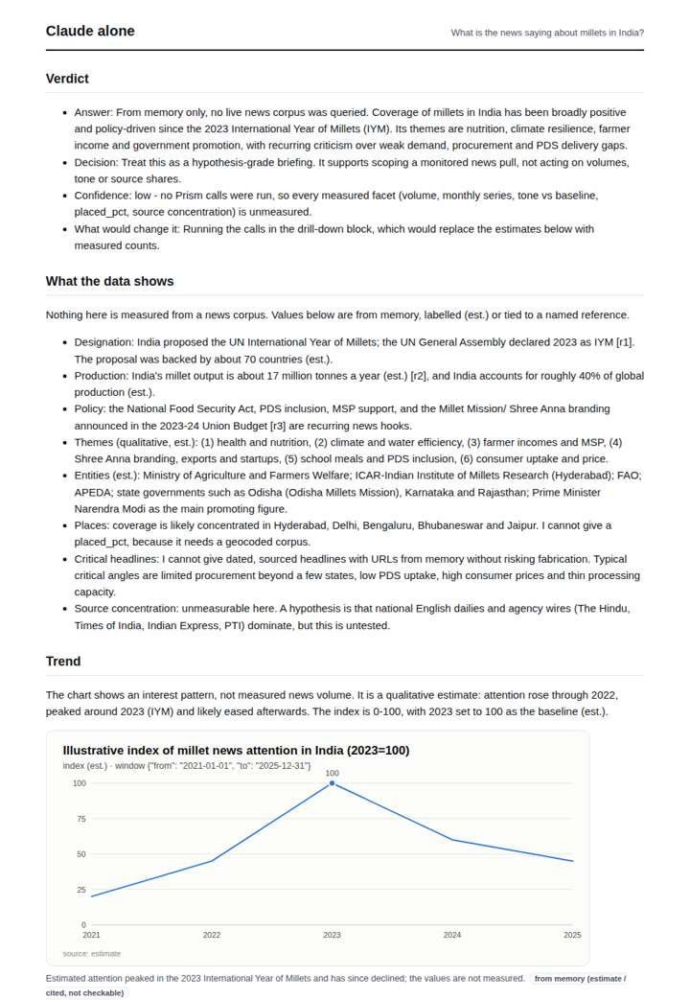
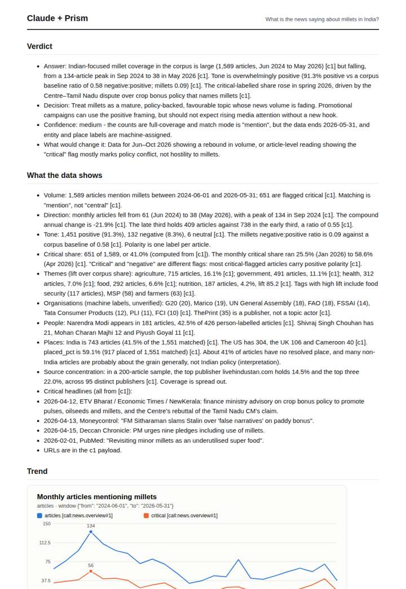
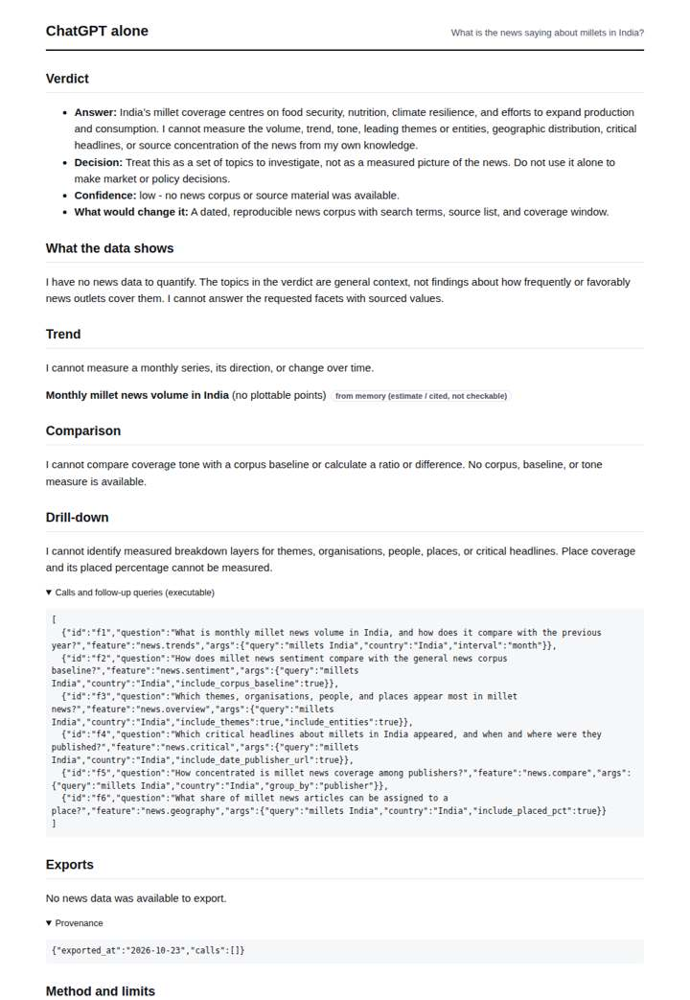
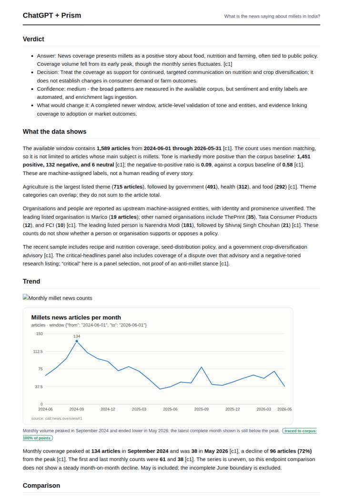

# Millets in Indian news

**Question.** What is the news saying about millets in India?

**Category:** Agriculture & food security · **Pattern:** `pulse` · **Why it is hard:** International Year of Millets 2023 created a spike; what remains after?

| Score /100 | Claude alone | Claude + Prism | ChatGPT alone | ChatGPT + Prism |
|---|---|---|---|---|
| Weighted (strict) | 37.3 | 71.5 | 28.3 | **73.3** |
| Opus judge | 30.4 | 70.6 | 20.6 | 65.0 |
| GPT judge | 44.2 | 72.4 | 36.0 | 81.6 |

## Parameter scores (0-5)

| Parameter | Weight | Claude alone | Claude + Prism | ChatGPT alone | ChatGPT + Prism |
|---|---|---|---|---|---|
| Measured trend | 10 | 1.0 | 5.0 | 0.5 | 4.0 |
| Measured comparison | 7 | 1.5 | 4.5 | 0.5 | 4.5 |
| Visualisation from counted data | 10 | 1.0 | 4.5 | 0.5 | 3.5 |
| Exploration and drill-down | 7 | 2.0 | 1.0 | 1.0 | 4.0 |
| Data export with provenance | 8 | 1.0 | 3.0 | 0.0 | 4.0 |
| Reproducibility | 12 | 1.0 | 5.0 | 1.0 | 4.5 |
| Traceable references | 8 | 1.5 | 1.0 | 0.5 | 1.0 |
| Accuracy against the corpus | 12 | 3.0 | 3.0 | 3.5 | 3.5 |
| Calibration and limits | 8 | 4.0 | 4.5 | 3.0 | 3.0 |
| Decision-grade verdict | 12 | 3.0 | 3.0 | 3.0 | 4.0 |
| Facet coverage | 6 | 1.0 | 4.0 | 0.5 | 4.0 |

## Script findings

| Check | Claude alone | Claude + Prism | ChatGPT alone | ChatGPT + Prism |
|---|---|---|---|---|
| Numbers traced to the corpus | 0/9 | 92/92 | 0/0 | 35/35 |
| Charts (traced share) | memory | 100% | memory | 100% |
| DOIs that resolve | 0/0 | 0/0 | 0/0 | 0/0 |
| Follow-up queries that ran | 3/6 | 0/6 | 0/6 | 3/6 |
| Invention gate | clear | clear | clear | clear |

**Claude Opus judge:** C gave the decision-maker the most usable picture. It shows volume falling (CAGR -21.9%, late/early 0.55) with the critical share decomposed, tone set against a defined baseline, and limits placed next to the numbers, including the five unmeasured months. Its weak points are failing follow-ups and an unlinked headline layer. B is cleanly traced but thinner: one series, no critical or CAGR reading. A and D answered honestly from no data or memory and cannot support a decision.

**GPT judge:** C is the strongest decision brief: it gives a traceable trend, a grounded tone comparison, useful breakdowns, and a reproducible export while distinguishing news coverage from adoption or outcomes. B has fuller trend decomposition, but its unsupported causal account and failed follow-ups weaken its decision value; C’s main gaps are the missing trend CAGR and incomplete placement of data limits.

## Before / after (first screen)

| | Alone | With Prism |
|---|---|---|
| Claude |  |  |
| ChatGPT |  |  |

Full deliverables, rendered: [PDF](https://fliarbi.com/demo/docs/prism-benchmark-v2-4ed65c83/full/millets-india-pulse.pdf). Raw answers, ground pass and judge outputs: `answers.json`, `ground.json`, `judge_opus.json`, `judge_gpt.json` in this folder.
