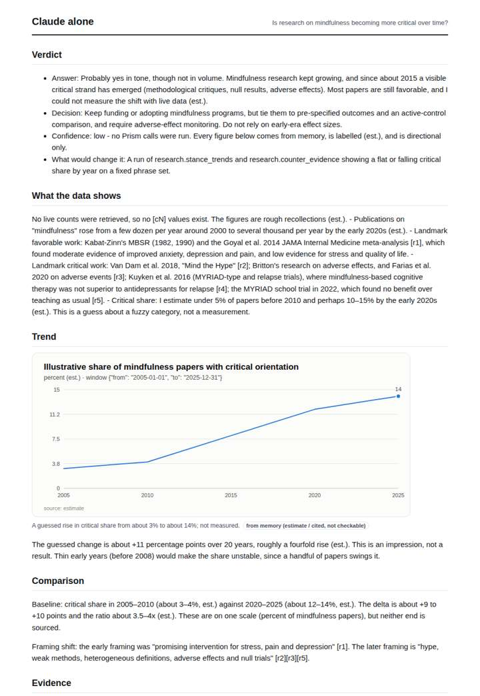
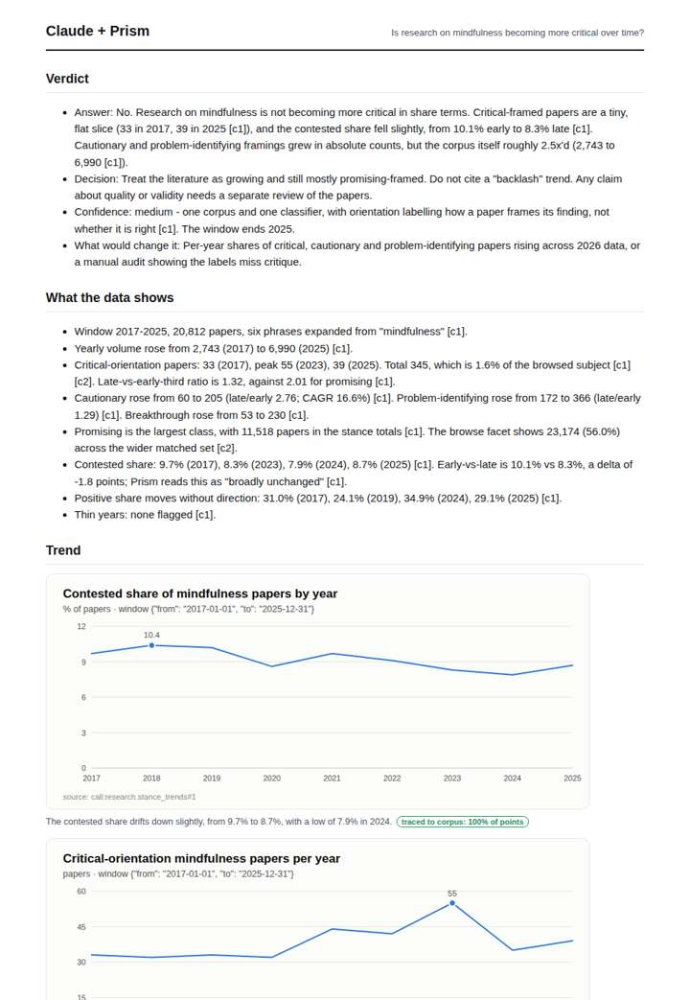
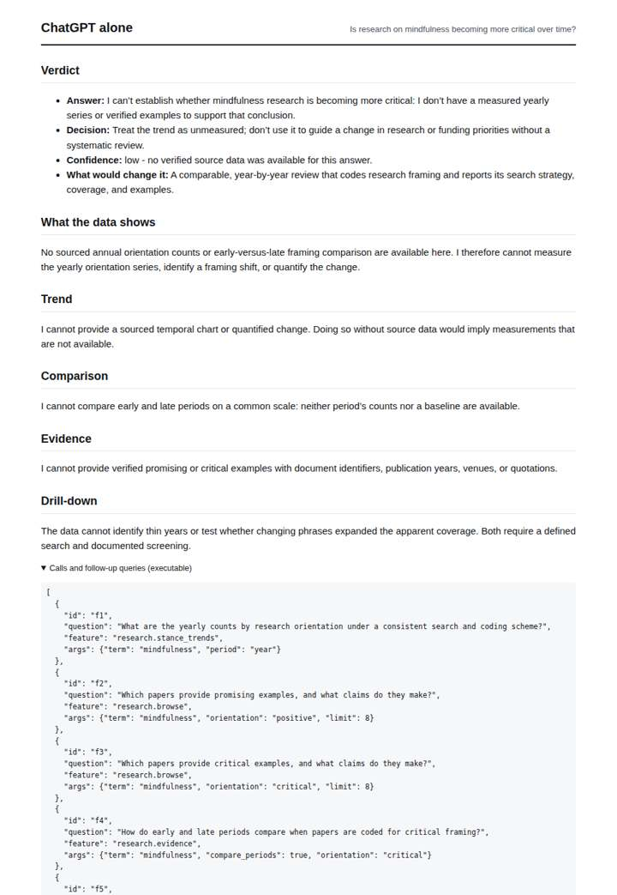
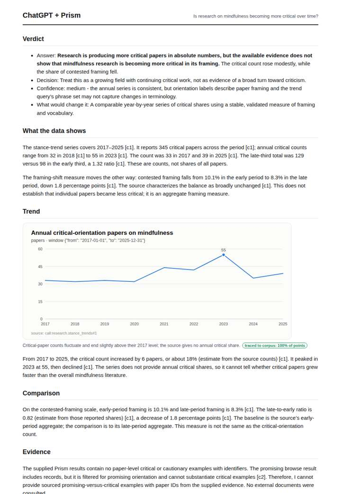

# Mindfulness research framing

**Question.** Is research on mindfulness becoming more critical over time?

**Category:** Academic research & literature review · **Pattern:** `stance` · **Why it is hard:** Replication critiques after 2017 should show.

| Score /100 | Claude alone | Claude + Prism | ChatGPT alone | ChatGPT + Prism |
|---|---|---|---|---|
| Weighted (strict) | 30.6 | **78.2** | 24.8 | 69.8 |
| Opus judge | 24.8 | 75.0 | 16.6 | 65.0 |
| GPT judge | 36.4 | 81.4 | 33.0 | 74.6 |

## Parameter scores (0-5)

| Parameter | Weight | Claude alone | Claude + Prism | ChatGPT alone | ChatGPT + Prism |
|---|---|---|---|---|---|
| Measured trend | 10 | 1.0 | 5.0 | 0.0 | 4.0 |
| Measured comparison | 7 | 1.5 | 4.0 | 0.0 | 4.5 |
| Visualisation from counted data | 10 | 1.0 | 4.5 | 0.0 | 3.0 |
| Exploration and drill-down | 7 | 1.5 | 4.0 | 1.0 | 3.5 |
| Data export with provenance | 8 | 1.0 | 3.0 | 0.0 | 3.5 |
| Reproducibility | 12 | 0.0 | 4.0 | 1.0 | 4.0 |
| Traceable references | 8 | 2.5 | 3.5 | 0.5 | 0.5 |
| Accuracy against the corpus | 12 | 2.0 | 3.0 | 4.0 | 3.5 |
| Calibration and limits | 8 | 3.0 | 4.0 | 2.5 | 4.0 |
| Decision-grade verdict | 12 | 2.5 | 4.0 | 2.5 | 4.0 |
| Facet coverage | 6 | 1.0 | 4.0 | 0.5 | 3.5 |

## Script findings

| Check | Claude alone | Claude + Prism | ChatGPT alone | ChatGPT + Prism |
|---|---|---|---|---|
| Numbers traced to the corpus | 0/12 | 76/78 | 0/0 | 19/19 |
| Charts (traced share) | memory | 100%, 100% | none | 100% |
| DOIs that resolve | 2/2 | 4/4 | 0/0 | 0/0 |
| Follow-up queries that ran | 3/6 | 5/6 | 2/5 | 4/4 |
| Invention gate | clear | clear | clear | clear |

**Claude Opus judge:** C decomposed the measured series: critical share fell from 1.2% to 0.6% while total volume grew about 2.5x, and contested share fell from 10.1% to 8.3%. It also tied paper IDs and specific limits to its 'not more critical' answer. B reached the same reading but did not use the yearly totals it had. D's memory-based 'probably yes' contradicts the record, and A gave no answer.

**GPT judge:** C gives the strongest decision-grade account: it traces the annual series, compares framing shares and orientation growth, and lays out relevant limits. Its denominator mix-up and unsupported coverage claims keep it below a clean expert-ready result; B is more cautious but leaves the supported framing comparison out of its chart and export.

## Before / after (first screen)

| | Alone | With Prism |
|---|---|---|
| Claude |  |  |
| ChatGPT |  |  |

Full deliverables, rendered: [PDF](https://fliarbi.com/demo/docs/prism-benchmark-v2-4ed65c83/full/mindfulness-stance.pdf). Raw answers, ground pass and judge outputs: `answers.json`, `ground.json`, `judge_opus.json`, `judge_gpt.json` in this folder.
