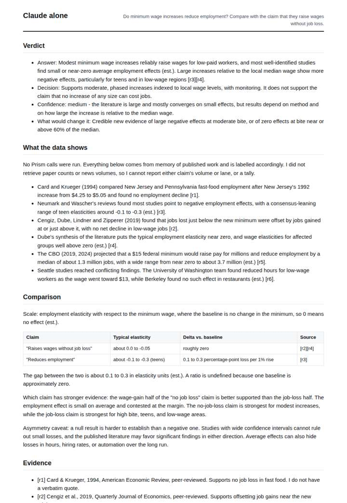
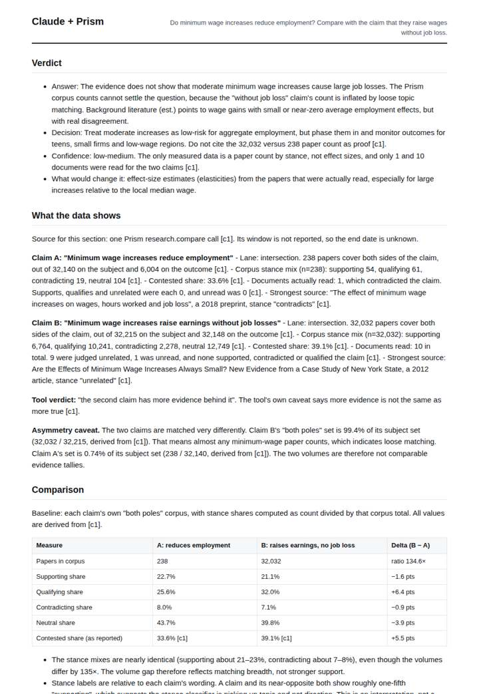
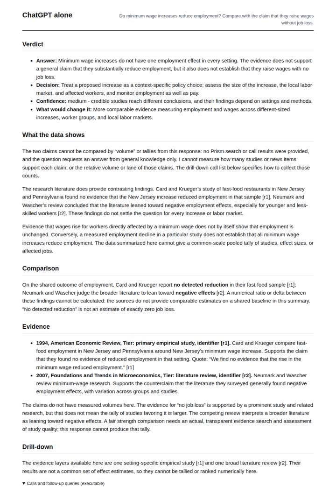
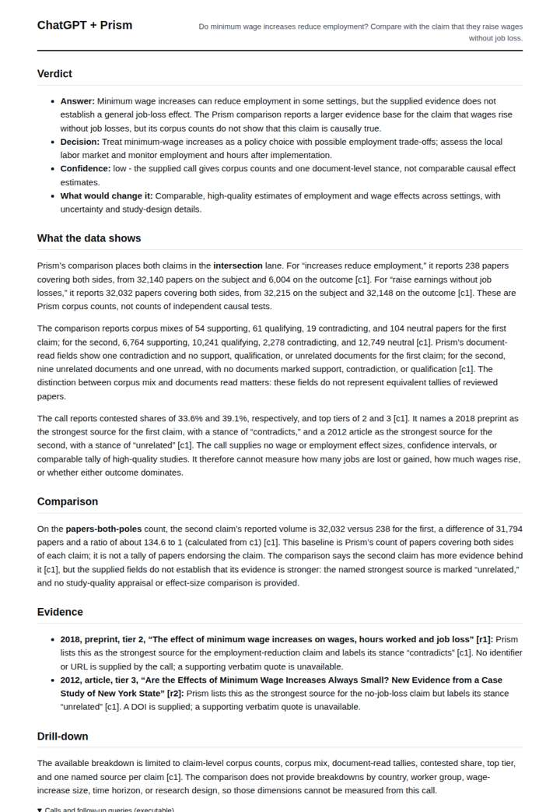

# Minimum wage and jobs

**Question.** Do minimum wage increases reduce employment? Compare with the claim that they raise wages without job loss.

**Category:** Policy & regulation · **Pattern:** `claims` · **Why it is hard:** The literature is genuinely split; tier-weighting is the whole answer.

| Score /100 | Claude alone | Claude + Prism | ChatGPT alone | ChatGPT + Prism |
|---|---|---|---|---|
| Weighted (strict) | 26.0 | **69.3** | 32.3 | 64.8 |
| Opus judge | 22.9 | 72.0 | 24.9 | 54.9 |
| GPT judge | 29.1 | 66.7 | 39.8 | 74.7 |

## Parameter scores (0-5)

| Parameter | Weight | Claude alone | Claude + Prism | ChatGPT alone | ChatGPT + Prism |
|---|---|---|---|---|---|
| Measured comparison | 7 | 2.0 | 5.0 | 1.0 | 4.5 |
| Visualisation from counted data | 10 | 0.0 | 0.0 | 0.0 | 0.0 |
| Exploration and drill-down | 7 | 1.0 | 3.0 | 1.5 | 1.0 |
| Data export with provenance | 8 | 1.0 | 4.5 | 0.0 | 4.5 |
| Reproducibility | 12 | 1.0 | 3.0 | 1.0 | 4.5 |
| Traceable references | 8 | 1.0 | 1.5 | 1.0 | 2.0 |
| Accuracy against the corpus | 12 | 2.0 | 4.5 | 2.5 | 3.0 |
| Calibration and limits | 8 | 4.0 | 5.0 | 3.0 | 4.5 |
| Decision-grade verdict | 12 | 0.0 | 4.5 | 3.5 | 4.0 |
| Facet coverage | 6 | 2.0 | 4.0 | 2.0 | 4.5 |

## Script findings

| Check | Claude alone | Claude + Prism | ChatGPT alone | ChatGPT + Prism |
|---|---|---|---|---|
| Numbers traced to the corpus | 0/18 | 45/53 | 0/0 | 20/20 |
| Charts (traced share) | none | 50% | none | none |
| DOIs that resolve | 0/0 | 1/1 | 1/2 | 1/1 |
| Follow-up queries that ran | 0/6 | 1/6 | 2/7 | 0/4 |
| Invention gate | tripped | clear | clear | clear |

**Claude Opus judge:** A was the only deliverable that used the measured record to read its own instrument. It normalised the stance mixes, showed that claim B's 32,032 count is a matching artifact (99.4% of its subject set), and turned that into the decision rule 'do not cite the count as proof', with every derived number recomputing exactly. B traced cleanly but stopped at the headline ratio and misread tier fields. C and D answered from memory, C with a likely fabricated DOI and a misquote, and D with an untagged threshold in its verdict.

**GPT judge:** C is strongest for a decision-maker because its comparisons, exports, and numerical claims are reproducible and it clearly separates corpus volume from causal evidence. Its missing chart, weak document references, and unexecuted follow-ups limit the deliverable, but D’s apparent breadth is weakened by an unsupported chart window and untraced numbers.

## Before / after (first screen)

| | Alone | With Prism |
|---|---|---|
| Claude |  |  |
| ChatGPT |  |  |

Full deliverables, rendered: [PDF](https://fliarbi.com/demo/docs/prism-benchmark-v2-4ed65c83/full/minimum-wage-employment.pdf). Raw answers, ground pass and judge outputs: `answers.json`, `ground.json`, `judge_opus.json`, `judge_gpt.json` in this folder.
