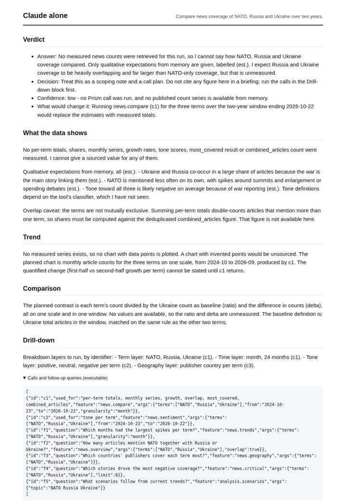
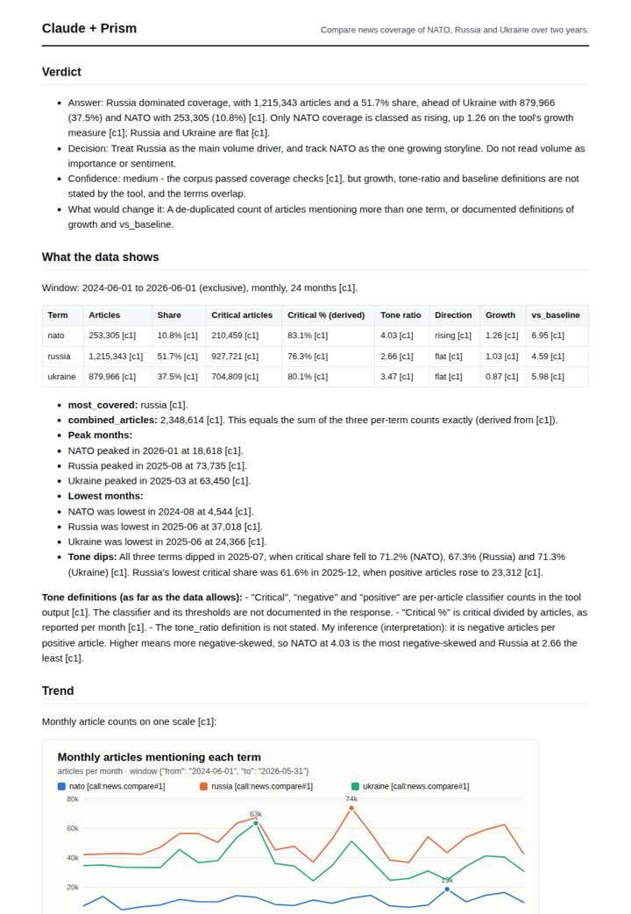
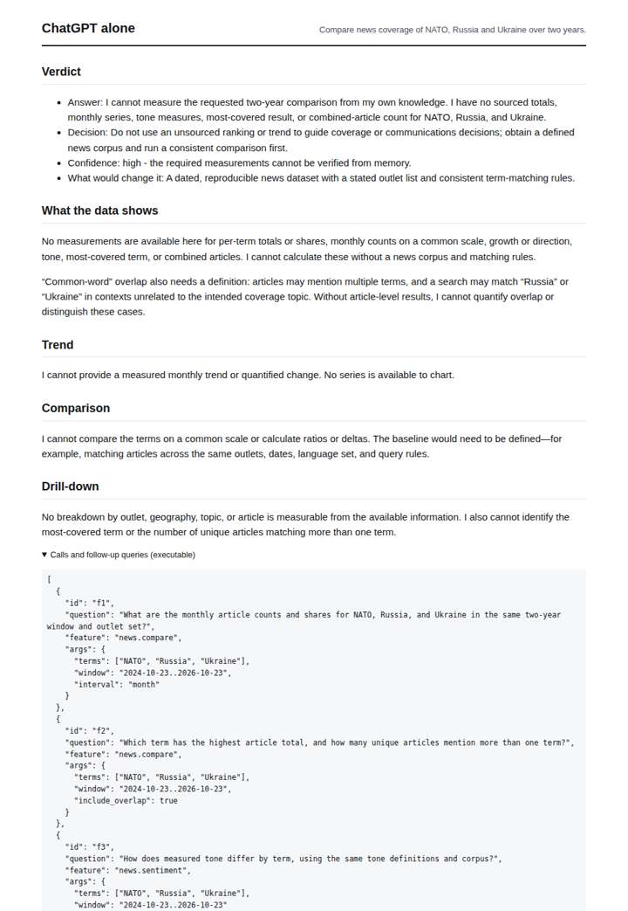
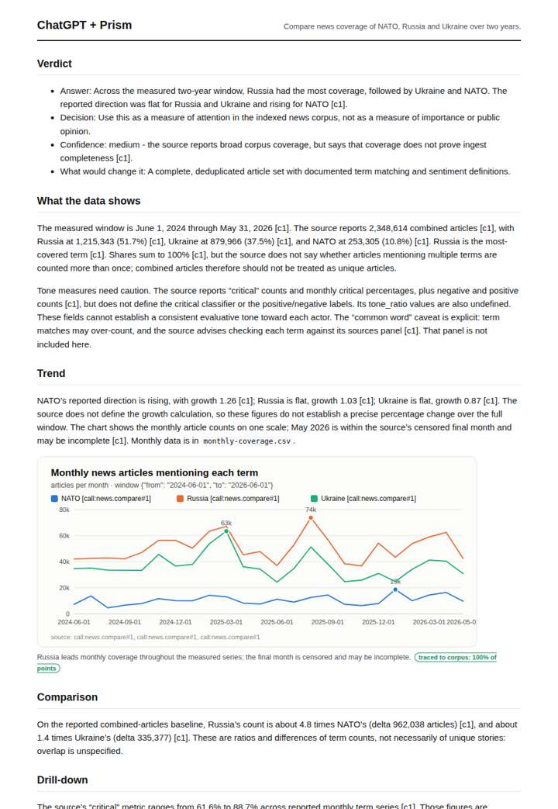

# NATO vs Russia vs Ukraine attention

**Question.** Compare news coverage of NATO, Russia and Ukraine over two years.

**Category:** Defence & geopolitics · **Pattern:** `compare` · **Why it is hard:** Russia and Ukraine co-occur in most articles; overlap is the caveat.

| Score /100 | Claude alone | Claude + Prism | ChatGPT alone | ChatGPT + Prism |
|---|---|---|---|---|
| Weighted (strict) | 32.8 | **70.8** | 27.0 | 61.0 |
| Opus judge | 27.0 | 75.9 | 22.4 | 55.9 |
| GPT judge | 38.7 | 65.7 | 31.5 | 66.1 |

## Parameter scores (0-5)

| Parameter | Weight | Claude alone | Claude + Prism | ChatGPT alone | ChatGPT + Prism |
|---|---|---|---|---|---|
| Measured trend | 10 | 0.5 | 3.5 | 0.0 | 2.5 |
| Measured comparison | 7 | 1.0 | 3.5 | 0.0 | 3.5 |
| Visualisation from counted data | 10 | 0.0 | 3.5 | 0.0 | 3.0 |
| Exploration and drill-down | 7 | 1.0 | 3.0 | 1.0 | 2.0 |
| Data export with provenance | 8 | 1.0 | 4.0 | 0.0 | 4.0 |
| Reproducibility | 12 | 1.0 | 4.0 | 1.0 | 3.0 |
| Accuracy against the corpus | 12 | 3.5 | 3.0 | 3.5 | 3.0 |
| Calibration and limits | 8 | 3.5 | 3.5 | 3.0 | 2.5 |
| Decision-grade verdict | 12 | 3.0 | 3.5 | 3.0 | 3.5 |
| Facet coverage | 6 | 1.0 | 4.0 | 0.5 | 3.5 |

## Script findings

| Check | Claude alone | Claude + Prism | ChatGPT alone | ChatGPT + Prism |
|---|---|---|---|---|
| Numbers traced to the corpus | 0/1 | 78/85 | 0/0 | 17/20 |
| Charts (traced share) | none | 100%, 100% | none | 100% |
| DOIs that resolve | 0/0 | 0/0 | 0/0 | 0/0 |
| Follow-up queries that ran | 0/5 | 3/6 | 0/3 | 1/4 |
| Invention gate | clear | clear | clear | clear |

**Claude Opus judge:** D was the only deliverable to turn the data into a decision-grade comparison. It gives exact half-on-half changes, ratios and peaks. It caught that combined_articles is a plain sum, so overlap is unresolved. It also flagged the mismatch between Ukraine's 'flat' label and its -15.9% decline. It has one wrong trough. B traced the same data but read it shallowly and misplaced the censoring. A and C honestly declined and gave a decision-maker nothing usable.

**GPT judge:** D is the most decision-ready: it gives a supported ranking and comparable ratios while clearly treating overlap and tone interpretation as limits. C has richer analysis and drill-down, but its speculative tone-ratio reading and treatment of the overlapping combined count weaken confidence; A and B are honest scoping notes rather than measured comparisons.

## Before / after (first screen)

| | Alone | With Prism |
|---|---|---|
| Claude |  |  |
| ChatGPT |  |  |

Full deliverables, rendered: [PDF](https://fliarbi.com/demo/docs/prism-benchmark-v2-4ed65c83/full/nato-russia-ukraine.pdf). Raw answers, ground pass and judge outputs: `answers.json`, `ground.json`, `judge_opus.json`, `judge_gpt.json` in this folder.
