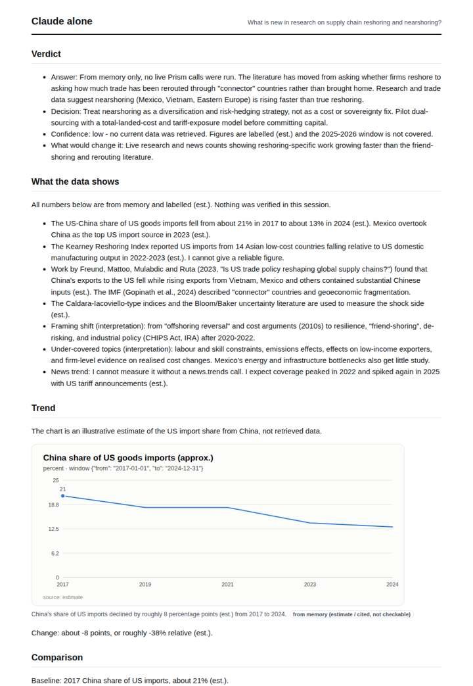
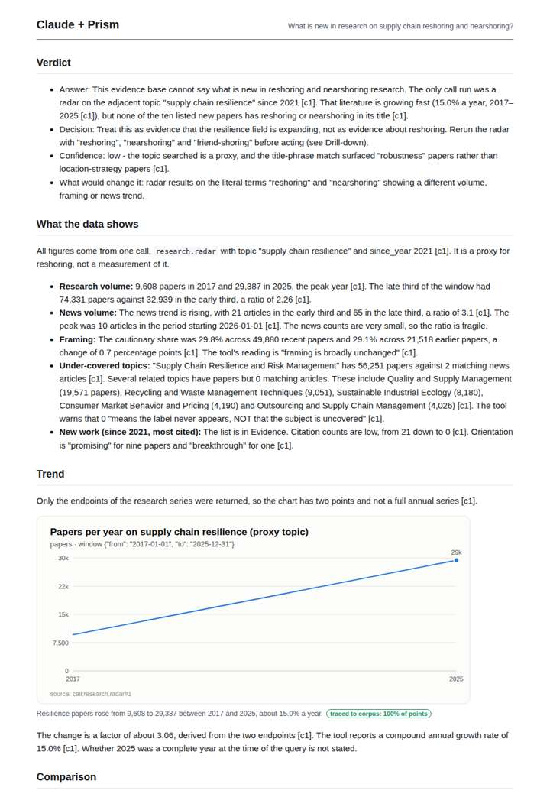
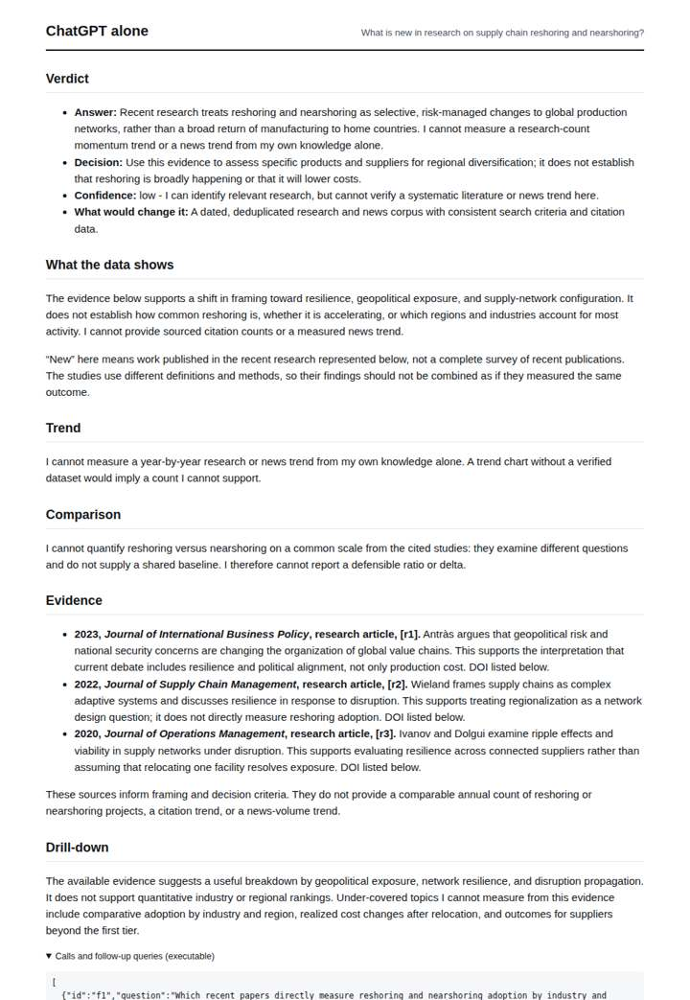
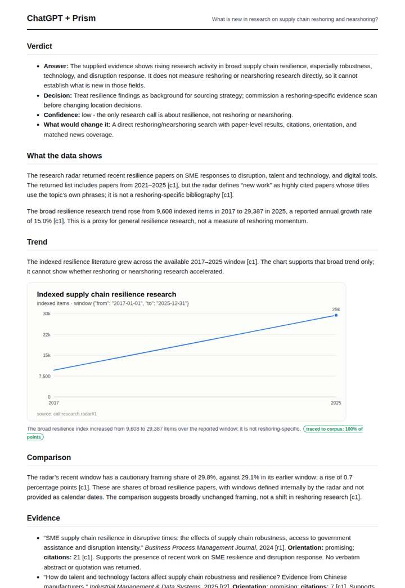

# Nearshoring research radar

**Question.** What is new in research on supply chain reshoring and nearshoring?

**Category:** Supply chain & trade · **Pattern:** `radar` · **Why it is hard:** Post-2020 literature; framing moved from cost to resilience.

| Score /100 | Claude alone | Claude + Prism | ChatGPT alone | ChatGPT + Prism |
|---|---|---|---|---|
| Weighted (strict) | 30.8 | **79.6** | 20.6 | 71.1 |
| Opus judge | 31.8 | 84.4 | 18.6 | 67.4 |
| GPT judge | 29.8 | 74.8 | 22.6 | 74.8 |

## Parameter scores (0-5)

| Parameter | Weight | Claude alone | Claude + Prism | ChatGPT alone | ChatGPT + Prism |
|---|---|---|---|---|---|
| Measured trend | 10 | 1.0 | 4.0 | 0.0 | 3.5 |
| Measured comparison | 7 | 2.0 | 4.0 | 0.5 | 3.5 |
| Visualisation from counted data | 10 | 1.0 | 3.5 | 0.0 | 4.0 |
| Exploration and drill-down | 7 | 2.0 | 4.0 | 1.5 | 2.0 |
| Data export with provenance | 8 | 1.0 | 4.0 | 0.0 | 3.0 |
| Reproducibility | 12 | 0.0 | 4.0 | 0.0 | 4.0 |
| Traceable references | 8 | 1.0 | 4.0 | 1.0 | 3.5 |
| Accuracy against the corpus | 12 | 2.5 | 4.5 | 1.0 | 4.0 |
| Calibration and limits | 8 | 3.0 | 4.0 | 3.0 | 3.5 |
| Decision-grade verdict | 12 | 2.5 | 4.0 | 3.0 | 4.0 |
| Facet coverage | 6 | 1.0 | 3.5 | 1.5 | 3.0 |

## Script findings

| Check | Claude alone | Claude + Prism | ChatGPT alone | ChatGPT + Prism |
|---|---|---|---|---|
| Numbers traced to the corpus | 0/13 | 38/39 | 0/2 | 7/7 |
| Charts (traced share) | memory | 100% | none | 100% |
| DOIs that resolve | 0/0 | 9/9 | 2/3 | 3/3 |
| Follow-up queries that ran | 3/6 | 4/6 | 1/5 | 2/7 |
| Invention gate | clear | clear | clear | clear |

**Claude Opus judge:** C was the only deliverable that traced nearly every number, recomputed its derived ratios correctly and carried the tool's caveats next to the figures. It also caught that the proxy search returned 'robustness' papers rather than reshoring work, so it did not present them as findings. B was honest but thinner, leaving out the news trend and the under-covered panel. A was a candid memory estimate, and D's references show fabricated-looking metadata.

**GPT judge:** B is the clearest decision brief: it answers that the supplied evidence measures broad resilience research, not reshoring or nearshoring, and gives a bounded sourcing recommendation. A has richer traced breakdowns and exports, but its trend and coverage claims carry material caveat problems; C and D rely on memory or provide no measurable research trend.

## Before / after (first screen)

| | Alone | With Prism |
|---|---|---|
| Claude |  |  |
| ChatGPT |  |  |

Full deliverables, rendered: [PDF](https://fliarbi.com/demo/docs/prism-benchmark-v2-4ed65c83/full/nearshoring-radar.pdf). Raw answers, ground pass and judge outputs: `answers.json`, `ground.json`, `judge_opus.json`, `judge_gpt.json` in this folder.
