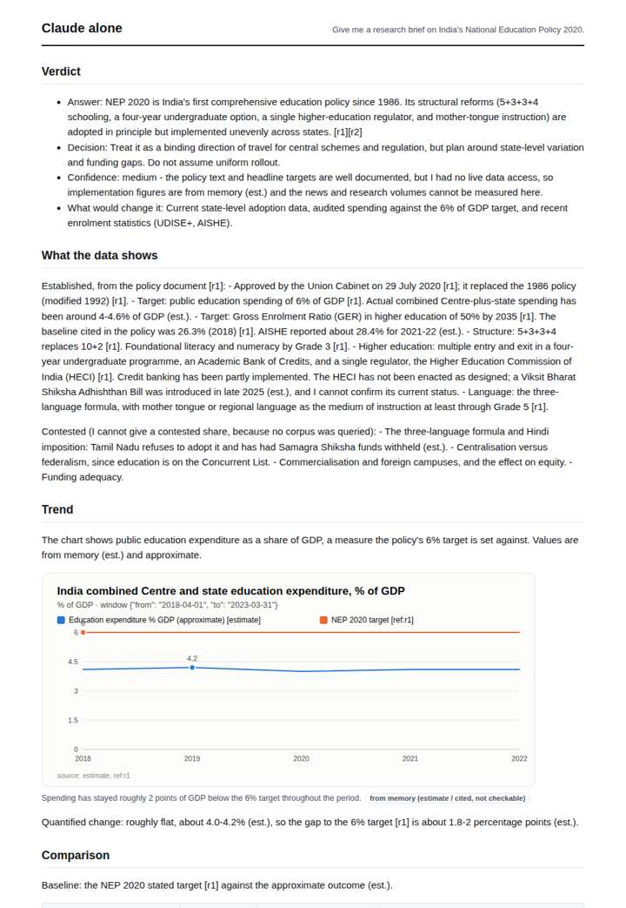
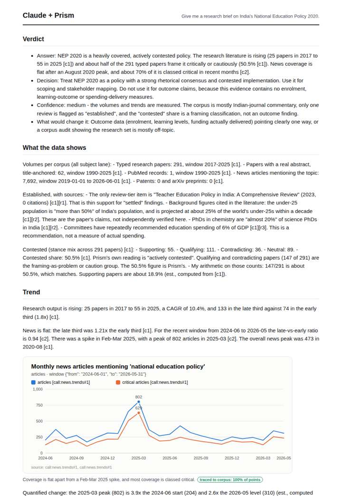
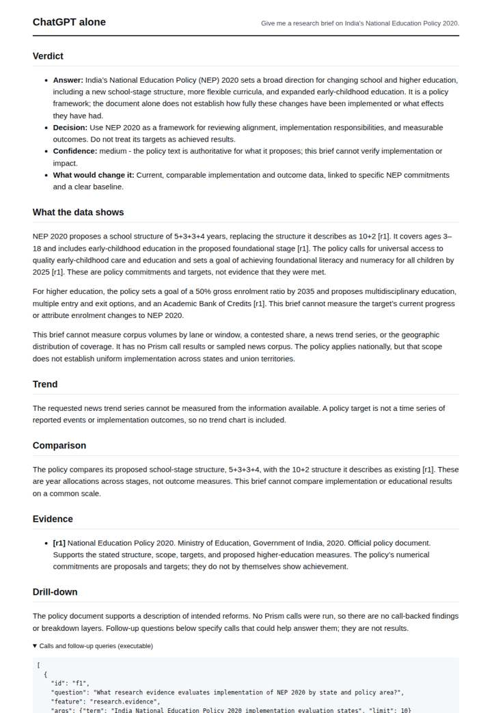
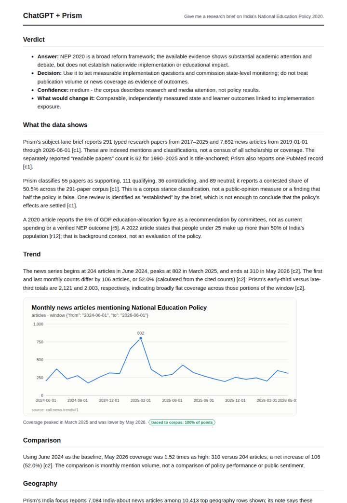

# National Education Policy brief

**Question.** Give me a research brief on India's National Education Policy 2020.

**Category:** Education & labour · **Pattern:** `brief` · **Why it is hard:** Small, recent literature; the brief must say how thin it is.

| Score /100 | Claude alone | Claude + Prism | ChatGPT alone | ChatGPT + Prism |
|---|---|---|---|---|
| Weighted (strict) | 24.9 | 71.6 | 32.6 | **73.0** |
| Opus judge | 24.6 | 70.0 | 28.8 | 65.6 |
| GPT judge | 25.2 | 73.2 | 36.4 | 80.4 |

## Parameter scores (0-5)

| Parameter | Weight | Claude alone | Claude + Prism | ChatGPT alone | ChatGPT + Prism |
|---|---|---|---|---|---|
| Measured trend | 10 | 1.0 | 4.5 | 0.0 | 4.0 |
| Measured comparison | 7 | 2.0 | 3.0 | 1.0 | 4.0 |
| Visualisation from counted data | 10 | 1.0 | 4.0 | 0.0 | 3.5 |
| Exploration and drill-down | 7 | 1.5 | 2.0 | 1.0 | 1.0 |
| Data export with provenance | 8 | 1.0 | 3.0 | 0.0 | 3.0 |
| Reproducibility | 12 | 0.0 | 4.0 | 1.0 | 4.5 |
| Traceable references | 8 | 1.5 | 3.5 | 2.0 | 4.0 |
| Accuracy against the corpus | 12 | 2.5 | 3.5 | 3.5 | 4.0 |
| Calibration and limits | 8 | 3.0 | 4.5 | 3.5 | 3.5 |
| Decision-grade verdict | 12 | 0.0 | 3.0 | 3.5 | 4.0 |
| Facet coverage | 6 | 1.0 | 4.0 | 1.5 | 3.5 |

## Script findings

| Check | Claude alone | Claude + Prism | ChatGPT alone | ChatGPT + Prism |
|---|---|---|---|---|
| Numbers traced to the corpus | 0/20 | 64/64 | 0/4 | 32/32 |
| Charts (traced share) | memory | 100% | none | 100% |
| DOIs that resolve | 0/0 | 7/7 | 0/0 | 3/3 |
| Follow-up queries that ran | 2/6 | 2/7 | 0/4 | 0/6 |
| Invention gate | tripped | clear | clear | clear |

**Claude Opus judge:** A and B both ground their claims in the recorded data. B goes further: it reads the rising research trend and the critical-share decomposition, catches the Indiana and off-country anomalies, and states plainly that the evidence base is thin (one review, one the health literature index record). Against that, B wrongly compares news 'critical' with research 'contested' as if they were one scale, and misreads a demographic quote. A is cleaner but narrower and never says the literature is thin. C and D are honest about having no data, but they deliver policy content and memory estimates rather than a measured brief.

**GPT judge:** D is the strongest decision brief: its measured comparisons, repeatable calls, and concise recommendation are well bounded by what the corpus can show. C covers more facets and evidence layers, but has weaker drill-down execution and a less decisive verdict; neither establishes implementation or educational impact.

## Before / after (first screen)

| | Alone | With Prism |
|---|---|---|
| Claude |  |  |
| ChatGPT |  |  |

Full deliverables, rendered: [PDF](https://fliarbi.com/demo/docs/prism-benchmark-v2-4ed65c83/full/nep-2020-brief.pdf). Raw answers, ground pass and judge outputs: `answers.json`, `ground.json`, `judge_opus.json`, `judge_gpt.json` in this folder.
