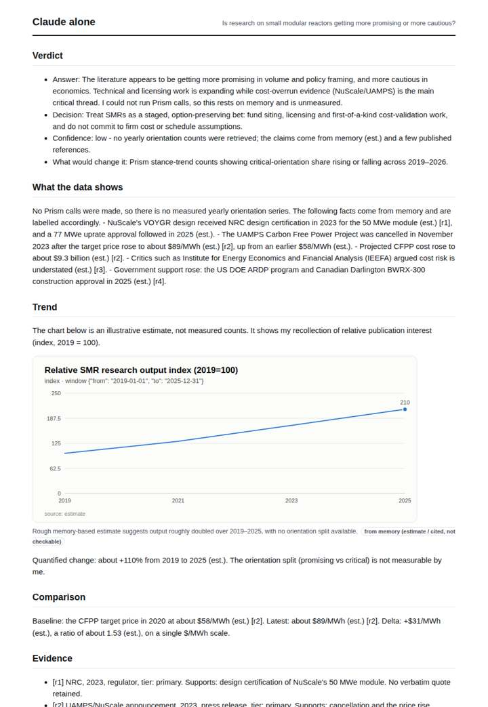
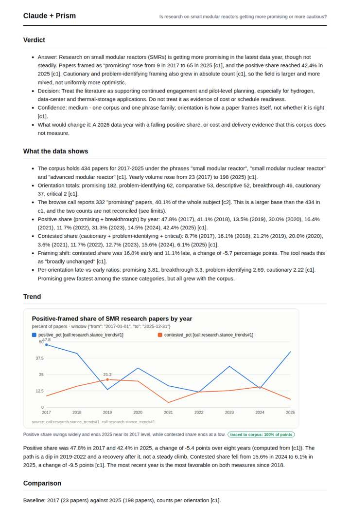
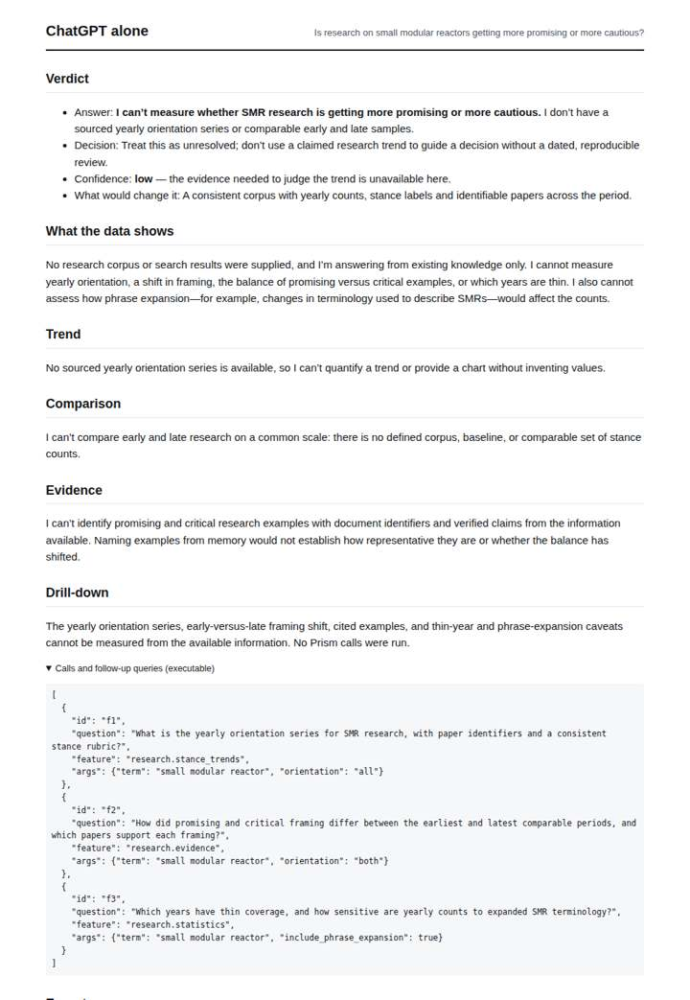
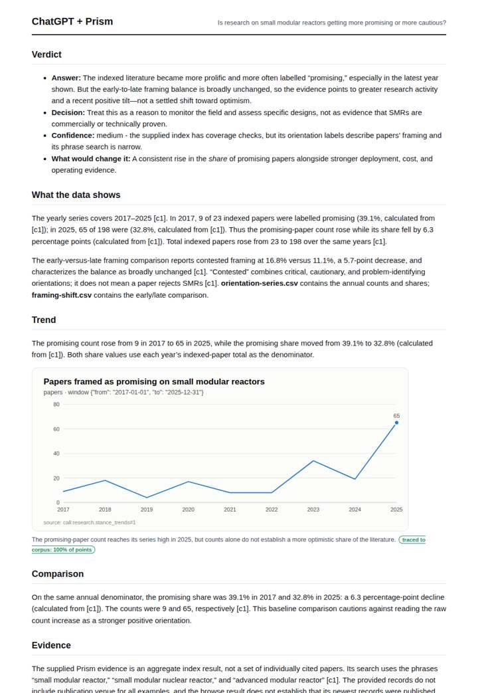

# Small modular reactor framing

**Question.** Is research on small modular reactors getting more promising or more cautious?

**Category:** Energy & climate · **Pattern:** `stance` · **Why it is hard:** SMR cost overruns (NuScale 2023) should show as a cautionary turn.

| Score /100 | Claude alone | Claude + Prism | ChatGPT alone | ChatGPT + Prism |
|---|---|---|---|---|
| Weighted (strict) | 30.6 | **75.1** | 24.4 | 61.0 |
| Opus judge | 28.0 | 76.8 | 18.2 | 58.4 |
| GPT judge | 33.2 | 73.4 | 30.6 | 63.6 |

## Parameter scores (0-5)

| Parameter | Weight | Claude alone | Claude + Prism | ChatGPT alone | ChatGPT + Prism |
|---|---|---|---|---|---|
| Measured trend | 10 | 1.0 | 4.5 | 0.0 | 3.5 |
| Measured comparison | 7 | 1.5 | 4.5 | 0.0 | 3.0 |
| Visualisation from counted data | 10 | 1.0 | 4.5 | 0.0 | 3.5 |
| Exploration and drill-down | 7 | 1.5 | 4.0 | 1.0 | 3.0 |
| Data export with provenance | 8 | 1.0 | 3.0 | 0.0 | 0.0 |
| Reproducibility | 12 | 1.0 | 4.0 | 1.0 | 3.0 |
| Traceable references | 8 | 1.0 | 3.0 | 0.5 | 2.0 |
| Accuracy against the corpus | 12 | 2.0 | 3.0 | 4.0 | 4.0 |
| Calibration and limits | 8 | 3.0 | 3.5 | 3.0 | 3.0 |
| Decision-grade verdict | 12 | 2.5 | 3.5 | 2.0 | 4.0 |
| Facet coverage | 6 | 1.0 | 4.0 | 0.5 | 3.5 |

## Script findings

| Check | Claude alone | Claude + Prism | ChatGPT alone | ChatGPT + Prism |
|---|---|---|---|---|
| Numbers traced to the corpus | 0/13 | 72/73 | 0/0 | 16/25 |
| Charts (traced share) | memory | 100% | none | 100% |
| DOIs that resolve | 0/0 | 5/5 | 0/0 | 2/2 |
| Follow-up queries that ran | 1/6 | 4/6 | 0/3 | 3/4 |
| Invention gate | clear | clear | clear | clear |

**Claude Opus judge:** B gave a fully traced orientation series split into positive and contested shares, an exact 2017-vs-2025 comparison, placed limits, and a caught count anomaly; its verdict honestly separates the 2025 rebound from a flat-to-slightly-negative net change. C was accurate but reported counts only and had untraced computed export columns. A declined to answer and D relied on memory about NuScale costs rather than measuring the research trend.

**GPT judge:** B best distinguishes rising research volume from the direction of orientation shares, gives a cautious decision with confidence and conditions, and preserves the key limits. A has richer charts and breakdowns but misreads the browse result’s filtered count and overstates the favorable endpoint; C is transparent but cannot answer the measured facets, while D’s cost-caution narrative remains memory-based.

## Before / after (first screen)

| | Alone | With Prism |
|---|---|---|
| Claude |  |  |
| ChatGPT |  |  |

Full deliverables, rendered: [PDF](https://fliarbi.com/demo/docs/prism-benchmark-v2-4ed65c83/full/nuclear-smr-stance.pdf). Raw answers, ground pass and judge outputs: `answers.json`, `ground.json`, `judge_opus.json`, `judge_gpt.json` in this folder.
