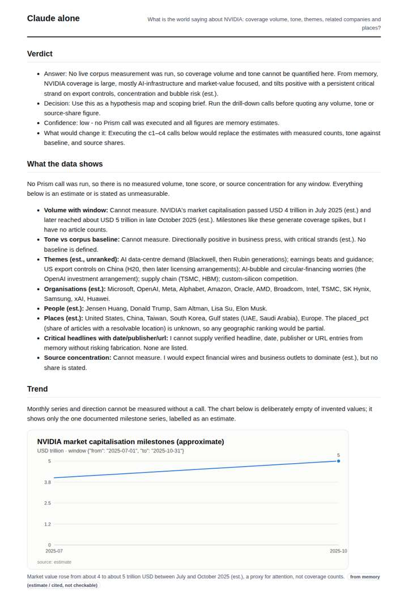
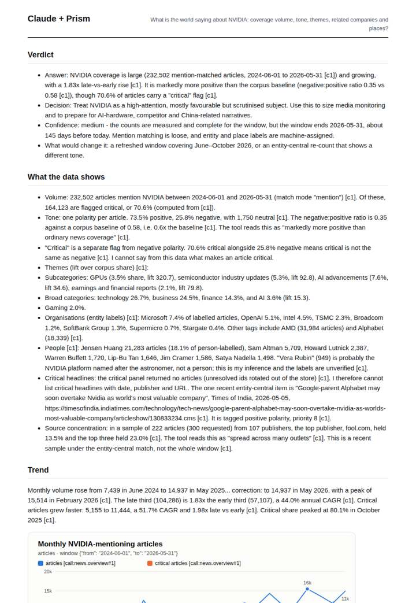
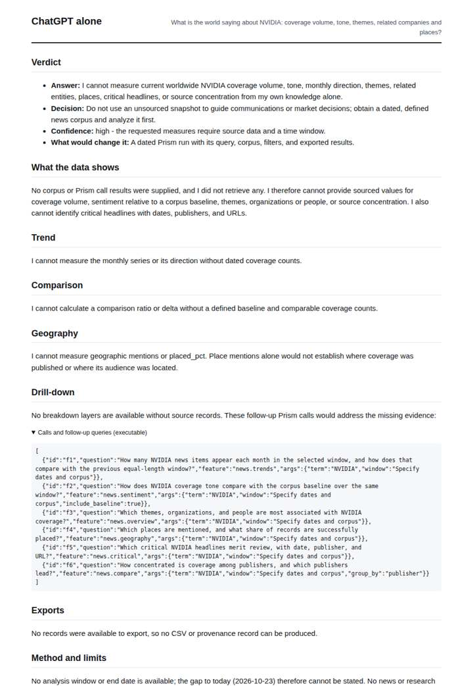
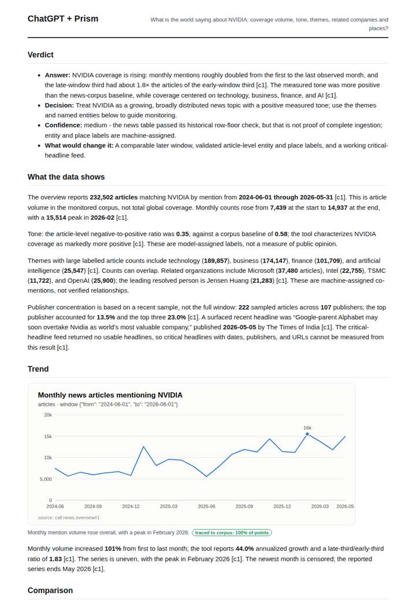

# NVIDIA media intelligence

**Question.** What is the world saying about NVIDIA: coverage volume, tone, themes, related companies and places?

**Category:** Company & competitive intelligence · **Pattern:** `pulse` · **Why it is hard:** Entity names are canonical ('nvidia corporation'); matching must be by entity, not word.

| Score /100 | Claude alone | Claude + Prism | ChatGPT alone | ChatGPT + Prism |
|---|---|---|---|---|
| Weighted (strict) | 26.9 | **75.2** | 24.0 | 70.2 |
| Opus judge | 25.0 | 72.2 | 18.2 | 66.2 |
| GPT judge | 28.8 | 78.2 | 29.8 | 74.2 |

## Parameter scores (0-5)

| Parameter | Weight | Claude alone | Claude + Prism | ChatGPT alone | ChatGPT + Prism |
|---|---|---|---|---|---|
| Measured trend | 10 | 1.0 | 4.5 | 0.0 | 4.5 |
| Measured comparison | 7 | 0.5 | 4.5 | 0.0 | 4.5 |
| Visualisation from counted data | 10 | 1.0 | 4.0 | 0.0 | 3.5 |
| Exploration and drill-down | 7 | 1.0 | 2.5 | 1.0 | 3.5 |
| Data export with provenance | 8 | 1.0 | 3.0 | 0.0 | 3.0 |
| Reproducibility | 12 | 0.0 | 5.0 | 1.0 | 3.5 |
| Traceable references | 8 | 0.5 | 1.0 | 0.5 | 1.0 |
| Accuracy against the corpus | 12 | 3.0 | 4.0 | 3.0 | 4.0 |
| Calibration and limits | 8 | 2.5 | 3.0 | 3.5 | 3.0 |
| Decision-grade verdict | 12 | 2.5 | 4.0 | 2.0 | 3.5 |
| Facet coverage | 6 | 1.0 | 5.0 | 1.5 | 4.5 |

## Script findings

| Check | Claude alone | Claude + Prism | ChatGPT alone | ChatGPT + Prism |
|---|---|---|---|---|
| Numbers traced to the corpus | 0/3 | 102/102 | 0/0 | 34/35 |
| Charts (traced share) | memory | 100% | none | 100% |
| DOIs that resolve | 0/0 | 0/0 | 0/0 | 0/0 |
| Follow-up queries that ran | 2/7 | 2/6 | 0/6 | 4/5 |
| Invention gate | clear | clear | clear | clear |

**Claude Opus judge:** A and D both delivered measured answers from the same overview call. D went further: it decomposed volume into critical and total, distinguished critical from negative, flagged the Colombia place-resolution artefact, and exported both the monthly and the country tables. B and C honestly declined to measure, but that left a decision-maker with no usable figures. C's market-cap proxy does not measure coverage.

**GPT judge:** D gives the strongest decision-ready account: it traces both total and critical volume, compares tone against a defined baseline, and distinguishes critical flags from negative polarity while covering themes, entities and places. C is close, but D provides a fuller traced trend decomposition and export; its main weaknesses are the claim of completeness and limited successful drill-downs.

## Before / after (first screen)

| | Alone | With Prism |
|---|---|---|
| Claude |  |  |
| ChatGPT |  |  |

Full deliverables, rendered: [PDF](https://fliarbi.com/demo/docs/prism-benchmark-v2-4ed65c83/full/nvidia-pulse.pdf). Raw answers, ground pass and judge outputs: `answers.json`, `ground.json`, `judge_opus.json`, `judge_gpt.json` in this folder.
