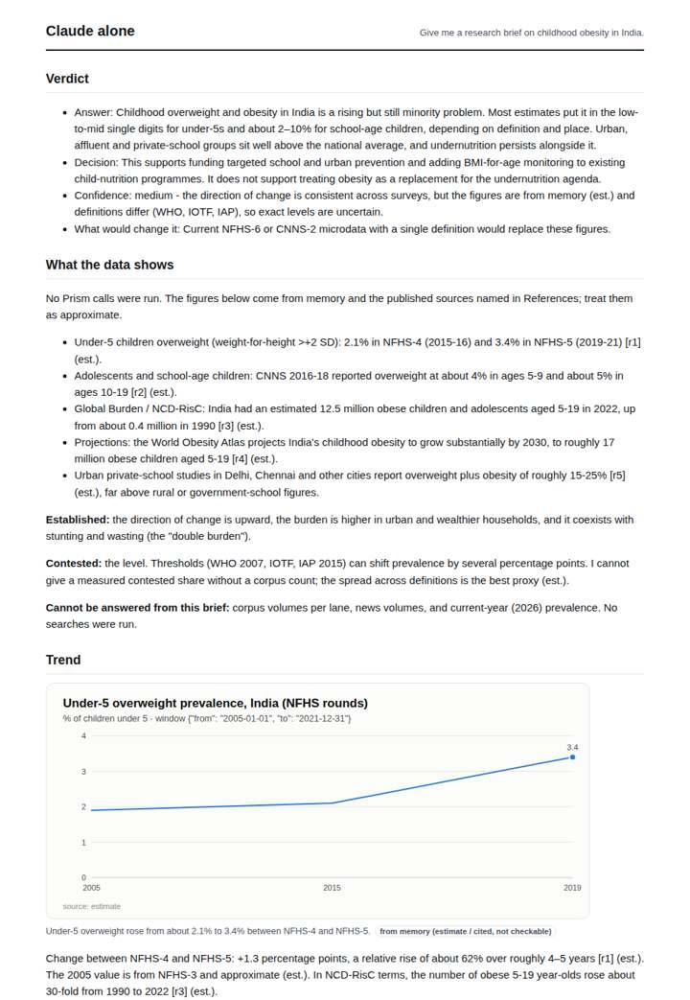
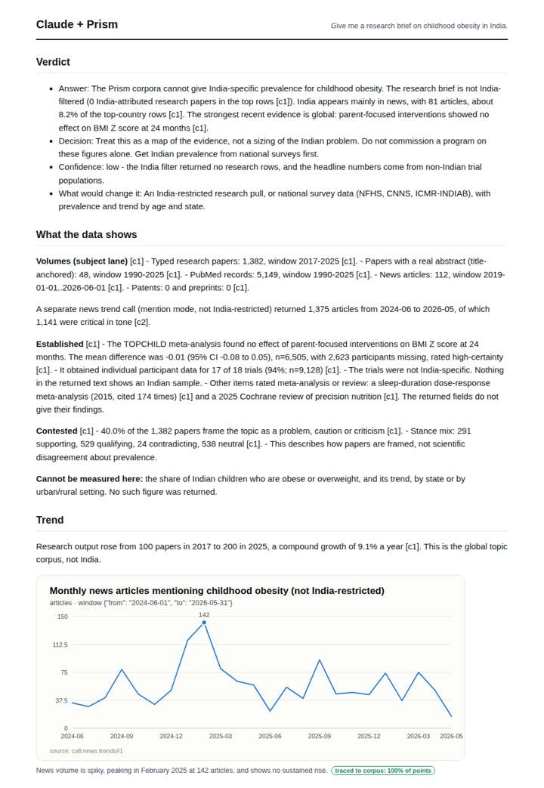
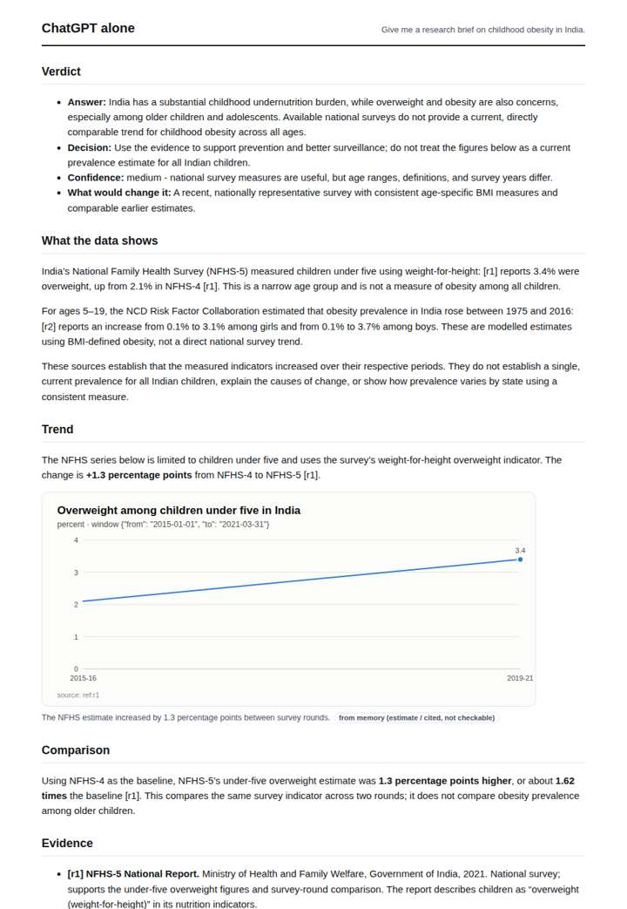
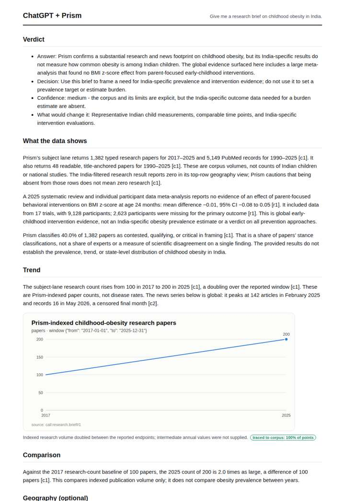

# Childhood obesity in India

**Question.** Give me a research brief on childhood obesity in India.

**Category:** Public health & epidemiology · **Pattern:** `brief` · **Why it is hard:** A geo scope must be a scope (papers about India), not a keyword (papers mentioning India).

| Score /100 | Claude alone | Claude + Prism | ChatGPT alone | ChatGPT + Prism |
|---|---|---|---|---|
| Weighted (strict) | 22.0 | **77.2** | 39.8 | 69.1 |
| Opus judge | 20.8 | 73.6 | 37.0 | 64.4 |
| GPT judge | 23.2 | 80.8 | 42.6 | 73.8 |

## Parameter scores (0-5)

| Parameter | Weight | Claude alone | Claude + Prism | ChatGPT alone | ChatGPT + Prism |
|---|---|---|---|---|---|
| Measured trend | 10 | 1.0 | 4.0 | 2.0 | 3.0 |
| Measured comparison | 7 | 1.0 | 4.0 | 2.0 | 3.5 |
| Visualisation from counted data | 10 | 1.0 | 3.5 | 1.0 | 3.0 |
| Exploration and drill-down | 7 | 1.0 | 2.0 | 1.0 | 1.0 |
| Data export with provenance | 8 | 1.0 | 3.0 | 1.0 | 3.5 |
| Reproducibility | 12 | 0.0 | 4.5 | 0.0 | 4.5 |
| Traceable references | 8 | 1.0 | 4.5 | 2.5 | 4.0 |
| Accuracy against the corpus | 12 | 2.5 | 4.0 | 3.5 | 3.5 |
| Calibration and limits | 8 | 3.0 | 4.0 | 3.0 | 4.0 |
| Decision-grade verdict | 12 | 0.0 | 4.0 | 3.5 | 3.5 |
| Facet coverage | 6 | 1.0 | 4.5 | 2.0 | 4.0 |

## Script findings

| Check | Claude alone | Claude + Prism | ChatGPT alone | ChatGPT + Prism |
|---|---|---|---|---|
| Numbers traced to the corpus | 0/29 | 59/59 | 0/17 | 25/25 |
| Charts (traced share) | memory | 100% | memory | 100% |
| DOIs that resolve | 0/0 | 4/4 | 1/1 | 2/2 |
| Follow-up queries that ran | 1/6 | 1/6 | 0/5 | 0/5 |
| Invention gate | tripped | clear | clear | clear |

**Claude Opus judge:** A traced every number. It quantified both the research and news trends and flagged that the 'India' query returned global evidence, including its conflicting institution and research-row signals. Its decision is honest: get national survey data before sizing the problem. B was similarly traced but thinner, and it misread the censoring. C and D gave plausible prevalence figures from memory that a decision-maker cannot verify; C also has questionable specifics.

**GPT judge:** B is the strongest decision brief because its core counts, monthly series, comparisons, and citations are traceable, and it clearly says the corpus cannot establish Indian child prevalence. C is careful and reproducible but omits the available quantified news trend and has no successful follow-up calls; neither brief resolves the underlying need for representative India-specific prevalence data.

## Before / after (first screen)

| | Alone | With Prism |
|---|---|---|
| Claude |  |  |
| ChatGPT |  |  |

Full deliverables, rendered: [PDF](https://fliarbi.com/demo/docs/prism-benchmark-v2-4ed65c83/full/obesity-children-india.pdf). Raw answers, ground pass and judge outputs: `answers.json`, `ground.json`, `judge_opus.json`, `judge_gpt.json` in this folder.
