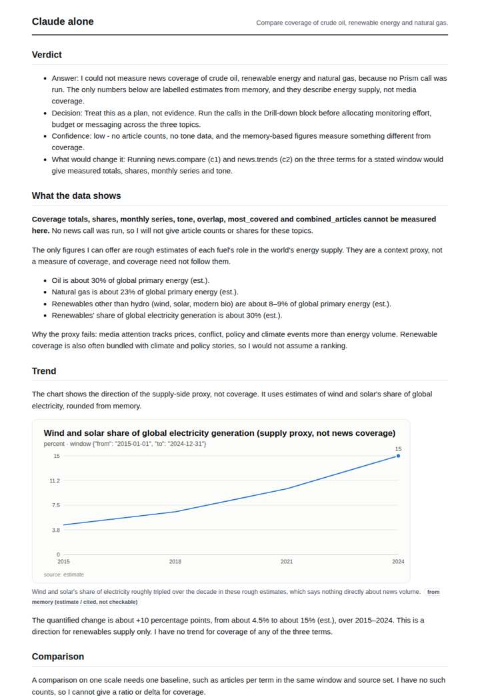
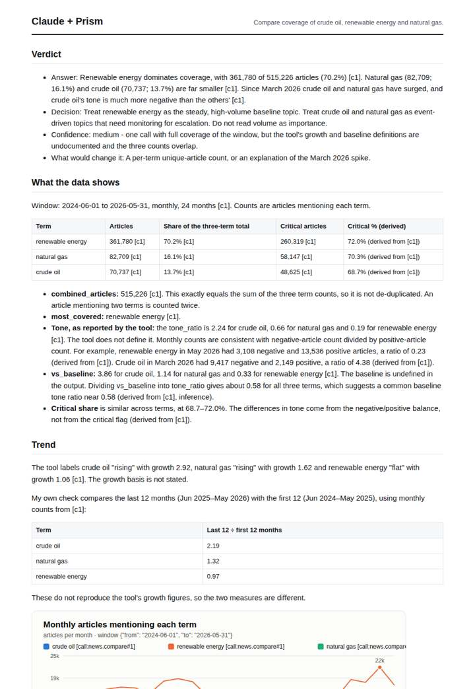
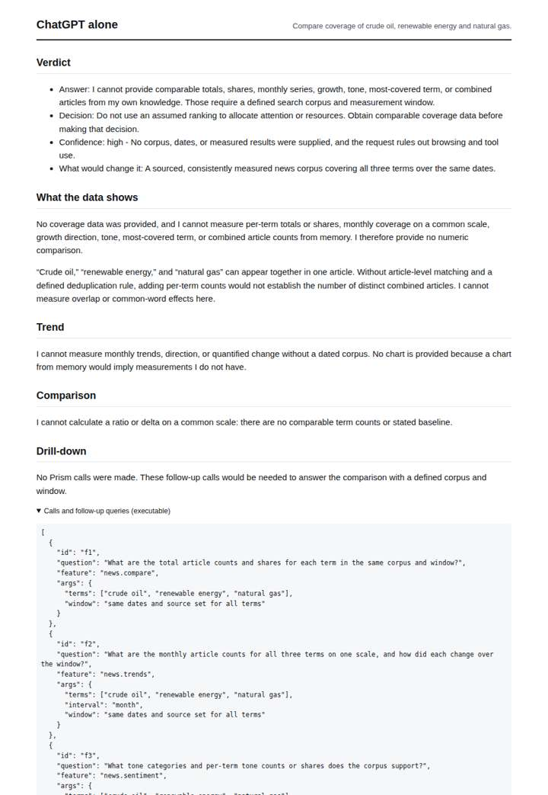
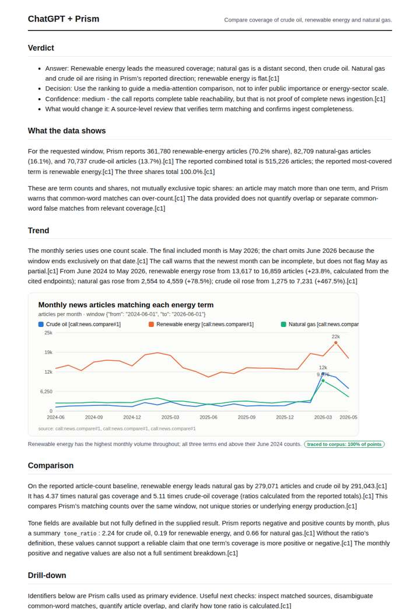

# Oil vs renewables in the news

**Question.** Compare coverage of crude oil, renewable energy and natural gas.

**Category:** Energy & climate · **Pattern:** `compare` · **Why it is hard:** Oil-price spikes drive volume; renewables carry positive tone.

| Score /100 | Claude alone | Claude + Prism | ChatGPT alone | ChatGPT + Prism |
|---|---|---|---|---|
| Weighted (strict) | 33.3 | **77.9** | 23.6 | 72.0 |
| Opus judge | 30.0 | 80.4 | 17.2 | 67.0 |
| GPT judge | 36.5 | 75.4 | 30.0 | 77.0 |

## Parameter scores (0-5)

| Parameter | Weight | Claude alone | Claude + Prism | ChatGPT alone | ChatGPT + Prism |
|---|---|---|---|---|---|
| Measured trend | 10 | 1.0 | 4.0 | 0.0 | 3.5 |
| Measured comparison | 7 | 1.0 | 4.5 | 0.0 | 4.0 |
| Visualisation from counted data | 10 | 1.0 | 4.0 | 0.0 | 3.5 |
| Exploration and drill-down | 7 | 1.0 | 3.0 | 0.5 | 2.0 |
| Data export with provenance | 8 | 1.0 | 4.0 | 0.0 | 4.0 |
| Reproducibility | 12 | 1.0 | 4.0 | 0.5 | 4.0 |
| Accuracy against the corpus | 12 | 3.5 | 4.0 | 4.0 | 4.0 |
| Calibration and limits | 8 | 3.0 | 4.0 | 3.0 | 3.5 |
| Decision-grade verdict | 12 | 2.5 | 3.5 | 2.0 | 3.5 |
| Facet coverage | 6 | 0.5 | 4.0 | 0.5 | 3.5 |

## Script findings

| Check | Claude alone | Claude + Prism | ChatGPT alone | ChatGPT + Prism |
|---|---|---|---|---|
| Numbers traced to the corpus | 0/10 | 80/83 | 0/0 | 23/25 |
| Charts (traced share) | memory | 100% | none | 100% |
| DOIs that resolve | 0/0 | 0/0 | 0/0 | 0/0 |
| Follow-up queries that ran | 1/5 | 2/6 | 0/5 | 1/4 |
| Invention gate | clear | clear | clear | clear |

**Claude Opus judge:** C and D both rest on the same traced news.compare call. D read what the question turns on: the March 2026 oil and gas spike, the negative vs positive tone split, and the non-deduplicated combined total. C only reported endpoint changes and declined to interpret tone. A and B measured nothing, so they offer a decision-maker only a plan.

**GPT judge:** D is the strongest decision aid: it exposes the monthly oil and gas spike, compares all three terms on a shared window, and supplies usable exports with clear limits. C is more restrained about tone, but D better answers the scenario’s central risk that a price-driven spike can distort headline coverage; both leave the spike’s cause and unique-article overlap unresolved.

## Before / after (first screen)

| | Alone | With Prism |
|---|---|---|
| Claude |  |  |
| ChatGPT |  |  |

Full deliverables, rendered: [PDF](https://fliarbi.com/demo/docs/prism-benchmark-v2-4ed65c83/full/oil-vs-renewables.pdf). Raw answers, ground pass and judge outputs: `answers.json`, `ground.json`, `judge_opus.json`, `judge_gpt.json` in this folder.
