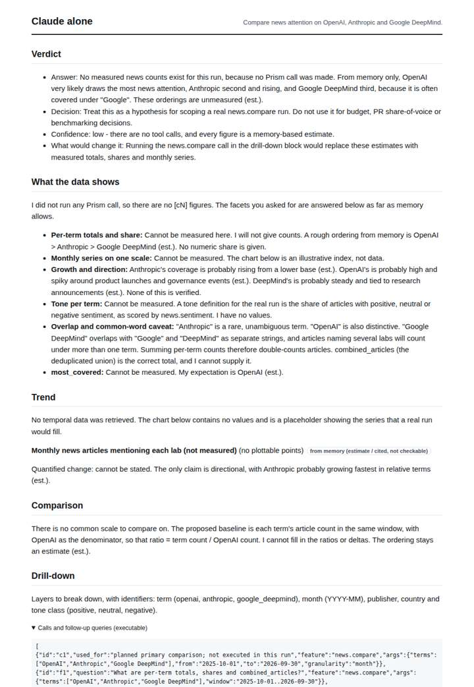
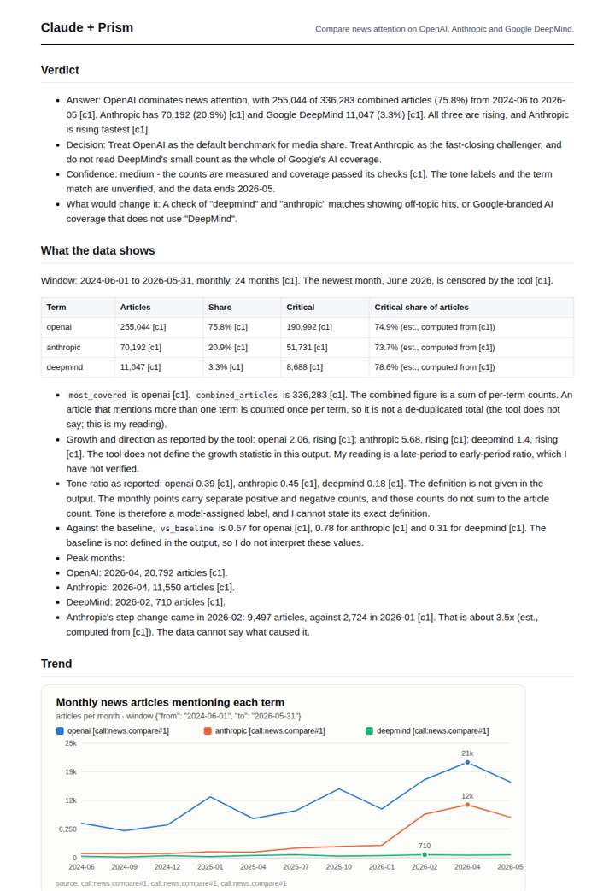
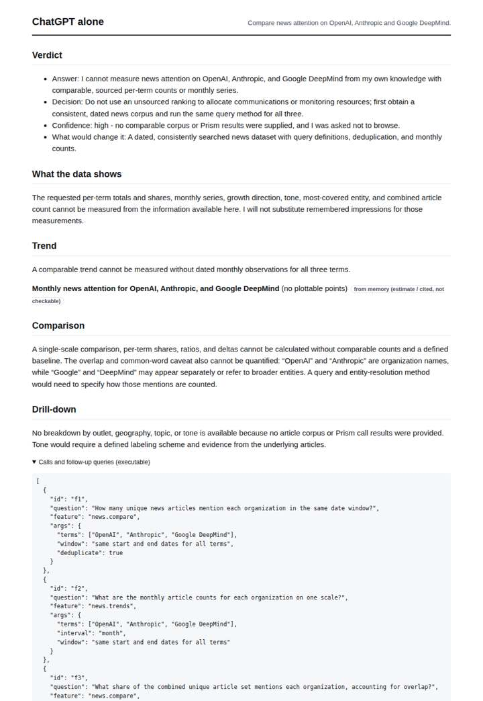
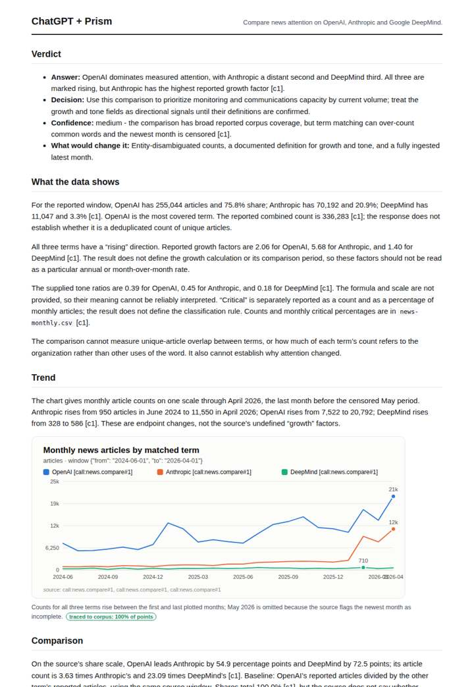

# OpenAI vs Anthropic vs Google DeepMind

**Question.** Compare news attention on OpenAI, Anthropic and Google DeepMind.

**Category:** Company & competitive intelligence · **Pattern:** `compare` · **Why it is hard:** OpenAI dominates volume; share and growth tell a different story.

| Score /100 | Claude alone | Claude + Prism | ChatGPT alone | ChatGPT + Prism |
|---|---|---|---|---|
| Weighted (strict) | 26.7 | 70.8 | 26.8 | **73.8** |
| Opus judge | 26.5 | 76.1 | 24.1 | 70.2 |
| GPT judge | 27.0 | 65.4 | 29.6 | 77.4 |

## Parameter scores (0-5)

| Parameter | Weight | Claude alone | Claude + Prism | ChatGPT alone | ChatGPT + Prism |
|---|---|---|---|---|---|
| Measured trend | 10 | 1.0 | 3.5 | 0.5 | 3.5 |
| Measured comparison | 7 | 1.0 | 4.5 | 0.5 | 4.5 |
| Visualisation from counted data | 10 | 0.5 | 3.0 | 0.5 | 3.5 |
| Exploration and drill-down | 7 | 1.0 | 3.0 | 1.0 | 3.0 |
| Data export with provenance | 8 | 1.0 | 3.0 | 1.0 | 4.0 |
| Reproducibility | 12 | 0.0 | 4.0 | 1.0 | 4.0 |
| Accuracy against the corpus | 12 | 3.0 | 3.0 | 3.0 | 3.0 |
| Calibration and limits | 8 | 2.5 | 3.5 | 2.5 | 4.0 |
| Decision-grade verdict | 12 | 2.0 | 4.0 | 2.0 | 4.0 |
| Facet coverage | 6 | 1.0 | 4.0 | 0.5 | 3.5 |

## Script findings

| Check | Claude alone | Claude + Prism | ChatGPT alone | ChatGPT + Prism |
|---|---|---|---|---|
| Numbers traced to the corpus | 0/1 | 66/67 | 0/0 | 25/26 |
| Charts (traced share) | memory | 100% | memory | 100% |
| DOIs that resolve | 0/0 | 0/0 | 0/0 | 0/0 |
| Follow-up queries that ran | 0/6 | 3/6 | 0/5 | 4/6 |
| Invention gate | clear | clear | clear | clear |

**Claude Opus judge:** C answered the hard part: OpenAI has the most volume, but Anthropic's gap to OpenAI narrowed from about 7.9:1 to 1.9:1. The ratios recompute exactly, the censoring is read correctly, and the anomalies are flagged. A had cleaner full-series exports and exact share arithmetic, but it misread May as censored and framed its decision around volume alone. B and D were honest but unmeasured.

**GPT judge:** D is the strongest decision aid: it compares all three terms on a shared scale, shows the monthly pattern, and carries the ingest caveat into its reading. A covers more caveats and follow-up questions, but its sampled trend export and unsupported coverage claim weaken trust; D still needs item-level evidence and a clearer reconciliation of May's partial status.

## Before / after (first screen)

| | Alone | With Prism |
|---|---|---|
| Claude |  |  |
| ChatGPT |  |  |

Full deliverables, rendered: [PDF](https://fliarbi.com/demo/docs/prism-benchmark-v2-4ed65c83/full/openai-anthropic-google.pdf). Raw answers, ground pass and judge outputs: `answers.json`, `ground.json`, `judge_opus.json`, `judge_gpt.json` in this folder.
