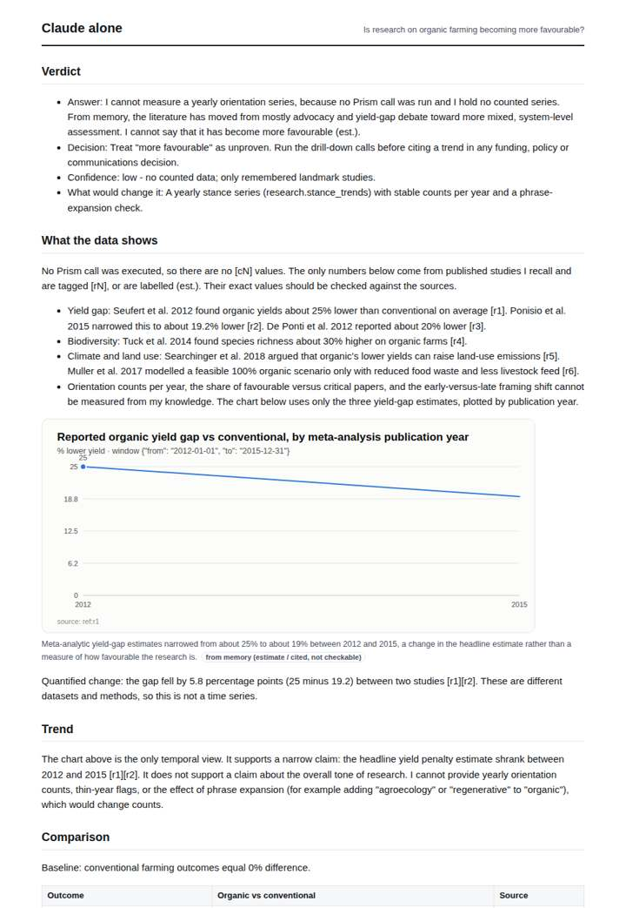
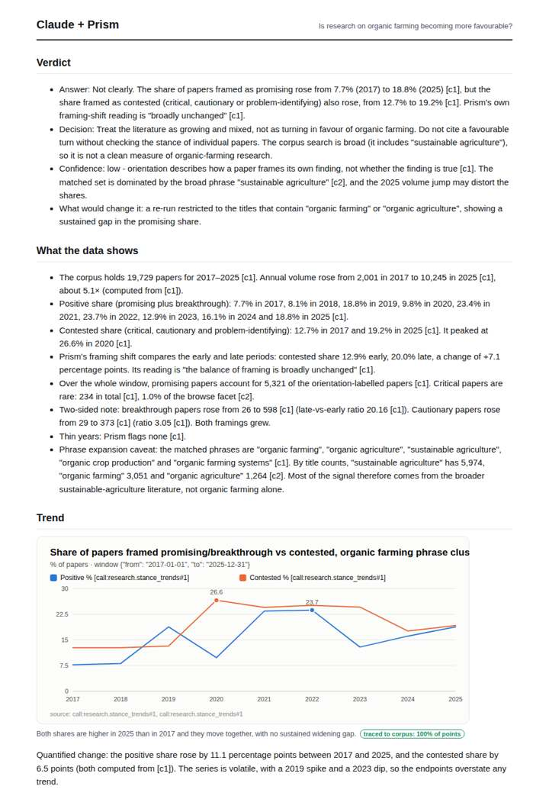
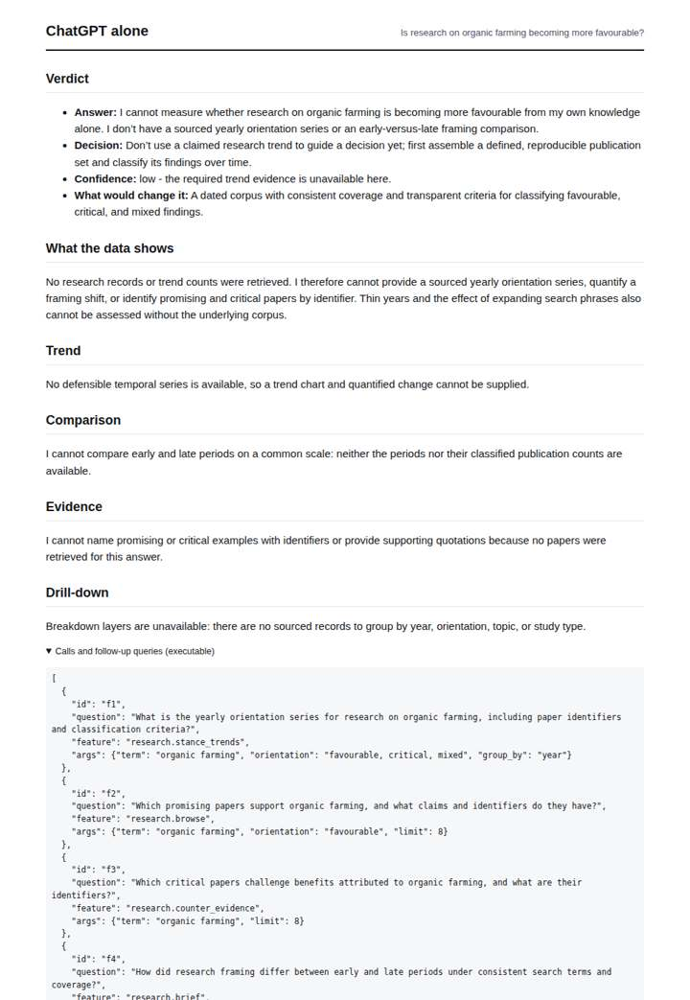
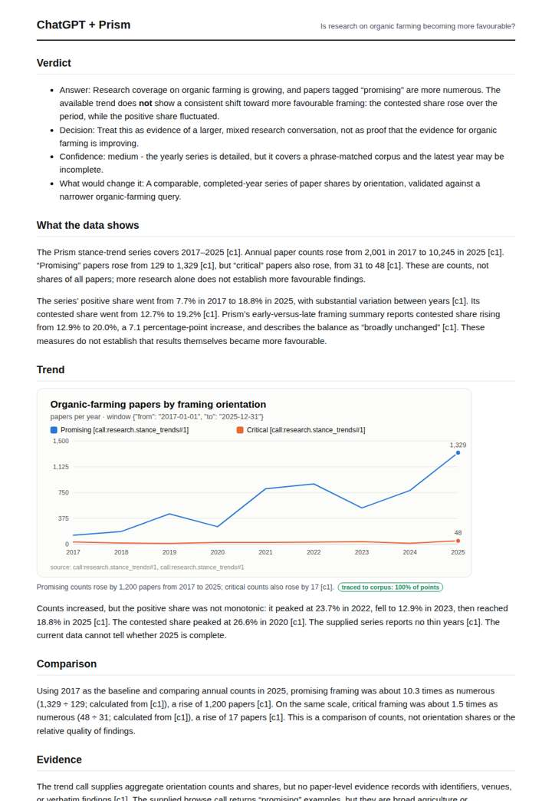

# Organic farming research framing

**Question.** Is research on organic farming becoming more favourable?

**Category:** Agriculture & food security · **Pattern:** `stance` · **Why it is hard:** Yield-gap critiques vs environmental-benefit findings.

| Score /100 | Claude alone | Claude + Prism | ChatGPT alone | ChatGPT + Prism |
|---|---|---|---|---|
| Weighted (strict) | 42.6 | **78.8** | 18.8 | 74.6 |
| Opus judge | 41.2 | 80.8 | 15.8 | 65.4 |
| GPT judge | 44.0 | 76.8 | 21.8 | 83.8 |

## Parameter scores (0-5)

| Parameter | Weight | Claude alone | Claude + Prism | ChatGPT alone | ChatGPT + Prism |
|---|---|---|---|---|---|
| Measured trend | 10 | 1.0 | 4.5 | 0.0 | 4.5 |
| Measured comparison | 7 | 2.0 | 5.0 | 0.0 | 4.0 |
| Visualisation from counted data | 10 | 1.0 | 4.5 | 0.0 | 4.0 |
| Exploration and drill-down | 7 | 2.0 | 3.0 | 1.0 | 3.0 |
| Data export with provenance | 8 | 1.0 | 3.0 | 0.0 | 3.5 |
| Reproducibility | 12 | 1.0 | 5.0 | 0.5 | 4.0 |
| Traceable references | 8 | 3.0 | 3.0 | 0.0 | 2.5 |
| Accuracy against the corpus | 12 | 4.0 | 4.0 | 3.0 | 4.0 |
| Calibration and limits | 8 | 3.5 | 4.0 | 3.0 | 4.0 |
| Decision-grade verdict | 12 | 3.0 | 3.0 | 1.5 | 3.5 |
| Facet coverage | 6 | 1.5 | 4.0 | 0.5 | 3.5 |

## Script findings

| Check | Claude alone | Claude + Prism | ChatGPT alone | ChatGPT + Prism |
|---|---|---|---|---|
| Numbers traced to the corpus | 0/16 | 56/56 | 0/0 | 27/28 |
| Charts (traced share) | memory | 100% | none | 100% |
| DOIs that resolve | 6/6 | 3/3 | 0/0 | 1/1 |
| Follow-up queries that ran | 3/6 | 2/6 | 1/4 | 3/4 |
| Invention gate | clear | clear | clear | clear |

**Claude Opus judge:** A was the only deliverable that compared positive and contested framing shares on one scale. It showed that both rose and that the gap nearly closed, and it flagged that the 'sustainable agriculture' phrase and off-topic rows contaminate the corpus. C used the same data but leaned on raw counts that mostly reflect volume growth. B offered accurate memory-based yield-gap context with real DOIs but no measurement, and D offered nothing.

**GPT judge:** C is the strongest decision aid: it shows the traced annual framing series, compares positive and contested patterns, and warns that framing is not evidence quality. D offers a more polished comparison but misstates the phrase matching; A and B appropriately limit claims but cannot measure the trend.

## Before / after (first screen)

| | Alone | With Prism |
|---|---|---|
| Claude |  |  |
| ChatGPT |  |  |

Full deliverables, rendered: [PDF](https://fliarbi.com/demo/docs/prism-benchmark-v2-4ed65c83/full/organic-farming-stance.pdf). Raw answers, ground pass and judge outputs: `answers.json`, `ground.json`, `judge_opus.json`, `judge_gpt.json` in this folder.
