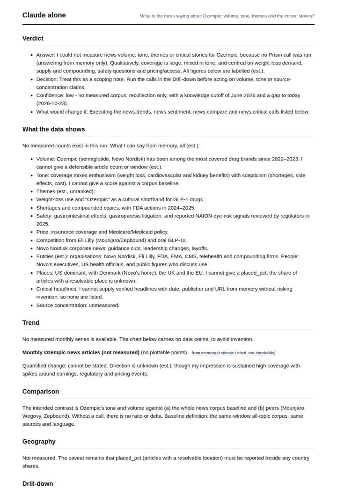
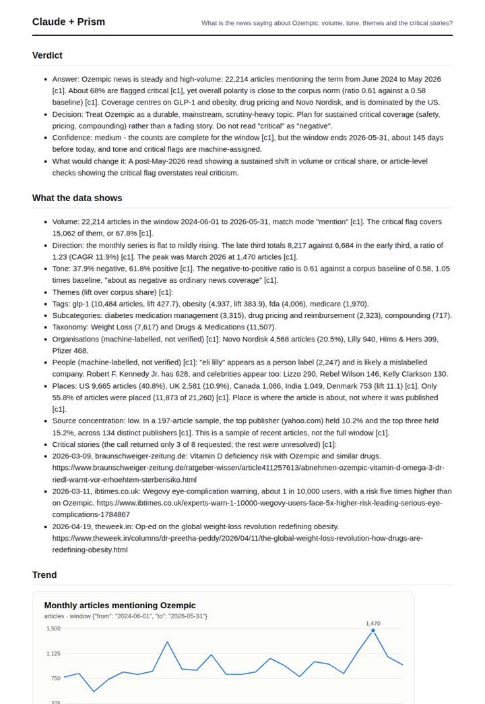
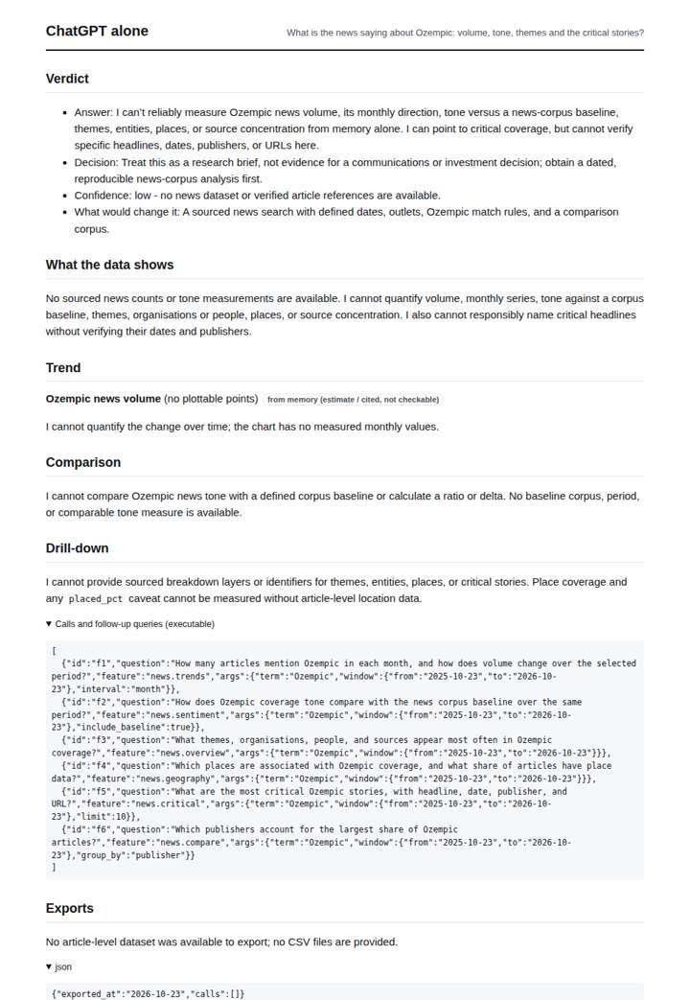
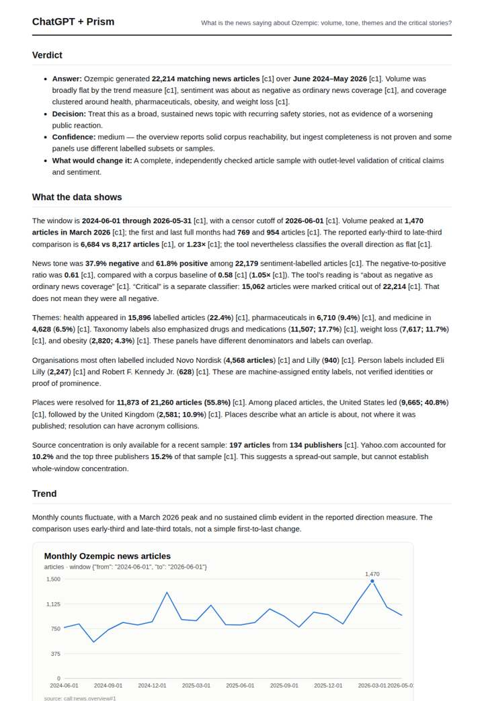

# Ozempic in the news

**Question.** What is the news saying about Ozempic: volume, tone, themes and the critical stories?

**Category:** Medical & clinical evidence · **Pattern:** `pulse` · **Why it is hard:** Brand, generic and class names (Ozempic, semaglutide, GLP-1) are covered differently.

| Score /100 | Claude alone | Claude + Prism | ChatGPT alone | ChatGPT + Prism |
|---|---|---|---|---|
| Weighted (strict) | 32.3 | **80.4** | 28.7 | 71.9 |
| Opus judge | 25.4 | 77.0 | 15.8 | 68.6 |
| GPT judge | 39.2 | 83.8 | 41.6 | 75.2 |

## Parameter scores (0-5)

| Parameter | Weight | Claude alone | Claude + Prism | ChatGPT alone | ChatGPT + Prism |
|---|---|---|---|---|---|
| Measured trend | 10 | 1.0 | 5.0 | 0.5 | 4.5 |
| Measured comparison | 7 | 0.5 | 4.5 | 0.5 | 4.5 |
| Visualisation from counted data | 10 | 0.5 | 4.0 | 0.5 | 3.5 |
| Exploration and drill-down | 7 | 1.0 | 2.5 | 1.0 | 3.0 |
| Data export with provenance | 8 | 1.0 | 3.0 | 0.0 | 3.0 |
| Reproducibility | 12 | 1.0 | 4.5 | 0.0 | 4.0 |
| Traceable references | 8 | 0.5 | 1.0 | 0.5 | 1.0 |
| Accuracy against the corpus | 12 | 3.5 | 4.5 | 4.0 | 4.0 |
| Calibration and limits | 8 | 3.5 | 4.5 | 4.0 | 3.0 |
| Decision-grade verdict | 12 | 2.5 | 5.0 | 2.5 | 4.0 |
| Facet coverage | 6 | 2.0 | 4.5 | 1.5 | 4.5 |

## Script findings

| Check | Claude alone | Claude + Prism | ChatGPT alone | ChatGPT + Prism |
|---|---|---|---|---|
| Numbers traced to the corpus | 0/0 | 80/80 | 0/1 | 51/52 |
| Charts (traced share) | memory | 100% | memory | 100% |
| DOIs that resolve | 0/0 | 0/0 | 0/0 | 0/0 |
| Follow-up queries that ran | 4/7 | 2/6 | 0/6 | 2/5 |
| Invention gate | clear | clear | clear | clear |

**Claude Opus judge:** A and B both drew on the same overview data and reported matching volume, tone and theme figures. B went further: it decomposed the trend into critical and polarity series and exported them. It also quantified monthly tone extremes against the baseline and caught the mislabelled 'eli lilly' entity, making it the more decision-ready of the two. C and D honestly declined to measure; D added labelled memory themes, but neither gives a decision-maker usable numbers.

**GPT judge:** A gives the most decision-ready answer: it combines a fully traced, decomposed trend with tone, themes, limits, and a clear recommendation, while distinguishing critical flags from negative sentiment. D is similarly strong on measurement but omits a tone chart, has less complete export and follow-up coverage, and misstates how the censored month is handled.

## Before / after (first screen)

| | Alone | With Prism |
|---|---|---|
| Claude |  |  |
| ChatGPT |  |  |

Full deliverables, rendered: [PDF](https://fliarbi.com/demo/docs/prism-benchmark-v2-4ed65c83/full/ozempic-news-pulse.pdf). Raw answers, ground pass and judge outputs: `answers.json`, `ground.json`, `judge_opus.json`, `judge_gpt.json` in this folder.
