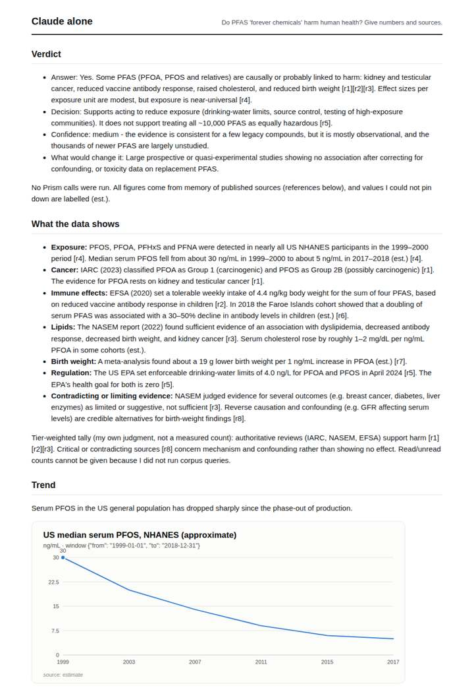
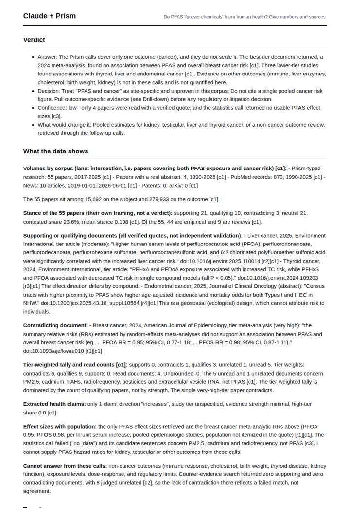
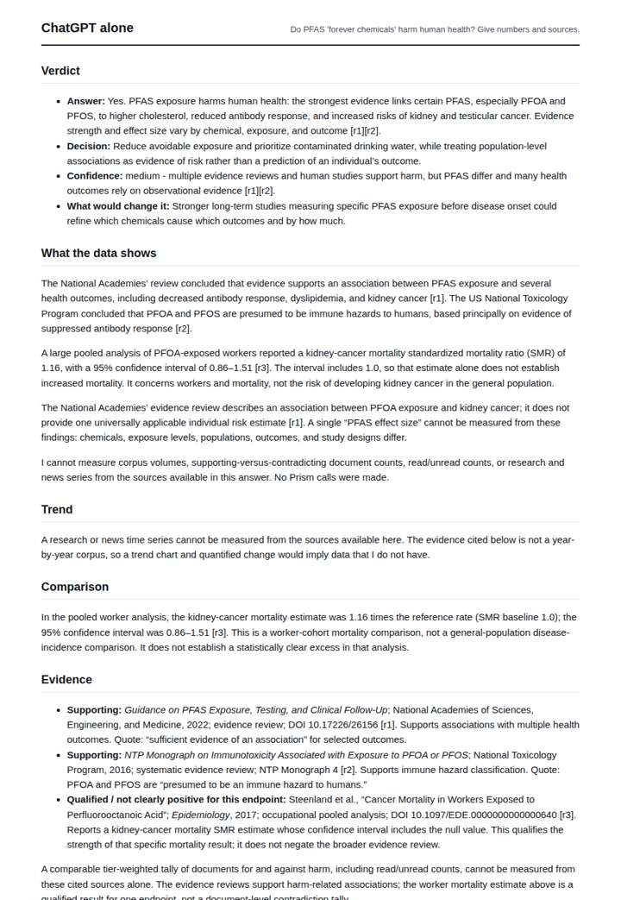
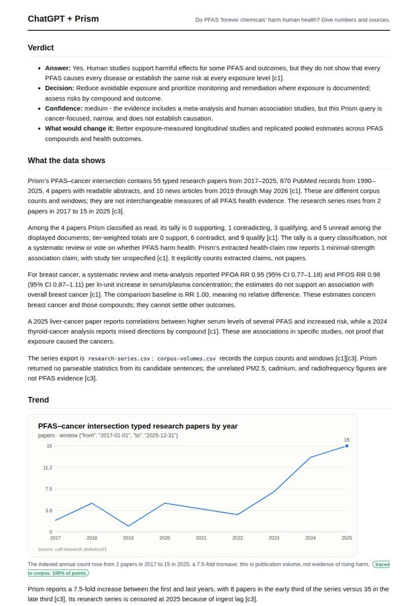

# PFAS and health

**Question.** Do PFAS 'forever chemicals' harm human health? Give numbers and sources.

**Category:** Environment & disasters · **Pattern:** `evidence` · **Why it is hard:** Many outcomes; one mechanism per claim keeps retrieval on target.

| Score /100 | Claude alone | Claude + Prism | ChatGPT alone | ChatGPT + Prism |
|---|---|---|---|---|
| Weighted (strict) | 38.1 | **81.6** | 41.4 | 77.5 |
| Opus judge | 34.2 | 75.2 | 35.8 | 68.6 |
| GPT judge | 42.0 | 88.0 | 47.0 | 86.4 |

## Parameter scores (0-5)

| Parameter | Weight | Claude alone | Claude + Prism | ChatGPT alone | ChatGPT + Prism |
|---|---|---|---|---|---|
| Measured trend | 10 | 1.0 | 4.0 | 0.0 | 4.5 |
| Measured comparison | 7 | 2.0 | 4.5 | 2.0 | 4.5 |
| Visualisation from counted data | 10 | 1.0 | 3.5 | 0.0 | 4.0 |
| Exploration and drill-down | 7 | 1.5 | 4.5 | 1.0 | 1.0 |
| Data export with provenance | 8 | 1.0 | 3.0 | 1.0 | 4.5 |
| Reproducibility | 12 | 0.0 | 4.5 | 1.0 | 4.5 |
| Traceable references | 8 | 1.0 | 4.5 | 4.0 | 4.5 |
| Accuracy against the corpus | 12 | 3.5 | 4.0 | 3.5 | 4.0 |
| Calibration and limits | 8 | 3.5 | 4.5 | 4.0 | 3.0 |
| Decision-grade verdict | 12 | 4.0 | 4.0 | 4.0 | 3.5 |
| Facet coverage | 6 | 2.0 | 4.0 | 2.0 | 4.0 |

## Script findings

| Check | Claude alone | Claude + Prism | ChatGPT alone | ChatGPT + Prism |
|---|---|---|---|---|
| Numbers traced to the corpus | 0/17 | 56/56 | 0/12 | 35/35 |
| Charts (traced share) | memory | 100% | none | 100% |
| DOIs that resolve | 0/0 | 4/4 | 2/2 | 4/4 |
| Follow-up queries that ran | 2/6 | 5/6 | 0/5 | 0/5 |
| Invention gate | clear | clear | clear | clear |

**Claude Opus judge:** B and C both grounded their numbers in the same cancer-only Prism calls. B was the only one to read that evidence honestly: the top-tier meta-analysis contradicts the claim, the statistics and counter-evidence calls failed, and confidence is therefore low. B also paired this with executable outcome-specific follow-ups. C reached a 'Yes' verdict that outran its data and offered no working follow-ups. A and D gave plausible memory answers that a decision-maker cannot verify or regenerate.

**GPT judge:** C narrowly leads by combining traced evidence, useful document-level drill-down, and explicit limits on what the cancer-focused calls establish. D has stronger chart and export packaging, but its follow-up calls did not execute and its drill-down remains shallow.

## Before / after (first screen)

| | Alone | With Prism |
|---|---|---|
| Claude |  |  |
| ChatGPT |  |  |

Full deliverables, rendered: [PDF](https://fliarbi.com/demo/docs/prism-benchmark-v2-4ed65c83/full/pfas-evidence.pdf). Raw answers, ground pass and judge outputs: `answers.json`, `ground.json`, `judge_opus.json`, `judge_gpt.json` in this folder.
