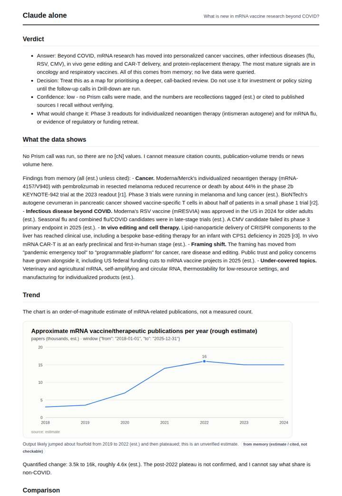
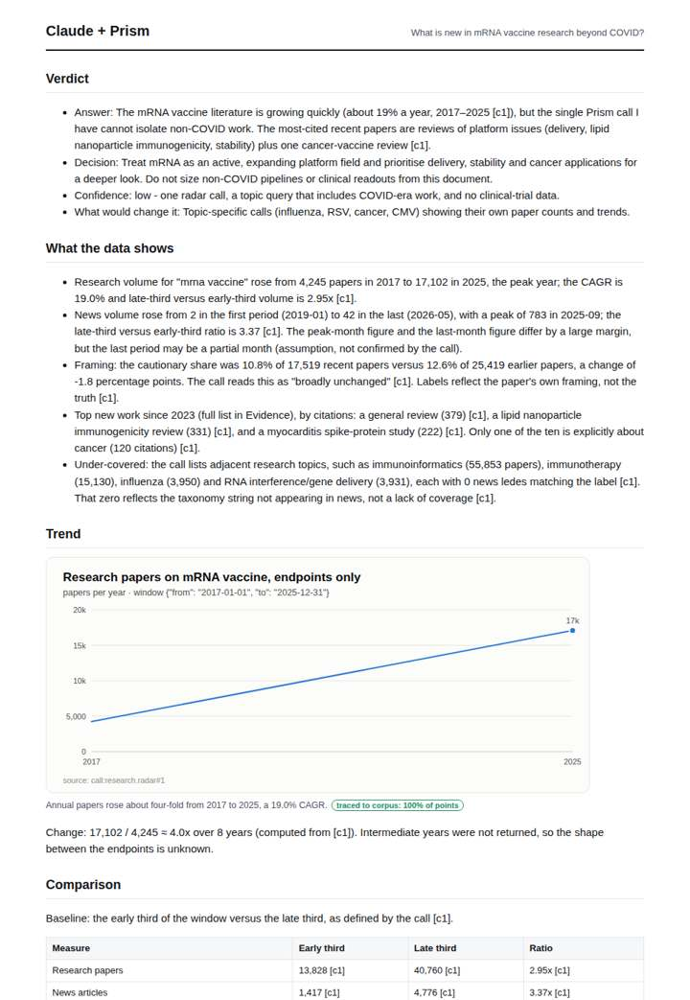
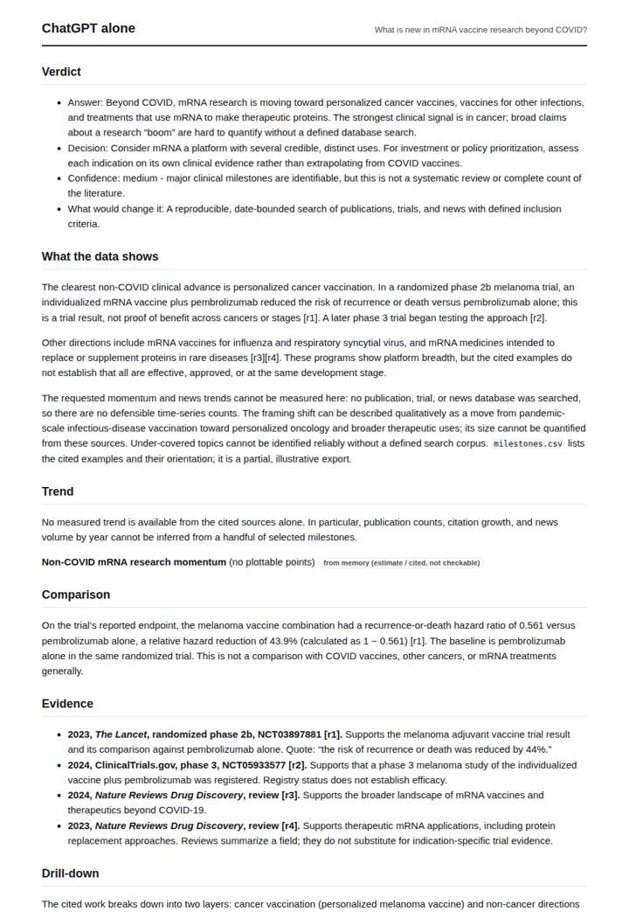
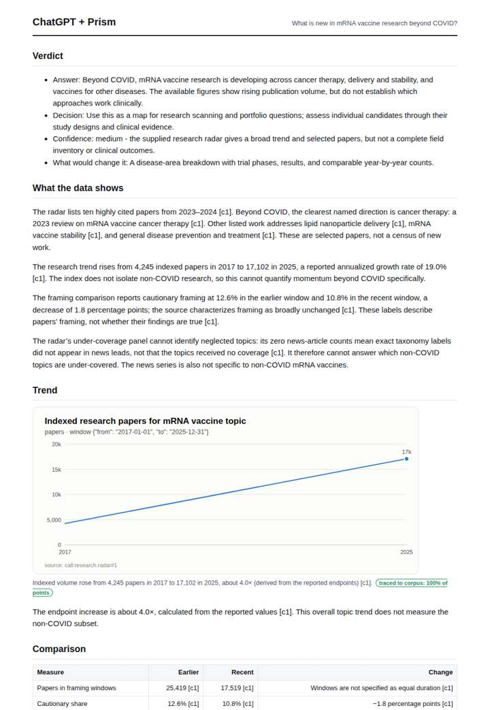

# mRNA beyond COVID

**Question.** What is new in mRNA vaccine research beyond COVID?

**Category:** Company & competitive intelligence · **Pattern:** `radar` · **Why it is hard:** The COVID papers swamp the non-COVID ones; the radar must show the newest work.

| Score /100 | Claude alone | Claude + Prism | ChatGPT alone | ChatGPT + Prism |
|---|---|---|---|---|
| Weighted (strict) | 36.0 | **78.2** | 25.2 | 68.8 |
| Opus judge | 32.8 | 75.8 | 17.4 | 66.4 |
| GPT judge | 39.2 | 80.6 | 33.0 | 71.2 |

## Parameter scores (0-5)

| Parameter | Weight | Claude alone | Claude + Prism | ChatGPT alone | ChatGPT + Prism |
|---|---|---|---|---|---|
| Measured trend | 10 | 1.0 | 4.0 | 0.5 | 3.0 |
| Measured comparison | 7 | 1.5 | 3.5 | 2.0 | 4.0 |
| Visualisation from counted data | 10 | 1.0 | 3.5 | 0.5 | 3.5 |
| Exploration and drill-down | 7 | 1.5 | 3.5 | 1.0 | 2.0 |
| Data export with provenance | 8 | 1.0 | 3.0 | 0.5 | 3.0 |
| Reproducibility | 12 | 1.0 | 5.0 | 0.0 | 4.0 |
| Traceable references | 8 | 1.0 | 3.5 | 0.0 | 3.5 |
| Accuracy against the corpus | 12 | 3.0 | 4.0 | 1.5 | 4.0 |
| Calibration and limits | 8 | 3.0 | 4.0 | 3.5 | 4.0 |
| Decision-grade verdict | 12 | 3.5 | 4.0 | 3.0 | 3.0 |
| Facet coverage | 6 | 1.5 | 4.5 | 1.5 | 3.5 |

## Script findings

| Check | Claude alone | Claude + Prism | ChatGPT alone | ChatGPT + Prism |
|---|---|---|---|---|
| Numbers traced to the corpus | 0/10 | 35/35 | 0/6 | 21/22 |
| Charts (traced share) | memory | 100% | memory | 100% |
| DOIs that resolve | 0/0 | 10/10 | 0/3 | 5/5 |
| Follow-up queries that ran | 3/6 | 3/6 | 1/5 | 2/5 |
| Invention gate | clear | clear | clear | clear |

**Claude Opus judge:** A and B both grounded their numbers in the radar call. A went further: it used the full thirds and news trend, recomputed exactly, and said plainly that the data cannot isolate non-COVID work, giving low confidence and naming the calls that would close the gap. B dropped the news series and overstated its confidence. C offered useful but unmeasured clinical context, honestly labelled. D attached fabricated DOIs to a confident narrative, which disqualifies it for decision use.

**GPT judge:** D is strongest for a decision-maker: it traces the broad research and news trends, names concrete papers and themes, and clearly warns that COVID-heavy data cannot answer non-COVID momentum. Its mixed-lane growth comparison and endpoint-only chart need care; C is more disciplined about the limits of the evidence but gives a thinner trend and drilldown.

## Before / after (first screen)

| | Alone | With Prism |
|---|---|---|
| Claude |  |  |
| ChatGPT |  |  |

Full deliverables, rendered: [PDF](https://fliarbi.com/demo/docs/prism-benchmark-v2-4ed65c83/full/pfizer-pipeline-radar.pdf). Raw answers, ground pass and judge outputs: `answers.json`, `ground.json`, `judge_opus.json`, `judge_gpt.json` in this folder.
