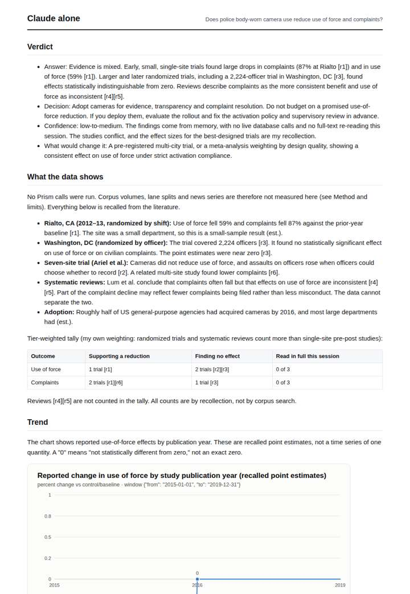
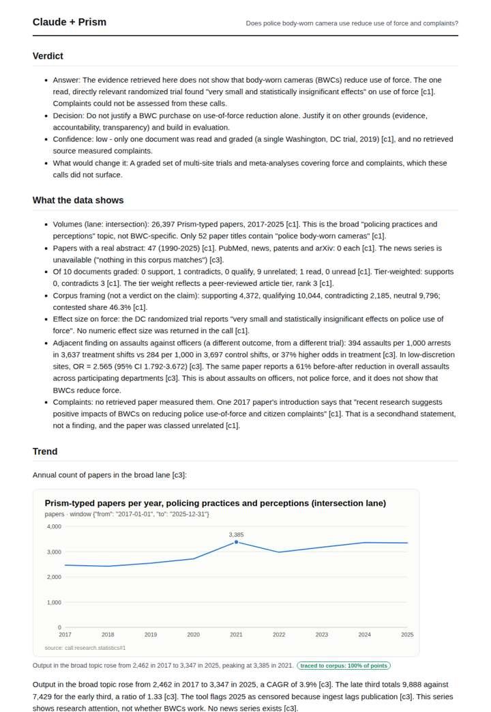
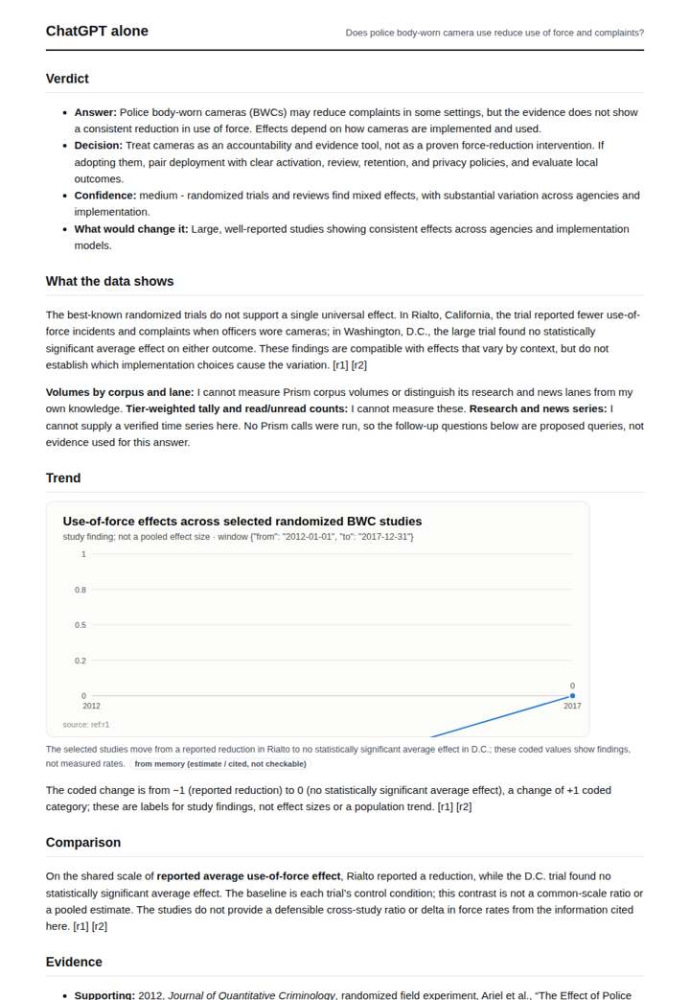
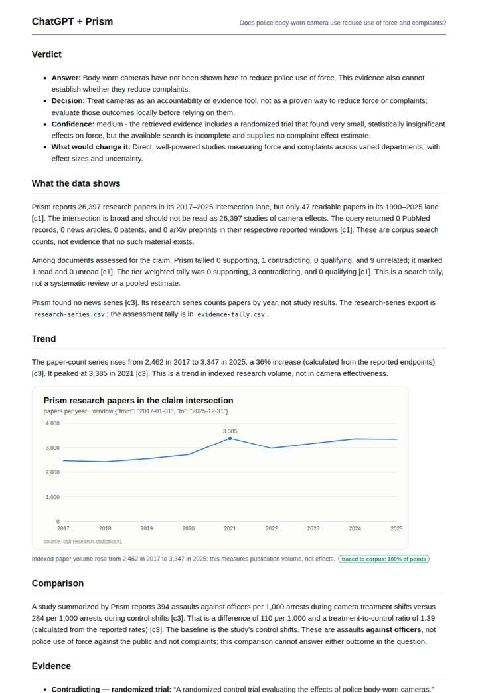

# Do body cameras reduce police use of force?

**Question.** Does police body-worn camera use reduce use of force and complaints?

**Category:** Crime & public safety · **Pattern:** `evidence` · **Why it is hard:** Early RCTs said yes; the large replication said no effect. Both must appear.

| Score /100 | Claude alone | Claude + Prism | ChatGPT alone | ChatGPT + Prism |
|---|---|---|---|---|
| Weighted (strict) | 38.7 | **82.3** | 26.3 | 76.4 |
| Opus judge | 31.0 | 79.2 | 24.0 | 73.0 |
| GPT judge | 46.4 | 85.4 | 28.6 | 79.8 |

## Parameter scores (0-5)

| Parameter | Weight | Claude alone | Claude + Prism | ChatGPT alone | ChatGPT + Prism |
|---|---|---|---|---|---|
| Measured trend | 10 | 1.0 | 4.5 | 1.5 | 4.5 |
| Measured comparison | 7 | 2.0 | 4.5 | 1.0 | 4.5 |
| Visualisation from counted data | 10 | 1.0 | 4.0 | 1.0 | 4.0 |
| Exploration and drill-down | 7 | 1.5 | 4.0 | 1.5 | 2.5 |
| Data export with provenance | 8 | 1.0 | 2.5 | 1.0 | 3.0 |
| Reproducibility | 12 | 1.0 | 4.0 | 0.0 | 4.0 |
| Traceable references | 8 | 3.5 | 4.5 | 0.0 | 4.5 |
| Accuracy against the corpus | 12 | 2.0 | 4.5 | 1.0 | 3.5 |
| Calibration and limits | 8 | 4.0 | 5.0 | 3.0 | 4.0 |
| Decision-grade verdict | 12 | 3.0 | 4.0 | 3.0 | 4.0 |
| Facet coverage | 6 | 1.5 | 3.5 | 1.5 | 3.0 |

## Script findings

| Check | Claude alone | Claude + Prism | ChatGPT alone | ChatGPT + Prism |
|---|---|---|---|---|
| Numbers traced to the corpus | 0/14 | 61/61 | 0/8 | 19/19 |
| Charts (traced share) | memory | 100% | memory | 100% |
| DOIs that resolve | 5/5 | 5/5 | 1/3 | 2/2 |
| Follow-up queries that ran | 2/6 | 4/6 | 2/6 | 2/3 |
| Invention gate | clear | clear | clear | clear |

**Claude Opus judge:** A and C both grounded every number in the recorded calls. A went further: it flagged that the 26,397-paper lane is a broad topic with only 52 BWC-titled papers, gave low confidence because just one trial was read, and placed limits next to the numbers. B and D were the only deliverables to present both the early-RCT and replication sides, but they did so from memory. B relied on a fabricated DOI, and D misstated the discretion finding against the record. A decision-maker can trust A's narrow but honest answer: no traceable evidence that BWCs reduce force, and complaints unmeasured.

**GPT judge:** B best supports a decision with a fully traced, censored research-volume series, a correctly bounded comparison, and the clearest distinction between force and assaults on officers. D is similarly careful and more concise, but gives less usable drilldown and facet coverage; B still overstates what the retrieved evidence establishes about complaints.

## Before / after (first screen)

| | Alone | With Prism |
|---|---|---|
| Claude |  |  |
| ChatGPT |  |  |

Full deliverables, rendered: [PDF](https://fliarbi.com/demo/docs/prism-benchmark-v2-4ed65c83/full/policing-body-cameras.pdf). Raw answers, ground pass and judge outputs: `answers.json`, `ground.json`, `judge_opus.json`, `judge_gpt.json` in this folder.
