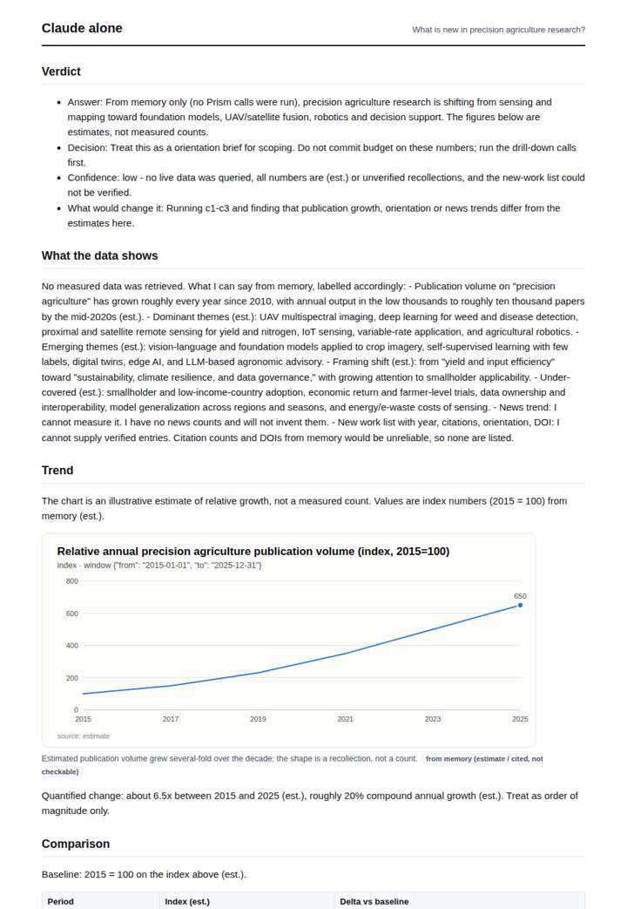
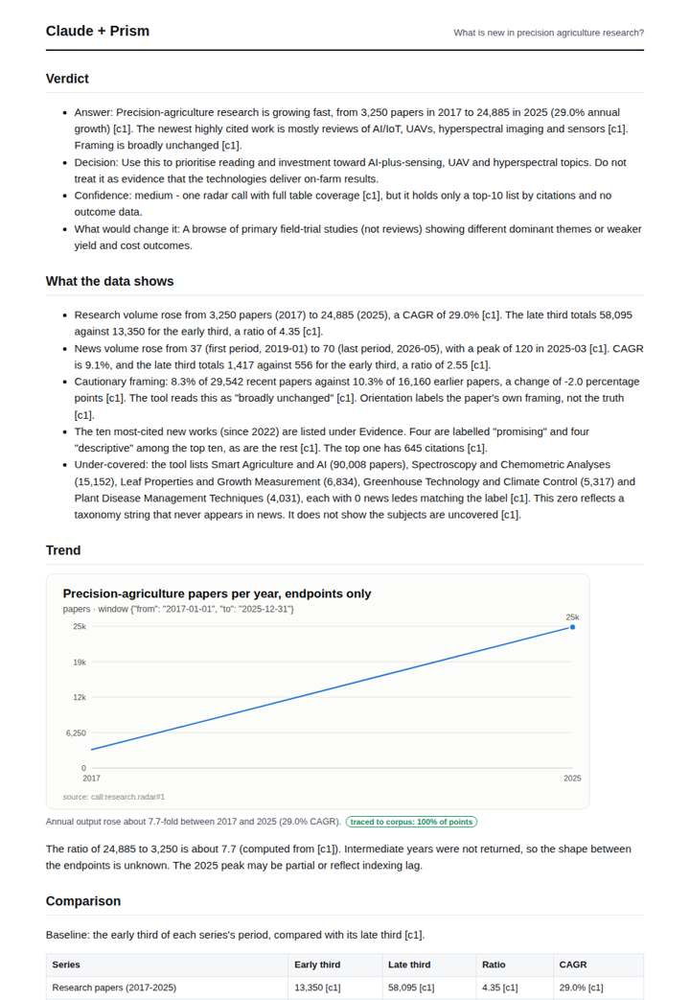
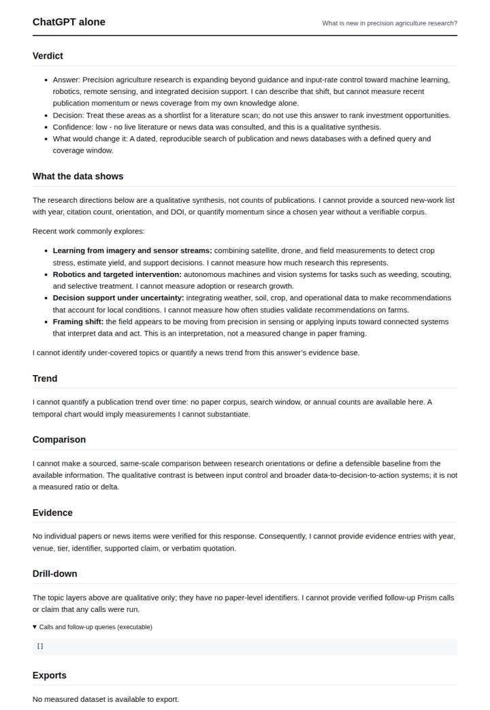
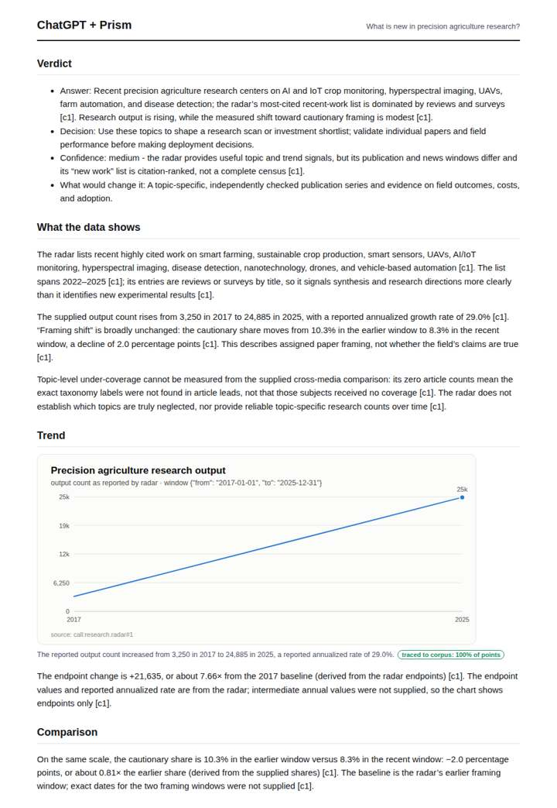

# Precision agriculture research radar

**Question.** What is new in precision agriculture research?

**Category:** Agriculture & food security · **Pattern:** `radar` · **Why it is hard:** Drones, AI and IoT sub-literatures move at different speeds.

| Score /100 | Claude alone | Claude + Prism | ChatGPT alone | ChatGPT + Prism |
|---|---|---|---|---|
| Weighted (strict) | 32.3 | **70.8** | 24.7 | 64.6 |
| Opus judge | 30.2 | 67.4 | 24.2 | 59.2 |
| GPT judge | 34.4 | 74.2 | 25.2 | 70.0 |

## Parameter scores (0-5)

| Parameter | Weight | Claude alone | Claude + Prism | ChatGPT alone | ChatGPT + Prism |
|---|---|---|---|---|---|
| Measured trend | 10 | 1.0 | 4.0 | 0.0 | 3.0 |
| Measured comparison | 7 | 1.5 | 4.0 | 0.5 | 4.0 |
| Visualisation from counted data | 10 | 1.0 | 3.5 | 0.0 | 3.0 |
| Exploration and drill-down | 7 | 1.0 | 3.0 | 0.0 | 2.0 |
| Data export with provenance | 8 | 1.0 | 3.0 | 0.0 | 3.0 |
| Reproducibility | 12 | 1.0 | 4.5 | 1.0 | 4.0 |
| Traceable references | 8 | 0.5 | 3.0 | 0.0 | 3.0 |
| Accuracy against the corpus | 12 | 2.5 | 2.5 | 3.5 | 3.0 |
| Calibration and limits | 8 | 3.5 | 4.0 | 3.0 | 4.0 |
| Decision-grade verdict | 12 | 3.0 | 3.5 | 3.0 | 3.0 |
| Facet coverage | 6 | 1.0 | 4.0 | 1.0 | 3.5 |

## Script findings

| Check | Claude alone | Claude + Prism | ChatGPT alone | ChatGPT + Prism |
|---|---|---|---|---|
| Numbers traced to the corpus | 0/11 | 58/58 | 0/0 | 25/26 |
| Charts (traced share) | memory | 100% | none | 100% |
| DOIs that resolve | 0/0 | 10/10 | 0/0 | 5/5 |
| Follow-up queries that ran | 2/6 | 3/6 | 0/0 | 2/6 |
| Invention gate | clear | clear | clear | clear |

**Claude Opus judge:** C and D both grounded their answers in the radar call. C used more of it: it quantified the research and news trends with ratios and the news peak, listed all ten DOI-linked works, and read the under-coverage zeros correctly. D omitted the news series and misread the direction of the framing shift in its verdict. A and B were honest memory-only answers with no measured support; B added labelled estimates that understate the recorded growth.

**GPT judge:** D offers the broadest decision-grade picture: it connects research and news trends, framing, recent papers, and taxonomy results while explaining what those counts cannot establish. Its numerical coverage and drill-down are stronger than B’s, though an orientation-count error and unsupported peak caveat weaken its accuracy; B is the cleaner, more restrained alternative.

## Before / after (first screen)

| | Alone | With Prism |
|---|---|---|
| Claude |  |  |
| ChatGPT |  |  |

Full deliverables, rendered: [PDF](https://fliarbi.com/demo/docs/prism-benchmark-v2-4ed65c83/full/precision-farming-radar.pdf). Raw answers, ground pass and judge outputs: `answers.json`, `ground.json`, `judge_opus.json`, `judge_gpt.json` in this folder.
