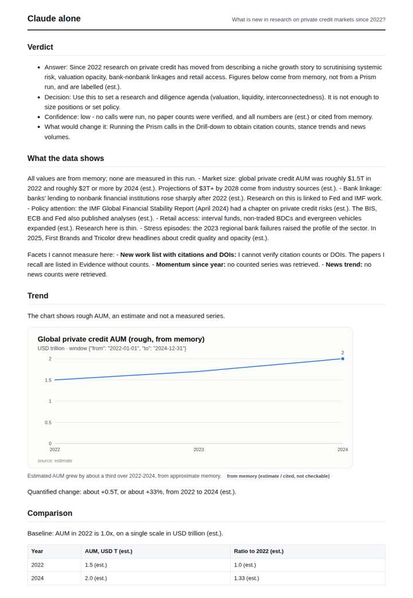
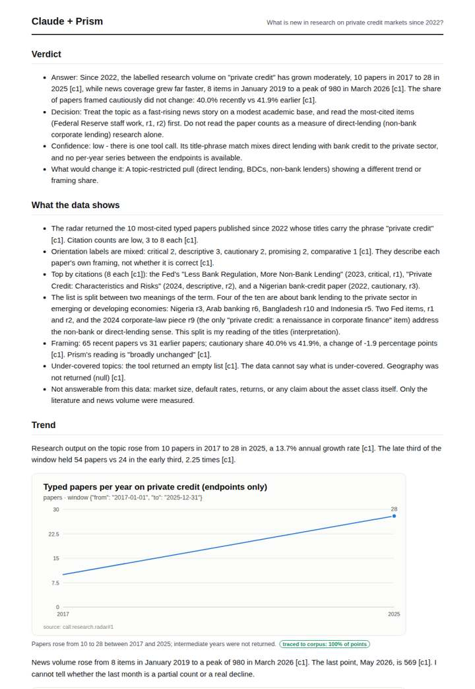
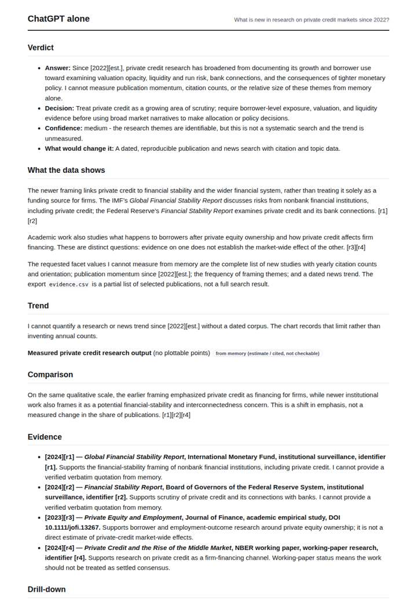
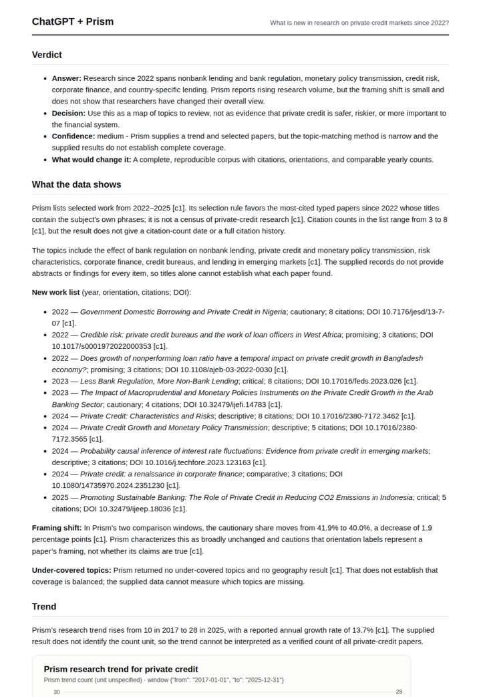

# Private credit research radar

**Question.** What is new in research on private credit markets since 2022?

**Category:** Finance & markets · **Pattern:** `radar` · **Why it is hard:** Small literature: the honest answer reports how thin it is.

| Score /100 | Claude alone | Claude + Prism | ChatGPT alone | ChatGPT + Prism |
|---|---|---|---|---|
| Weighted (strict) | 32.4 | **71.5** | 29.4 | 71.3 |
| Opus judge | 32.8 | 76.4 | 25.6 | 68.4 |
| GPT judge | 32.0 | 66.6 | 33.2 | 74.2 |

## Parameter scores (0-5)

| Parameter | Weight | Claude alone | Claude + Prism | ChatGPT alone | ChatGPT + Prism |
|---|---|---|---|---|---|
| Measured trend | 10 | 1.0 | 4.0 | 1.0 | 3.5 |
| Measured comparison | 7 | 1.0 | 2.5 | 1.0 | 3.5 |
| Visualisation from counted data | 10 | 1.0 | 2.5 | 1.0 | 3.5 |
| Exploration and drill-down | 7 | 1.0 | 3.0 | 1.0 | 2.0 |
| Data export with provenance | 8 | 1.0 | 4.0 | 1.0 | 2.5 |
| Reproducibility | 12 | 1.0 | 4.0 | 0.0 | 4.5 |
| Traceable references | 8 | 1.0 | 3.5 | 1.0 | 3.0 |
| Accuracy against the corpus | 12 | 2.5 | 4.0 | 1.5 | 4.5 |
| Calibration and limits | 8 | 3.5 | 4.0 | 3.5 | 3.0 |
| Decision-grade verdict | 12 | 3.0 | 3.0 | 3.5 | 4.0 |
| Facet coverage | 6 | 1.0 | 5.0 | 1.5 | 4.0 |

## Script findings

| Check | Claude alone | Claude + Prism | ChatGPT alone | ChatGPT + Prism |
|---|---|---|---|---|
| Numbers traced to the corpus | 0/9 | 28/30 | 0/1 | 29/29 |
| Charts (traced share) | memory | 100%, 100%, 100% | memory | 100% |
| DOIs that resolve | 0/0 | 10/10 | 1/2 | 10/10 |
| Follow-up queries that ran | 1/6 | 3/6 | 0/5 | 2/6 |
| Invention gate | clear | clear | clear | clear |

**Claude Opus judge:** B and D both grounded their answers in the radar call. Only B noticed that half of the 'private credit' papers concern bank credit to the private sector rather than private credit markets, which shows how thin the real literature is. B also quantified the gap between research and news. D was faithful to the data but had a shallower trend and only one chart. A and C answered from memory: C was honestly labelled but answered with AUM rather than research measures, and A cited unresolvable identifiers.

**GPT judge:** A is the strongest decision aid: it treats the literature as a selected, thin map, quantifies the framing shift, and clearly bounds what the data can establish. B adds useful comparisons and exports, but mislabels an unspecified trend unit and overstates a cross-window research/news comparison; C and D are candid about memory limits but provide little grounded measurement.

## Before / after (first screen)

| | Alone | With Prism |
|---|---|---|
| Claude |  |  |
| ChatGPT |  |  |

Full deliverables, rendered: [PDF](https://fliarbi.com/demo/docs/prism-benchmark-v2-4ed65c83/full/private-credit-radar.pdf). Raw answers, ground pass and judge outputs: `answers.json`, `ground.json`, `judge_opus.json`, `judge_gpt.json` in this folder.
