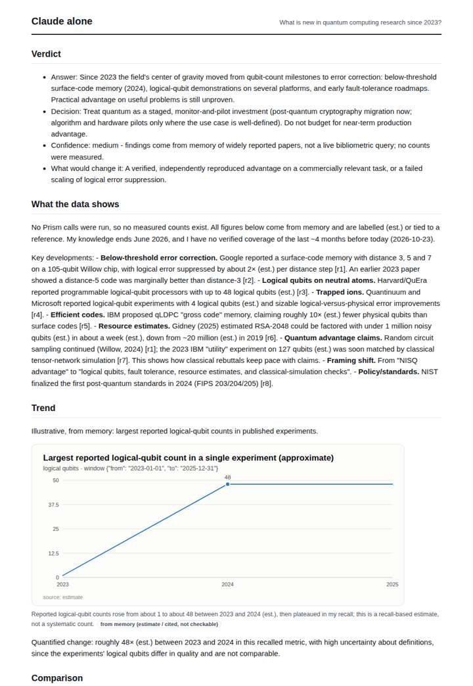
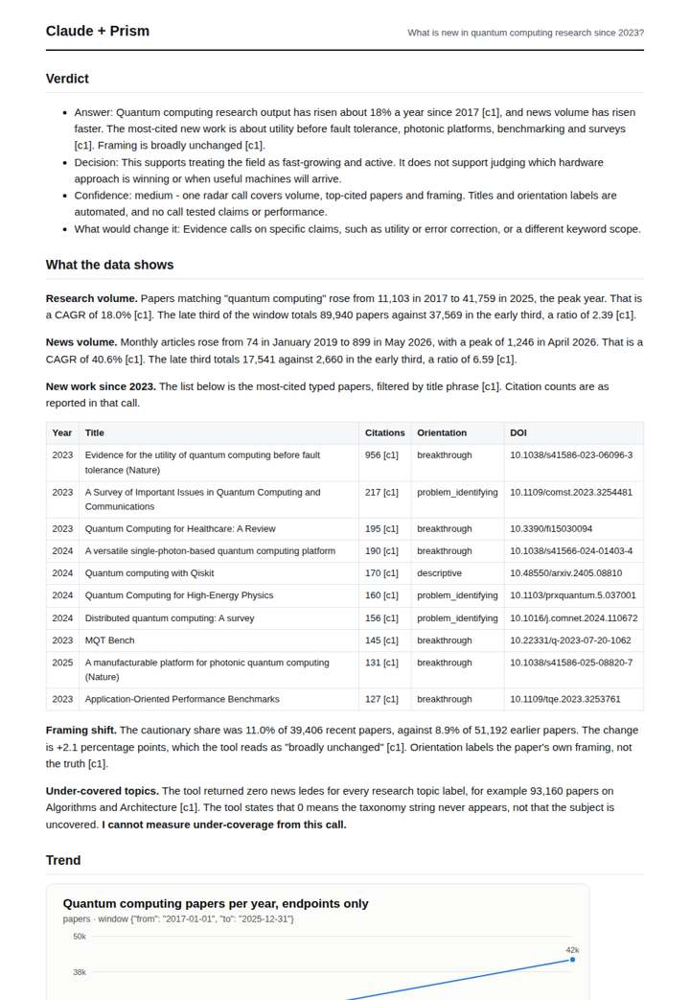
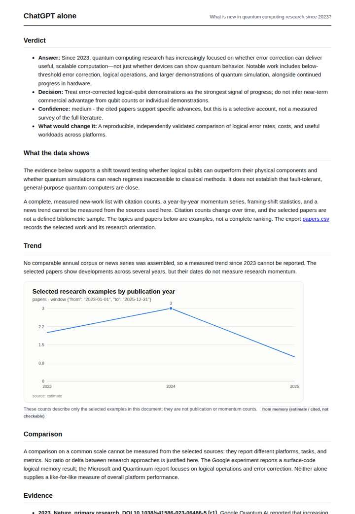
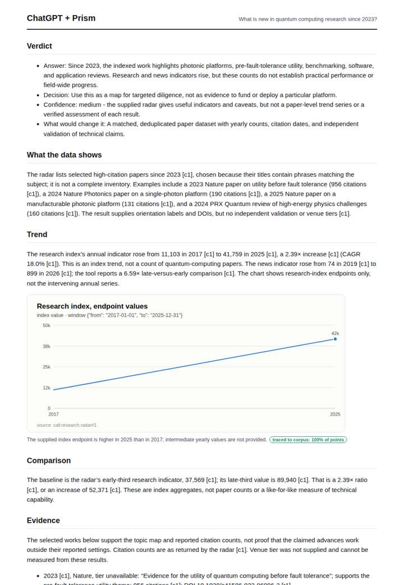

# Quantum computing research radar

**Question.** What is new in quantum computing research since 2023?

**Category:** Technology & AI · **Pattern:** `radar` · **Why it is hard:** Error-correction milestones in 2024-2025 shifted the framing.

| Score /100 | Claude alone | Claude + Prism | ChatGPT alone | ChatGPT + Prism |
|---|---|---|---|---|
| Weighted (strict) | 37.5 | **70.2** | 21.4 | 59.5 |
| Opus judge | 36.6 | 74.4 | 15.0 | 53.8 |
| GPT judge | 38.4 | 66.0 | 27.8 | 65.2 |

## Parameter scores (0-5)

| Parameter | Weight | Claude alone | Claude + Prism | ChatGPT alone | ChatGPT + Prism |
|---|---|---|---|---|---|
| Measured trend | 10 | 1.0 | 4.0 | 0.5 | 2.5 |
| Measured comparison | 7 | 2.0 | 3.0 | 0.0 | 3.5 |
| Visualisation from counted data | 10 | 1.0 | 3.0 | 1.0 | 2.5 |
| Exploration and drill-down | 7 | 1.5 | 2.0 | 1.0 | 2.0 |
| Data export with provenance | 8 | 1.0 | 2.5 | 0.5 | 3.0 |
| Reproducibility | 12 | 1.0 | 4.0 | 1.0 | 3.5 |
| Traceable references | 8 | 1.0 | 2.5 | 0.0 | 3.0 |
| Accuracy against the corpus | 12 | 3.0 | 4.5 | 0.5 | 2.0 |
| Calibration and limits | 8 | 3.5 | 4.0 | 3.0 | 4.0 |
| Decision-grade verdict | 12 | 3.5 | 4.0 | 2.5 | 3.5 |
| Facet coverage | 6 | 1.5 | 4.0 | 1.5 | 3.5 |

## Script findings

| Check | Claude alone | Claude + Prism | ChatGPT alone | ChatGPT + Prism |
|---|---|---|---|---|
| Numbers traced to the corpus | 0/11 | 63/64 | 0/15 | 34/35 |
| Charts (traced share) | memory | 100% | memory | 100% |
| DOIs that resolve | 0/0 | 10/10 | 2/5 | 5/5 |
| Follow-up queries that ran | 2/7 | 1/6 | 0/5 | 1/5 |
| Invention gate | clear | clear | clear | clear |

**Claude Opus judge:** D read every radar field correctly, including CAGRs, peak, censoring and the under-covered artifact. It quantified the change exactly and was honest that error-correction milestones are outside what the call can show. B used the same data but misreported the growth ratio and mislabelled paper counts as an index. A gave the most expert-correct narrative on error correction, but entirely from memory. C's references were largely fabricated or mismatched.

**GPT judge:** B is the strongest decision aid: it traces the broad volume and framing indicators, states their limits, and gives a usable but bounded answer. A is close, but adds unsupported coverage metadata; C and D offer more concrete error-correction claims, yet their evidence is substantially less verifiable.

## Before / after (first screen)

| | Alone | With Prism |
|---|---|---|
| Claude |  |  |
| ChatGPT |  |  |

Full deliverables, rendered: [PDF](https://fliarbi.com/demo/docs/prism-benchmark-v2-4ed65c83/full/quantum-computing-radar.pdf). Raw answers, ground pass and judge outputs: `answers.json`, `ground.json`, `judge_opus.json`, `judge_gpt.json` in this folder.
