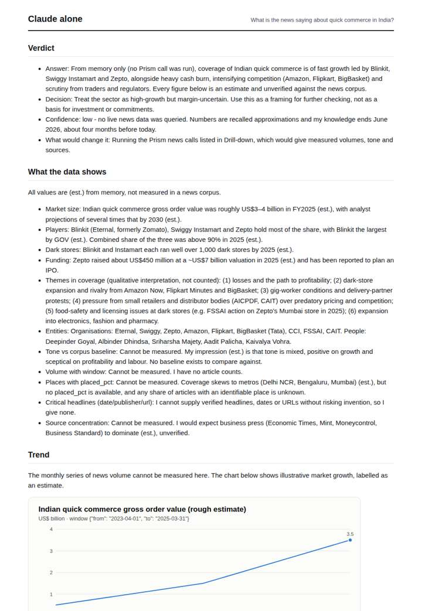
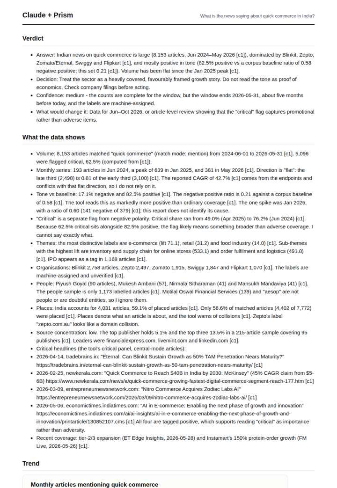
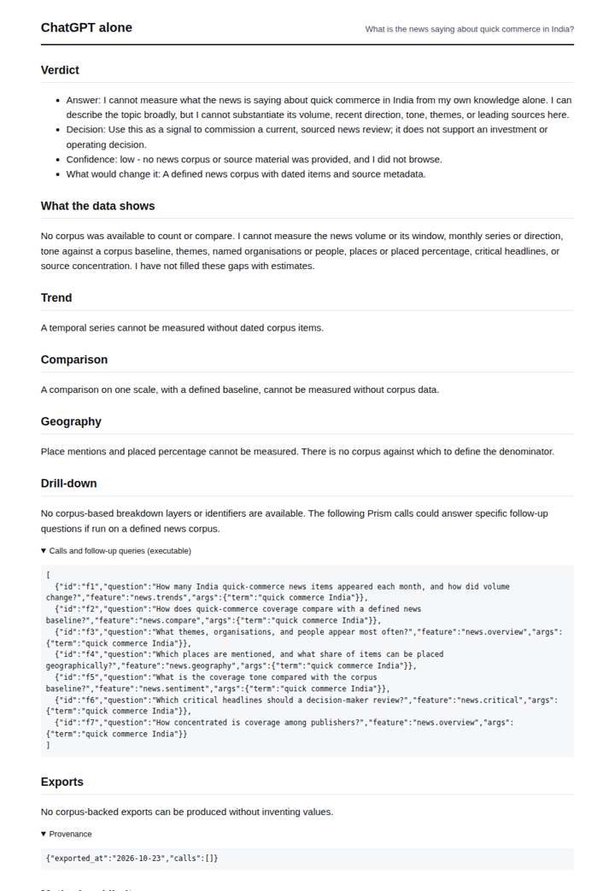
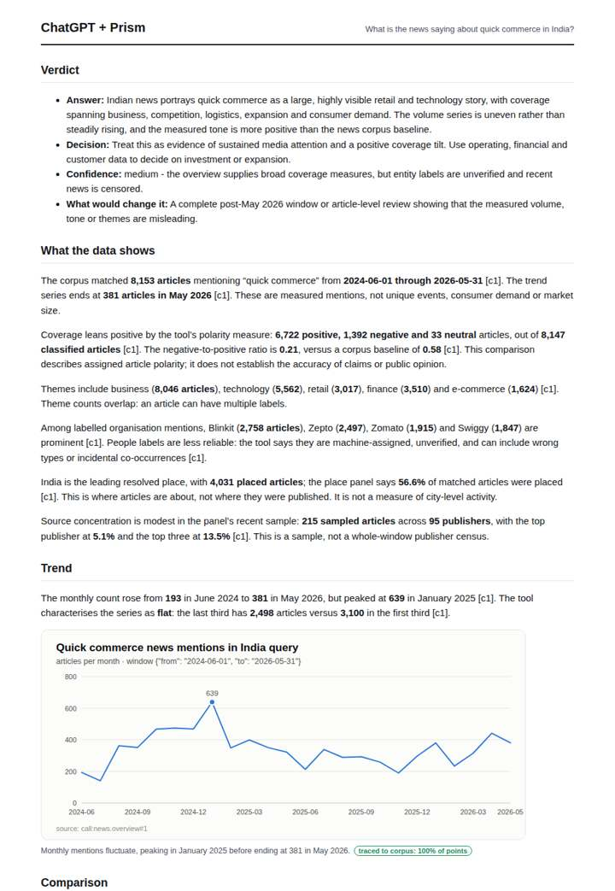

# Quick commerce in India

**Question.** What is the news saying about quick commerce in India?

**Category:** Consumer, brands & media · **Pattern:** `pulse` · **Why it is hard:** Blinkit, Zepto and Instamart; dark-store regulation stories.

| Score /100 | Claude alone | Claude + Prism | ChatGPT alone | ChatGPT + Prism |
|---|---|---|---|---|
| Weighted (strict) | 34.6 | **72.8** | 23.5 | 71.0 |
| Opus judge | 32.6 | 69.2 | 19.6 | 69.2 |
| GPT judge | 36.6 | 76.4 | 27.4 | 72.8 |

## Parameter scores (0-5)

| Parameter | Weight | Claude alone | Claude + Prism | ChatGPT alone | ChatGPT + Prism |
|---|---|---|---|---|---|
| Measured trend | 10 | 1.0 | 4.5 | 0.0 | 3.5 |
| Measured comparison | 7 | 2.0 | 4.5 | 0.5 | 4.0 |
| Visualisation from counted data | 10 | 1.0 | 3.0 | 0.0 | 3.0 |
| Exploration and drill-down | 7 | 1.0 | 3.5 | 2.0 | 2.0 |
| Data export with provenance | 8 | 1.0 | 3.0 | 0.0 | 4.5 |
| Reproducibility | 12 | 1.0 | 4.0 | 1.0 | 5.0 |
| Traceable references | 8 | 0.5 | 1.0 | 0.5 | 1.0 |
| Accuracy against the corpus | 12 | 3.0 | 4.0 | 3.0 | 4.0 |
| Calibration and limits | 8 | 3.0 | 4.5 | 3.0 | 4.5 |
| Decision-grade verdict | 12 | 3.5 | 4.0 | 2.0 | 3.5 |
| Facet coverage | 6 | 1.0 | 3.5 | 0.0 | 3.0 |

## Script findings

| Check | Claude alone | Claude + Prism | ChatGPT alone | ChatGPT + Prism |
|---|---|---|---|---|
| Numbers traced to the corpus | 0/9 | 80/81 | 0/0 | 35/35 |
| Charts (traced share) | memory | 100% | none | 100% |
| DOIs that resolve | 0/0 | 0/0 | 0/0 | 0/0 |
| Follow-up queries that ran | 3/6 | 3/6 | 5/7 | 1/5 |
| Invention gate | clear | clear | clear | clear |

**Claude Opus judge:** A and B both answer from the traced overview with correct trend and tone-versus-baseline numbers. B goes further: it names dated critical headlines with URLs, decomposes critical versus negative, and catches entity and place anomalies. A has cleaner provenance and fewer slips. C and D are honest but measure nothing; C offers memory estimates and D declines entirely.

**GPT judge:** C best combines a quantified trend, tone comparison, grounded themes and entities, and a clear warning that “critical” is not the same as negative. D has cleaner exports and stronger reproducibility, but its trend reading is less complete and its follow-up drill-downs mostly did not execute; neither deliverable fully resolves dark-store regulation or the brand-versus-generic comparison.

## Before / after (first screen)

| | Alone | With Prism |
|---|---|---|
| Claude |  |  |
| ChatGPT |  |  |

Full deliverables, rendered: [PDF](https://fliarbi.com/demo/docs/prism-benchmark-v2-4ed65c83/full/quick-commerce-pulse.pdf). Raw answers, ground pass and judge outputs: `answers.json`, `ground.json`, `judge_opus.json`, `judge_gpt.json` in this folder.
