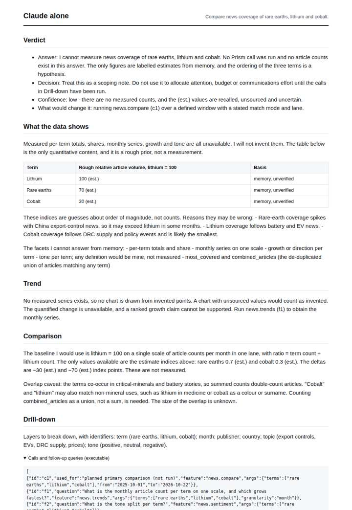
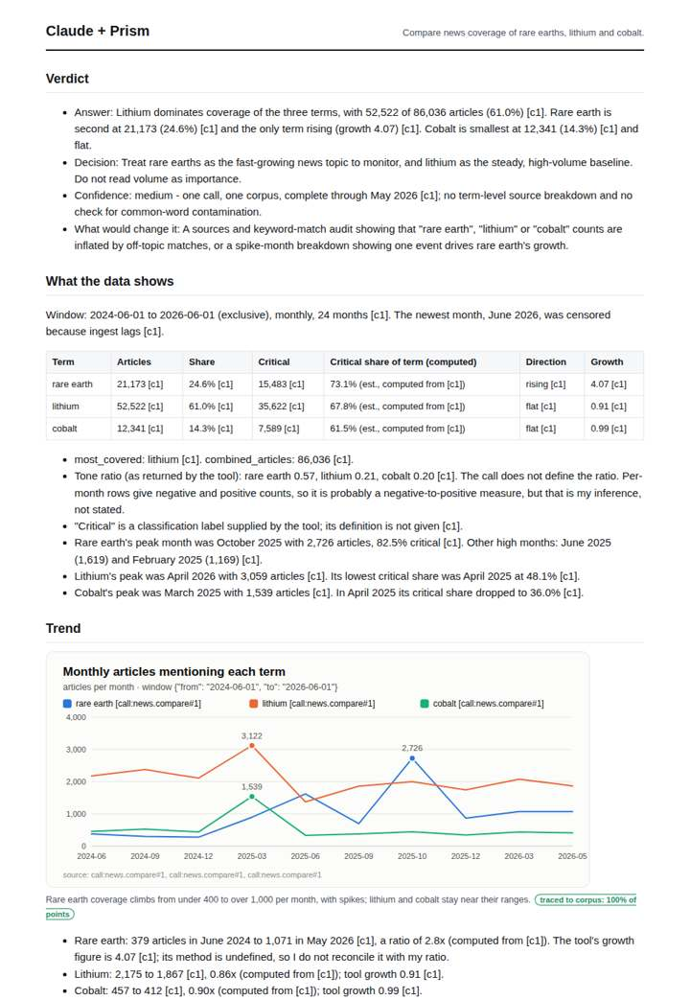
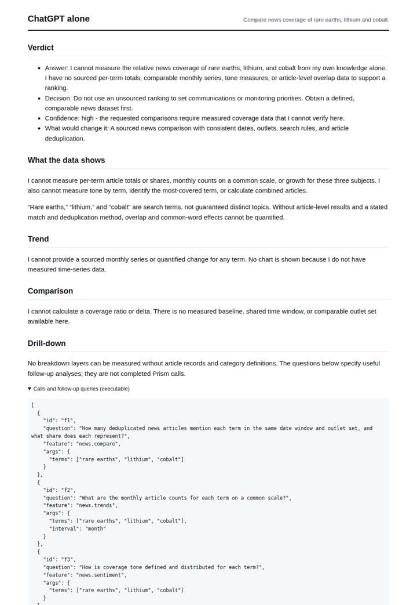
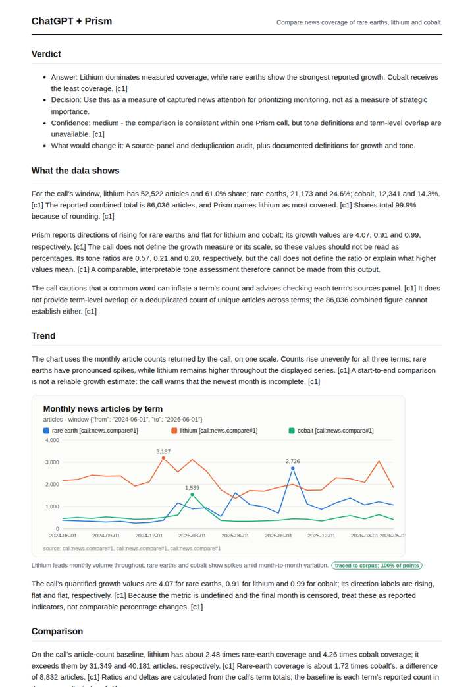

# Rare earths vs lithium vs cobalt

**Question.** Compare news coverage of rare earths, lithium and cobalt.

**Category:** Supply chain & trade · **Pattern:** `compare` · **Why it is hard:** China's 2025 rare-earth export controls spike one series.

| Score /100 | Claude alone | Claude + Prism | ChatGPT alone | ChatGPT + Prism |
|---|---|---|---|---|
| Weighted (strict) | 31.1 | 63.9 | 22.2 | **65.8** |
| Opus judge | 24.3 | 64.6 | 19.8 | 58.7 |
| GPT judge | 37.8 | 63.3 | 24.6 | 72.8 |

## Parameter scores (0-5)

| Parameter | Weight | Claude alone | Claude + Prism | ChatGPT alone | ChatGPT + Prism |
|---|---|---|---|---|---|
| Measured trend | 10 | 0.5 | 3.5 | 0.0 | 3.0 |
| Measured comparison | 7 | 1.0 | 4.5 | 0.0 | 4.5 |
| Visualisation from counted data | 10 | 0.0 | 3.0 | 0.0 | 3.5 |
| Exploration and drill-down | 7 | 1.0 | 3.5 | 1.0 | 2.0 |
| Data export with provenance | 8 | 1.0 | 2.0 | 0.0 | 4.0 |
| Reproducibility | 12 | 0.0 | 4.0 | 1.0 | 4.0 |
| Accuracy against the corpus | 12 | 3.5 | 1.5 | 3.5 | 2.5 |
| Calibration and limits | 8 | 4.0 | 3.5 | 2.5 | 3.5 |
| Decision-grade verdict | 12 | 3.0 | 3.5 | 1.5 | 3.0 |
| Facet coverage | 6 | 1.0 | 3.5 | 0.5 | 3.0 |

## Script findings

| Check | Claude alone | Claude + Prism | ChatGPT alone | ChatGPT + Prism |
|---|---|---|---|---|
| Numbers traced to the corpus | 0/9 | 75/75 | 0/0 | 24/25 |
| Charts (traced share) | none | 100% | none | 100% |
| DOIs that resolve | 0/0 | 0/0 | 0/0 | 0/0 |
| Follow-up queries that ran | 1/5 | 4/6 | 1/4 | 1/5 |
| Invention gate | clear | clear | clear | clear |

**Claude Opus judge:** D and A both grounded their answers in the same traced call, but D read the series more closely. It named peaks and computed critical shares, caught that combined_articles is an undeduplicated sum, and placed the window and overlap limits where they change the reading. Each data-backed deliverable has a factual slip. D misstates lithium's peak month, and A wrongly says lithium leads in every month. B and C honestly declined to measure, so a decision-maker gets nothing actionable from them.

**GPT judge:** C gives the strongest decision-ready comparison: its complete traced chart and exports show lithium’s volume lead and rare earths’ spikes, with useful limits. B quantifies the trend and offers deeper follow-up, but its unsupported interpretation of the combined count and overlap weakens trust; C also has a direction error in its trend prose.

## Before / after (first screen)

| | Alone | With Prism |
|---|---|---|
| Claude |  |  |
| ChatGPT |  |  |

Full deliverables, rendered: [PDF](https://fliarbi.com/demo/docs/prism-benchmark-v2-4ed65c83/full/rare-earths-compare.pdf). Raw answers, ground pass and judge outputs: `answers.json`, `ground.json`, `judge_opus.json`, `judge_gpt.json` in this folder.
