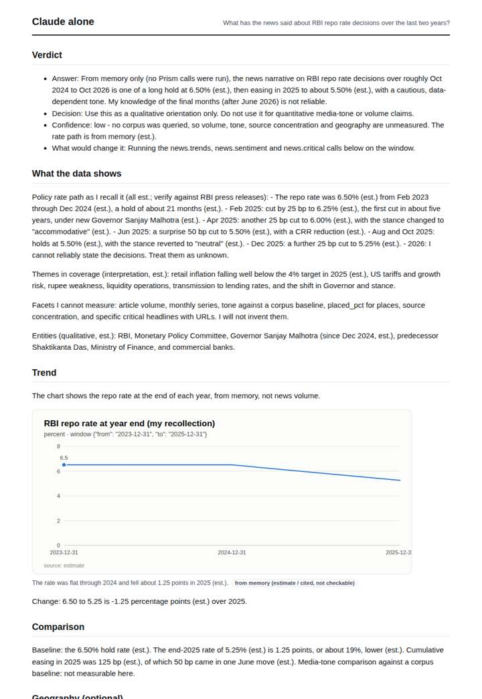
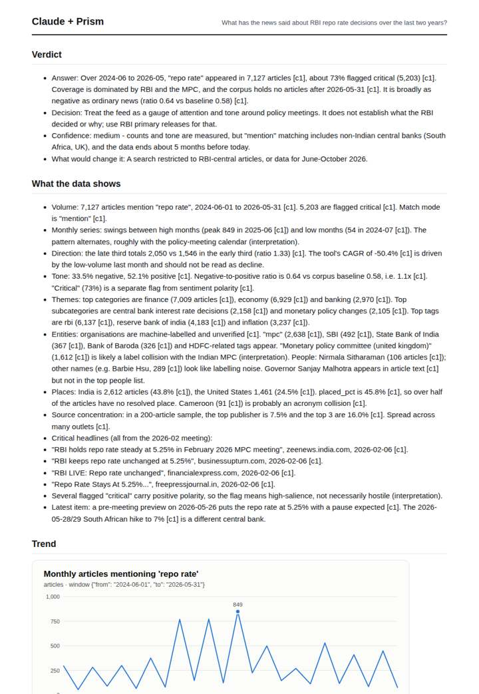
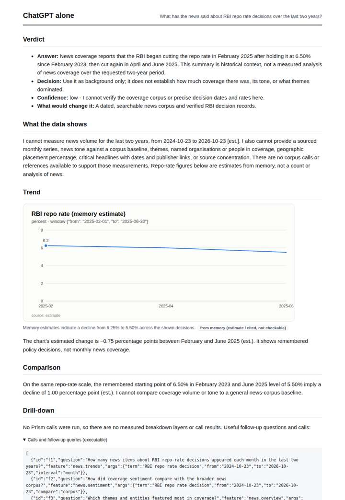
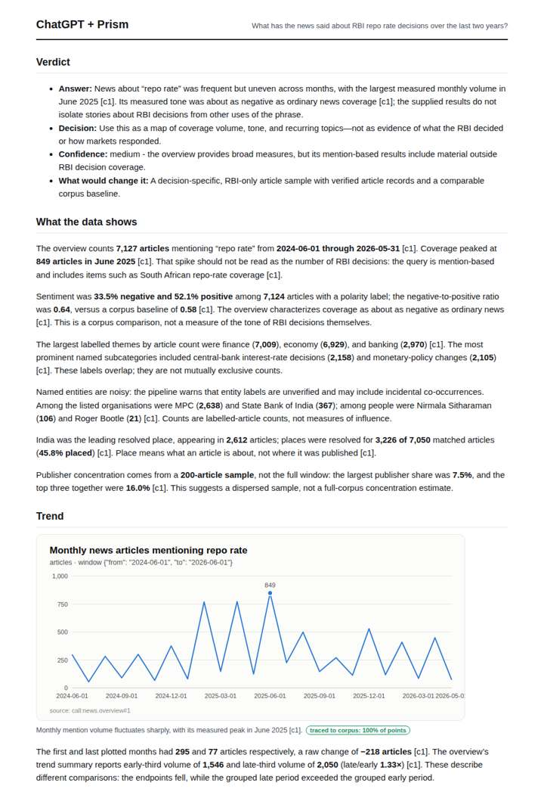

# RBI repo rate coverage

**Question.** What has the news said about RBI repo rate decisions over the last two years?

**Category:** Finance & markets · **Pattern:** `pulse` · **Why it is hard:** An acronym-heavy term; the resolver must route it as a topic, not a place.

| Score /100 | Claude alone | Claude + Prism | ChatGPT alone | ChatGPT + Prism |
|---|---|---|---|---|
| Weighted (strict) | 35.9 | **74.5** | 24.4 | 73.8 |
| Opus judge | 32.6 | 81.2 | 23.0 | 69.4 |
| GPT judge | 39.2 | 67.8 | 25.8 | 78.2 |

## Parameter scores (0-5)

| Parameter | Weight | Claude alone | Claude + Prism | ChatGPT alone | ChatGPT + Prism |
|---|---|---|---|---|---|
| Measured trend | 10 | 1.0 | 3.5 | 1.0 | 4.0 |
| Measured comparison | 7 | 2.0 | 4.0 | 2.0 | 4.0 |
| Visualisation from counted data | 10 | 1.0 | 2.5 | 1.0 | 3.0 |
| Exploration and drill-down | 7 | 1.5 | 3.5 | 1.0 | 3.0 |
| Data export with provenance | 8 | 1.0 | 3.0 | 1.0 | 3.0 |
| Reproducibility | 12 | 1.0 | 5.0 | 0.0 | 4.5 |
| Traceable references | 8 | 0.5 | 1.0 | 0.5 | 2.0 |
| Accuracy against the corpus | 12 | 3.5 | 4.5 | 3.0 | 4.5 |
| Calibration and limits | 8 | 3.0 | 4.5 | 3.0 | 4.5 |
| Decision-grade verdict | 12 | 3.0 | 4.0 | 0.0 | 3.5 |
| Facet coverage | 6 | 1.5 | 5.0 | 1.5 | 4.0 |

## Script findings

| Check | Claude alone | Claude + Prism | ChatGPT alone | ChatGPT + Prism |
|---|---|---|---|---|
| Numbers traced to the corpus | 0/23 | 62/62 | 0/5 | 36/37 |
| Charts (traced share) | memory | 100% | memory | 100% |
| DOIs that resolve | 0/0 | 0/0 | 0/0 | 0/0 |
| Follow-up queries that ran | 3/6 | 3/6 | 0/6 | 1/4 |
| Invention gate | clear | clear | tripped | clear |

**Claude Opus judge:** C and B both grounded every figure in the recorded overview, but C read the data more critically. It rejected the misleading CAGR, separated 'critical' from polarity, and flagged the entity and place collisions and the non-RBI contamination. It also stated plainly that RBI decisions after May 2026 are unseen. A and D answered honestly from memory but could not measure coverage at all.

**GPT judge:** A is the strongest decision aid: it separates mention-based coverage from RBI decisions, gives a traceable volume and tone read, and places the key data limits beside the findings. B covers more facets, but its chart treats the censored final month as an ordinary low point and its export labels coverage as full, making its trend reading less dependable.

## Before / after (first screen)

| | Alone | With Prism |
|---|---|---|
| Claude |  |  |
| ChatGPT |  |  |

Full deliverables, rendered: [PDF](https://fliarbi.com/demo/docs/prism-benchmark-v2-4ed65c83/full/rbi-repo-rate.pdf). Raw answers, ground pass and judge outputs: `answers.json`, `ground.json`, `judge_opus.json`, `judge_gpt.json` in this folder.
