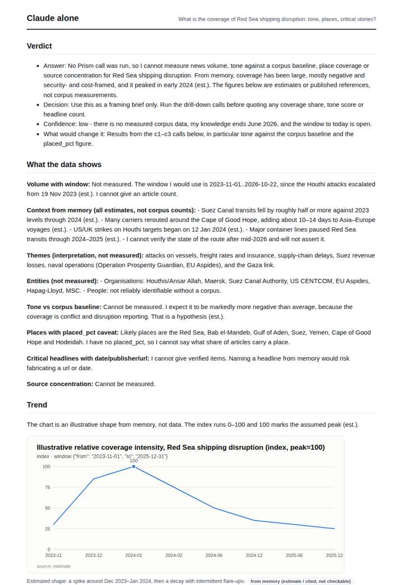
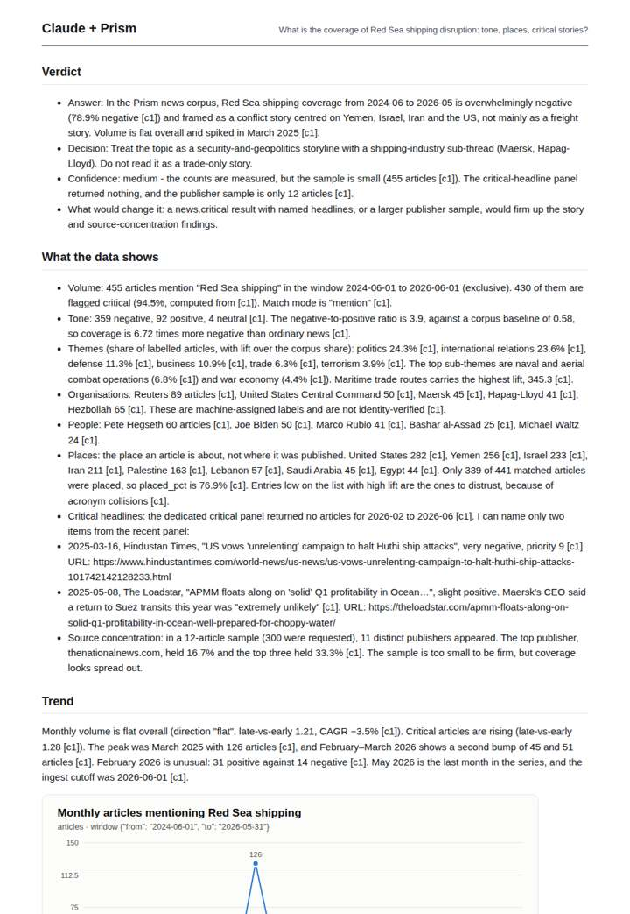
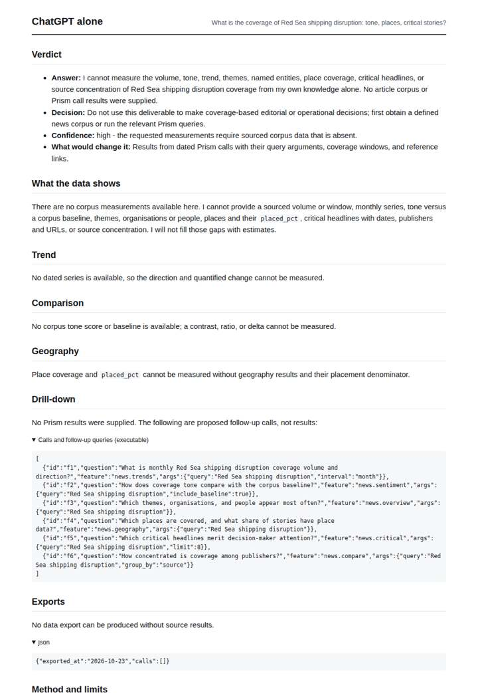
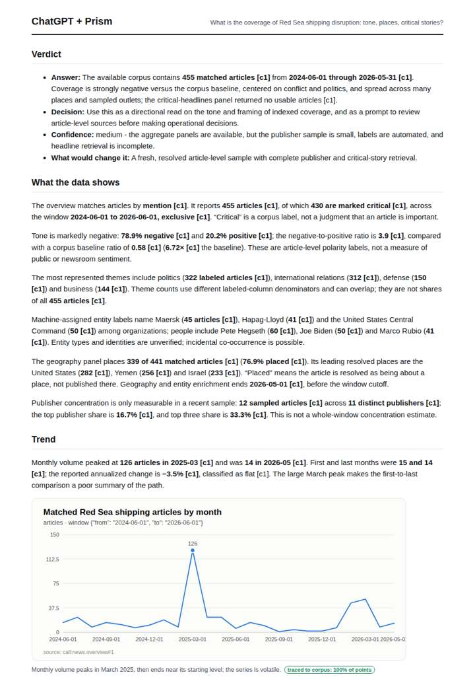

# Red Sea shipping disruption

**Question.** What is the coverage of Red Sea shipping disruption: tone, places, critical stories?

**Category:** Supply chain & trade · **Pattern:** `pulse` · **Why it is hard:** Houthi attacks since late 2023; coverage geography spans Asia and Europe.

| Score /100 | Claude alone | Claude + Prism | ChatGPT alone | ChatGPT + Prism |
|---|---|---|---|---|
| Weighted (strict) | 29.6 | **72.4** | 24.8 | 70.5 |
| Opus judge | 27.4 | 72.6 | 19.0 | 69.0 |
| GPT judge | 31.8 | 72.2 | 30.6 | 72.0 |

## Parameter scores (0-5)

| Parameter | Weight | Claude alone | Claude + Prism | ChatGPT alone | ChatGPT + Prism |
|---|---|---|---|---|---|
| Measured trend | 10 | 1.0 | 4.5 | 0.0 | 4.5 |
| Measured comparison | 7 | 0.5 | 4.5 | 0.0 | 4.5 |
| Visualisation from counted data | 10 | 1.0 | 4.0 | 0.0 | 3.5 |
| Exploration and drill-down | 7 | 1.5 | 2.5 | 1.0 | 1.0 |
| Data export with provenance | 8 | 1.0 | 2.5 | 0.0 | 4.0 |
| Reproducibility | 12 | 1.0 | 5.0 | 1.0 | 5.0 |
| Traceable references | 8 | 0.5 | 1.0 | 0.5 | 1.0 |
| Accuracy against the corpus | 12 | 3.0 | 3.5 | 4.0 | 3.5 |
| Calibration and limits | 8 | 3.0 | 4.0 | 2.5 | 4.0 |
| Decision-grade verdict | 12 | 2.0 | 3.5 | 2.5 | 3.0 |
| Facet coverage | 6 | 1.0 | 4.0 | 0.5 | 4.0 |

## Script findings

| Check | Claude alone | Claude + Prism | ChatGPT alone | ChatGPT + Prism |
|---|---|---|---|---|
| Numbers traced to the corpus | 0/9 | 67/67 | 0/0 | 40/40 |
| Charts (traced share) | memory | 100% | none | 100% |
| DOIs that resolve | 0/0 | 0/0 | 0/0 | 0/0 |
| Follow-up queries that ran | 1/4 | 2/6 | 0/6 | 0/4 |
| Invention gate | clear | clear | clear | clear |

**Claude Opus judge:** A and D both traced every number to the Prism overview and stated window, censoring and the gap to today. A gave the decision-maker more: two critical headlines with URLs, the February 2026 positive-tone anomaly, the second volume bump, and a sharper framing decision. D had the cleaner full export. B and C honestly declined to measure, so they offer only framing for a decision.

**GPT judge:** D is the strongest decision aid: it supplies a reproducible monthly series, a correctly computed tone comparison, useful place and theme context, and specific limits around matching, enrichment, and sampling. B covers more facets and adds subthemes, but its critical-headline claims overreach the bounded empty result; neither database-backed report establishes a reliable ranking of the critical stories.

## Before / after (first screen)

| | Alone | With Prism |
|---|---|---|
| Claude |  |  |
| ChatGPT |  |  |

Full deliverables, rendered: [PDF](https://fliarbi.com/demo/docs/prism-benchmark-v2-4ed65c83/full/red-sea-shipping.pdf). Raw answers, ground pass and judge outputs: `answers.json`, `ground.json`, `judge_opus.json`, `judge_gpt.json` in this folder.
