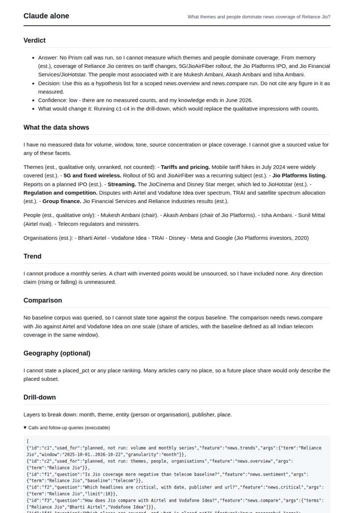
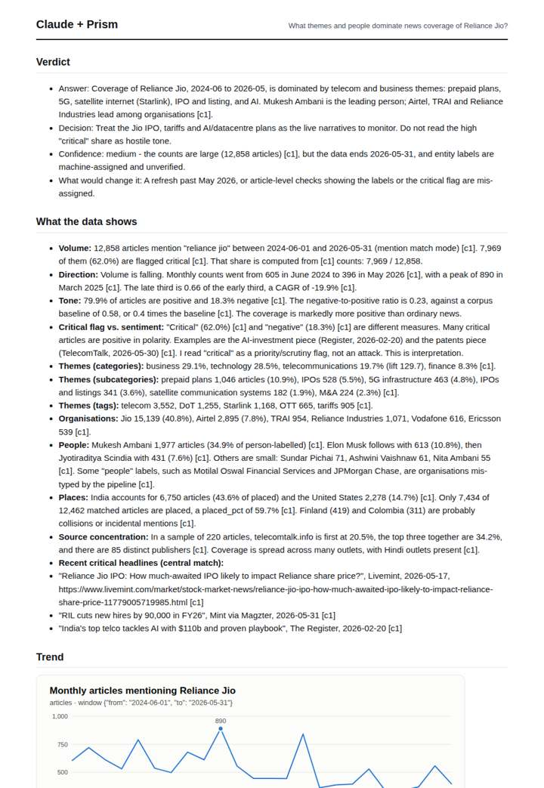
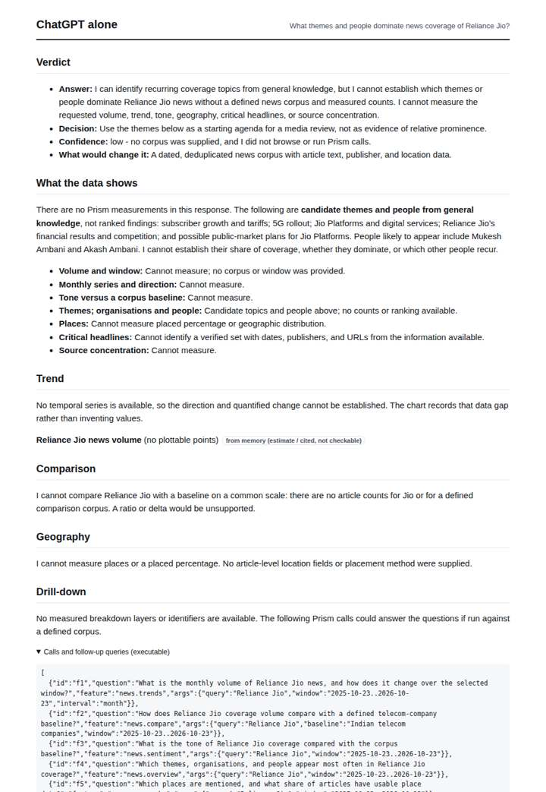
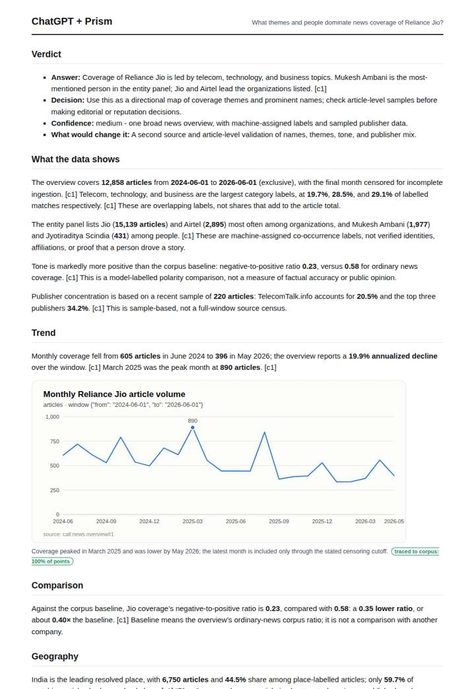

# Reliance Jio coverage

**Question.** What themes and people dominate news coverage of Reliance Jio?

**Category:** Company & competitive intelligence · **Pattern:** `pulse` · **Why it is hard:** Jio IPO speculation and telecom tariffs both drive coverage.

| Score /100 | Claude alone | Claude + Prism | ChatGPT alone | ChatGPT + Prism |
|---|---|---|---|---|
| Weighted (strict) | 28.2 | **76.7** | 29.0 | 63.0 |
| Opus judge | 24.8 | 80.0 | 21.8 | 61.2 |
| GPT judge | 31.6 | 73.4 | 36.2 | 64.8 |

## Parameter scores (0-5)

| Parameter | Weight | Claude alone | Claude + Prism | ChatGPT alone | ChatGPT + Prism |
|---|---|---|---|---|---|
| Measured trend | 10 | 0.5 | 4.5 | 0.5 | 4.0 |
| Measured comparison | 7 | 0.5 | 4.0 | 0.0 | 4.0 |
| Visualisation from counted data | 10 | 0.0 | 3.5 | 0.5 | 3.0 |
| Exploration and drill-down | 7 | 1.5 | 3.5 | 1.0 | 2.0 |
| Data export with provenance | 8 | 1.0 | 3.0 | 0.5 | 3.0 |
| Reproducibility | 12 | 1.0 | 4.5 | 1.0 | 3.5 |
| Traceable references | 8 | 0.0 | 1.0 | 0.0 | 1.0 |
| Accuracy against the corpus | 12 | 3.5 | 4.5 | 3.5 | 3.5 |
| Calibration and limits | 8 | 3.0 | 4.5 | 3.5 | 3.0 |
| Decision-grade verdict | 12 | 2.5 | 4.0 | 3.0 | 3.5 |
| Facet coverage | 6 | 1.0 | 4.5 | 1.0 | 3.5 |

## Script findings

| Check | Claude alone | Claude + Prism | ChatGPT alone | ChatGPT + Prism |
|---|---|---|---|---|
| Numbers traced to the corpus | 0/0 | 98/98 | 0/0 | 24/25 |
| Charts (traced share) | none | 100% | memory | 100% |
| DOIs that resolve | 0/0 | 0/0 | 0/0 | 0/0 |
| Follow-up queries that ran | 3/5 | 4/6 | 0/7 | 1/5 |
| Invention gate | clear | clear | clear | clear |

**Claude Opus judge:** D answered the question with traced counts for themes, people and organisations. It separated the 'critical' flag from negative tone, caught pipeline anomalies, and placed every limit next to its number. B had the same data but was thinner: it omitted Musk among people and left the IPO-vs-tariff tension unquantified. A and C were honest memory-only responses with no measured content.

**GPT judge:** B is the strongest decision aid: it answers which themes and people dominate with traced counts, trend and caveats, and it addresses several implied contrasts. Its missing theme and people exports, incomplete drill-down linkage, and inconsistent end-date wording keep it short of a fully reproducible, decision-grade package.

## Before / after (first screen)

| | Alone | With Prism |
|---|---|---|
| Claude |  |  |
| ChatGPT |  |  |

Full deliverables, rendered: [PDF](https://fliarbi.com/demo/docs/prism-benchmark-v2-4ed65c83/full/reliance-jio.pdf). Raw answers, ground pass and judge outputs: `answers.json`, `ground.json`, `judge_opus.json`, `judge_gpt.json` in this folder.
