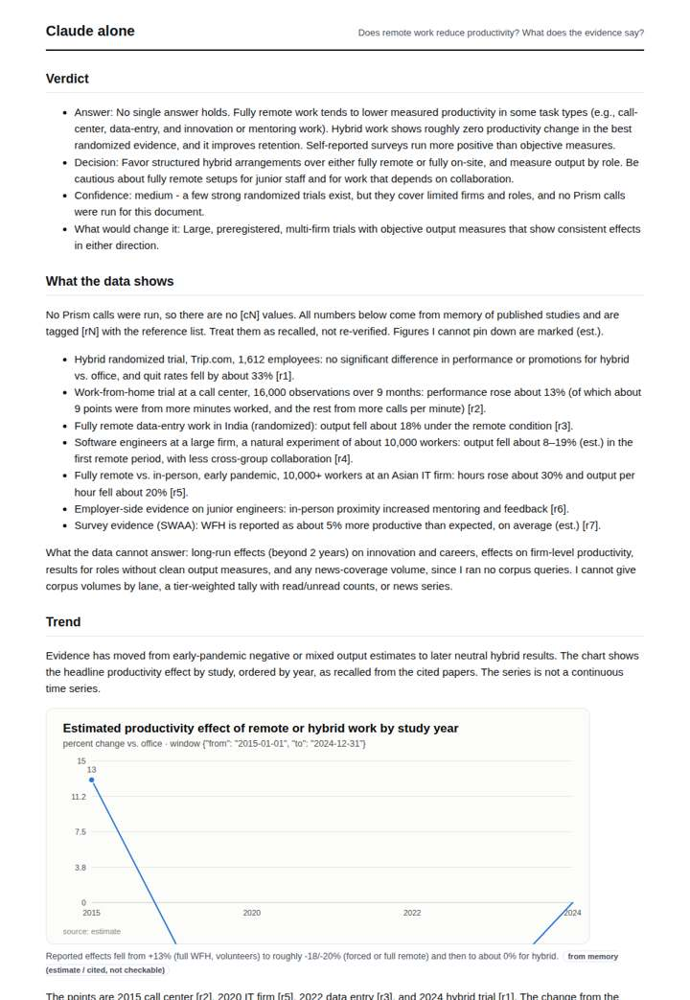
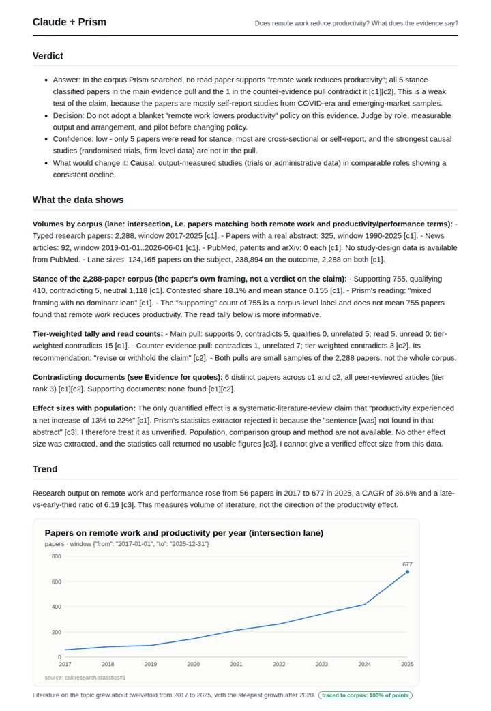
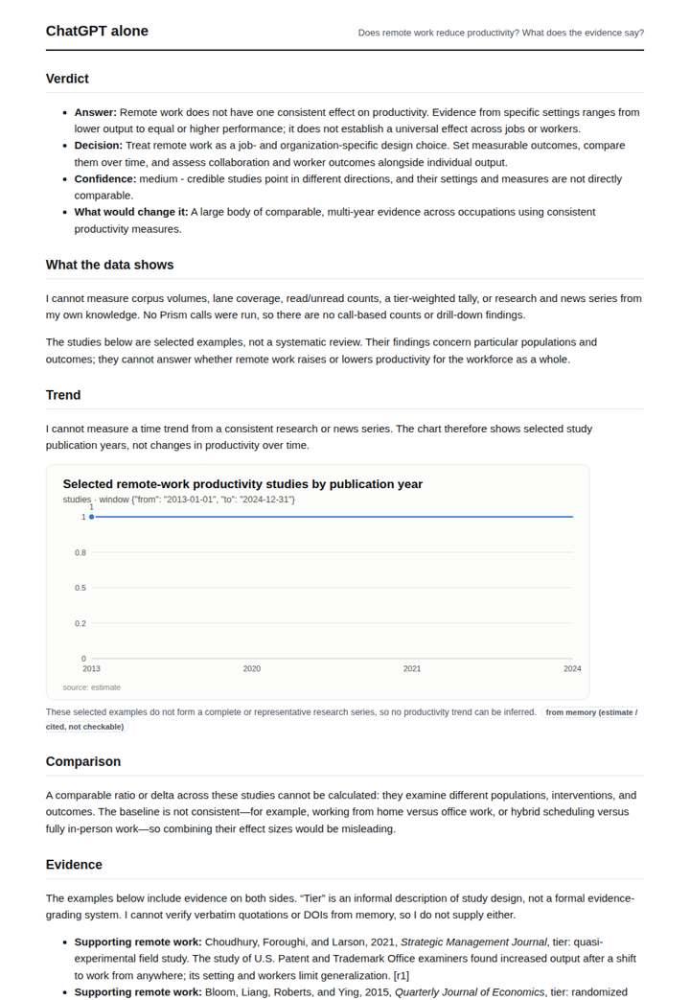
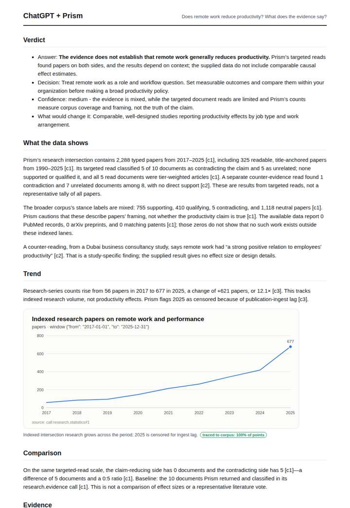

# Does remote work hurt productivity?

**Question.** Does remote work reduce productivity? What does the evidence say?

**Category:** Education & labour · **Pattern:** `evidence` · **Why it is hard:** Pandemic-era studies and RCTs disagree; both appear.

| Score /100 | Claude alone | Claude + Prism | ChatGPT alone | ChatGPT + Prism |
|---|---|---|---|---|
| Weighted (strict) | 31.5 | 73.4 | 32.2 | **74.0** |
| Opus judge | 31.0 | 79.0 | 30.4 | 66.2 |
| GPT judge | 32.0 | 67.8 | 34.0 | 81.8 |

## Parameter scores (0-5)

| Parameter | Weight | Claude alone | Claude + Prism | ChatGPT alone | ChatGPT + Prism |
|---|---|---|---|---|---|
| Measured trend | 10 | 1.0 | 4.0 | 1.0 | 4.0 |
| Measured comparison | 7 | 2.0 | 4.0 | 1.0 | 4.0 |
| Visualisation from counted data | 10 | 1.0 | 4.0 | 1.0 | 4.0 |
| Exploration and drill-down | 7 | 1.5 | 3.0 | 1.0 | 1.0 |
| Data export with provenance | 8 | 1.0 | 3.5 | 1.0 | 3.0 |
| Reproducibility | 12 | 1.0 | 4.5 | 1.0 | 4.5 |
| Traceable references | 8 | 1.5 | 4.0 | 1.0 | 4.5 |
| Accuracy against the corpus | 12 | 1.5 | 3.0 | 2.0 | 3.5 |
| Calibration and limits | 8 | 3.0 | 3.5 | 3.0 | 4.5 |
| Decision-grade verdict | 12 | 2.5 | 3.0 | 3.5 | 3.5 |
| Facet coverage | 6 | 1.5 | 4.0 | 1.5 | 3.5 |

## Script findings

| Check | Claude alone | Claude + Prism | ChatGPT alone | ChatGPT + Prism |
|---|---|---|---|---|
| Numbers traced to the corpus | 0/17 | 38/38 | 0/0 | 32/32 |
| Charts (traced share) | memory | 100% | memory | 100% |
| DOIs that resolve | 3/3 | 11/11 | 2/3 | 3/3 |
| Follow-up queries that ran | 2/6 | 2/7 | 0/5 | 0/4 |
| Invention gate | clear | clear | clear | clear |

**Claude Opus judge:** A was the only deliverable that read its own data honestly. It surfaced that zero read papers supported the claim and flagged the rejected 13-22% statistic and the framing-label trap. It also gave a low-confidence verdict noting that RCTs were absent from the pull. C used the same data but misstated it as 'both sides' and had no working follow-ups. B and D carried the substantive RCT-vs-pandemic content from memory, but with misattributed venues and effect sizes.

**GPT judge:** A is the strongest decision-grade deliverable: it gives a cautious, actionable answer while tracing its corpus figures, chart, references and limitations. B is more comprehensive, but it turns unsupported study-design claims and a rejected effect-size quote into evidence; C and D offer useful context but rely on memory estimates rather than reproducible measurements.

## Before / after (first screen)

| | Alone | With Prism |
|---|---|---|
| Claude |  |  |
| ChatGPT |  |  |

Full deliverables, rendered: [PDF](https://fliarbi.com/demo/docs/prism-benchmark-v2-4ed65c83/full/remote-work-productivity.pdf). Raw answers, ground pass and judge outputs: `answers.json`, `ground.json`, `judge_opus.json`, `judge_gpt.json` in this folder.
