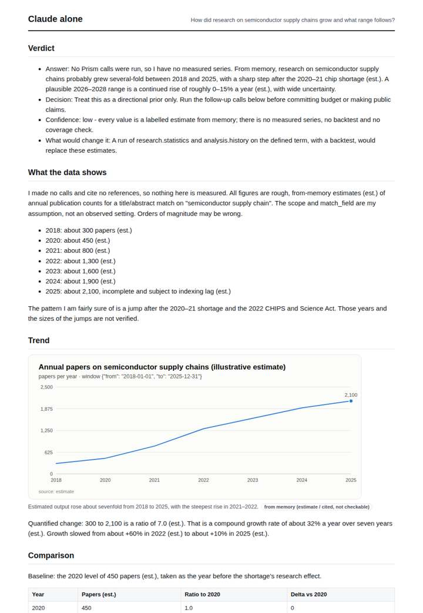
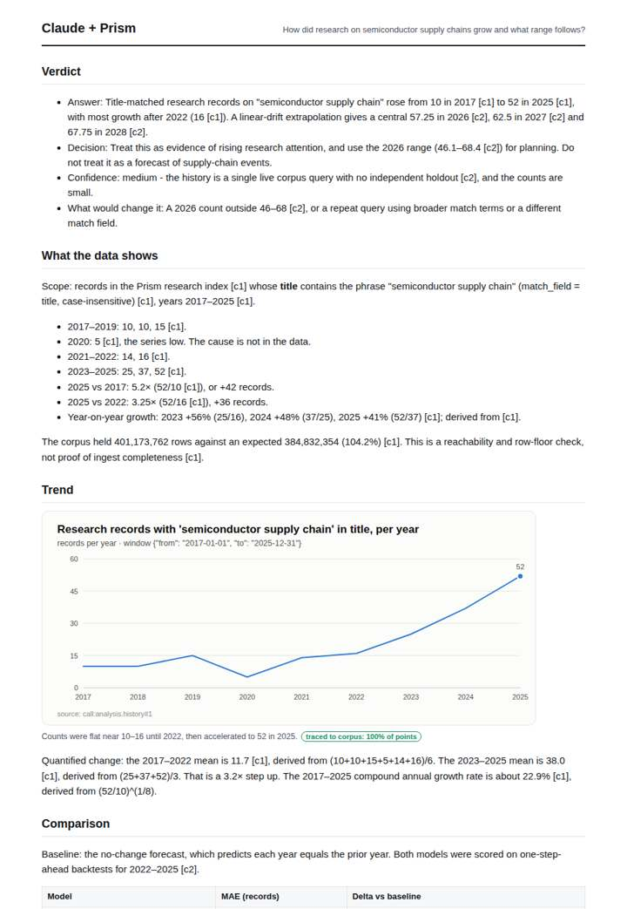
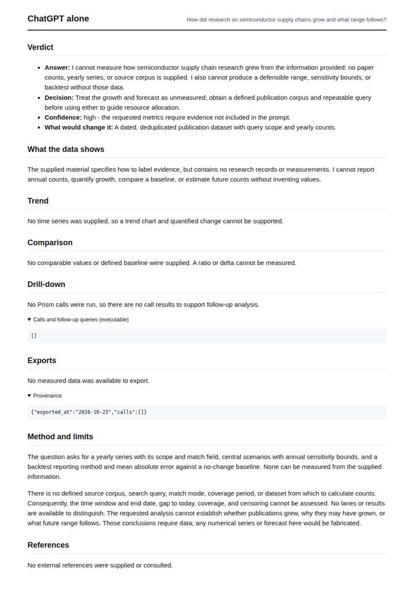
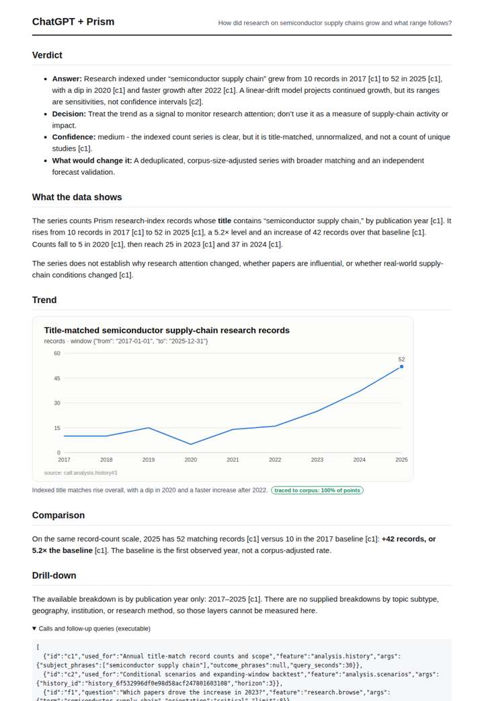

# Chip shortage research trend

**Question.** How did research on semiconductor supply chains grow and what range follows?

**Category:** Supply chain & trade · **Pattern:** `history` · **Why it is hard:** 2021 shortage spike: a naive trend line overshoots.

| Score /100 | Claude alone | Claude + Prism | ChatGPT alone | ChatGPT + Prism |
|---|---|---|---|---|
| Weighted (strict) | 30.2 | **86.0** | 23.4 | 70.5 |
| Opus judge | 27.6 | 78.9 | 13.9 | 68.7 |
| GPT judge | 32.8 | 93.0 | 32.8 | 72.4 |

## Parameter scores (0-5)

| Parameter | Weight | Claude alone | Claude + Prism | ChatGPT alone | ChatGPT + Prism |
|---|---|---|---|---|---|
| Measured trend | 10 | 1.0 | 4.5 | 0.0 | 4.0 |
| Measured comparison | 7 | 1.5 | 4.5 | 0.0 | 4.5 |
| Visualisation from counted data | 10 | 1.0 | 4.0 | 0.0 | 3.5 |
| Exploration and drill-down | 7 | 1.5 | 4.0 | 0.5 | 2.0 |
| Data export with provenance | 8 | 1.0 | 4.5 | 0.0 | 3.0 |
| Reproducibility | 12 | 0.0 | 5.0 | 0.5 | 4.0 |
| Accuracy against the corpus | 12 | 3.0 | 4.0 | 4.0 | 4.0 |
| Calibration and limits | 8 | 3.0 | 4.0 | 2.5 | 3.0 |
| Decision-grade verdict | 12 | 2.0 | 4.0 | 2.0 | 3.0 |
| Facet coverage | 6 | 1.0 | 4.5 | 1.0 | 4.0 |

## Script findings

| Check | Claude alone | Claude + Prism | ChatGPT alone | ChatGPT + Prism |
|---|---|---|---|---|
| Numbers traced to the corpus | 0/37 | 77/77 | 0/0 | 13/14 |
| Charts (traced share) | memory | 100% | none | 100% |
| DOIs that resolve | 0/0 | 0/0 | 0/0 | 0/0 |
| Follow-up queries that ran | 3/6 | 4/6 | 0/0 | 1/4 |
| Invention gate | clear | clear | clear | clear |

**Claude Opus judge:** B and A both traced the same 10→52 series and the scenario output. B went further: it gave an exact CAGR and year-on-year growth, an early-vs-late split, and a quantified baseline-vs-drift backtest showing that every fold under-predicted. Its verdict carried a usable 2026 range and a falsifiable trigger. C refused outright, and D offered only labelled memory estimates whose shape conflicts with the record.

**GPT judge:** A is the strongest decision deliverable: it connects the traced annual rise to conditional scenario bounds, provides reproducible exports, and names useful follow-up questions. D is a concise, largely accurate account but leaves out scenario values and several decision-relevant facets; B is careful but does not answer the measured question, while C's explicitly labelled estimates are not decision-grade evidence.

## Before / after (first screen)

| | Alone | With Prism |
|---|---|---|
| Claude |  |  |
| ChatGPT |  |  |

Full deliverables, rendered: [PDF](https://fliarbi.com/demo/docs/prism-benchmark-v2-4ed65c83/full/semiconductor-shortage-history.pdf). Raw answers, ground pass and judge outputs: `answers.json`, `ground.json`, `judge_opus.json`, `judge_gpt.json` in this folder.
